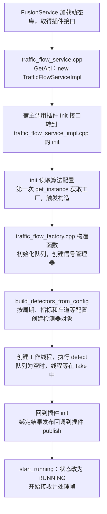
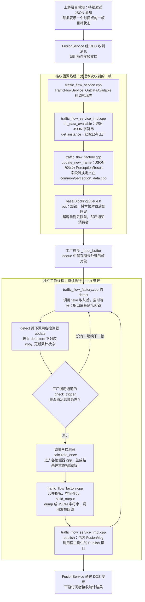

# 交通参数服务：文件、对象与执行流程

可用[逐步互动动画](traffic-flow-interactive.html)观察工厂创建、逐帧解析、队列积压和周期发布。

先记三个事实：一条感知 JSON 消息按接口约定表示一帧，帧中包含多个目标；每来一帧创建一个新的 PerceptionResult 对象；工厂和检测器在初始化时创建，后面持续复用。

## 先认清对象

```text
TrafficFlowServiceImpl：插件的接收、发布入口
TrafficFlowFactory：全局复用的处理管理对象
  ├─ _input_buffer：存放多帧 PerceptionResult 的队列
  ├─ _working_thread：运行 detect() 的计算线程
  └─ _output_channels：按统计周期组织的通道
       └─ detectors：流量、车头时距等检测器对象
```

这个类虽然叫 Factory，但除了创建检测器，还负责队列、线程和处理主循环。读源码时先把它理解为“检测管理器”。不是每一帧都新建工厂或检测器。

## 图一：初始化时做一次



- `get_instance()` 是取单例：首次调用创建，后续返回已有对象。
- 工厂构造函数创建线程；`start_running()` 主要改状态，并不是在这里新建线程。
- 检测器对象由工厂创建，但对象的算法实现在各检测器自己的 `.cpp` 文件。

## 图二：每收到一帧重复执行



这是逻辑调用图；生产者和消费者并发运行，不需要等一整帧计算、发布完毕才能收到下一帧。上图沿感知目标消息路径绘制，另有信号消息回调更新相位状态。

## 容易混的地方

- **输入帧**：JSON 字符串 → JSON 对象 → PerceptionResult 对象 → 队列；不是一直把 JSON 字符串存队列。PerceptionResult 的类型定义在 `common/perception_data.h`。
- **两处 get_instance**：初始化中首次创建工厂；数据回调中获取已有工厂。后者不重新创建检测器。
- **同一个文件不等于同一个线程**：工厂的 update_new_frame 在接收回调线程执行，detect 在独立工作线程执行。
- **谁创建、谁计算**：工厂 new 检测器对象，随后调用对象的 update / calculate_once，具体算法进入 `detectors/accumulate_*_detector.cpp`。
- **结算触发**：固定周期检查使用当前帧时间戳；信号周期通道参考相位边界。检查在 detect 中发生，不是另开定时线程。
- **JSON 输出**：先是内存中的 JSON 对象，再 dump 成字符串，经宿主发布消息；主链路没有把结果写成 JSON 文件。

## 源码入口

当前代码根目录：`C:/Users/sunboxue/Desktop/traffic_flow-main/project/traffic_flow-main`

| 文件 | 重点位置 |
|---|---|
| `src/plugin/traffic_flow_service.cpp` | 20 行 Init 包装；75 行接收包装；86 行 GetApi 创建实现对象 |
| `src/plugin/traffic_flow_service_impl.cpp` | 39 行 init；126 行 on_data_available；217 行 publish |
| `src/traffic_flow/traffic_flow_factory.cpp` | 65 行构造；191 行 update_new_frame；243 行创建检测器；358 行 detect |
| `src/common/perception_data.h / .cpp` | 帧结构与 JSON 字段转换 |
| `src/base/BlockingQueue.h` | 27 行 put；48 行 take |
| `src/traffic_flow/detectors/accumulate_volume_detector.cpp` | 流量检测器 update / calculate_once |
| `src/traffic_flow/detectors/accumulate_headway_detector.cpp` | 车头时距检测器 update / calculate_once |
