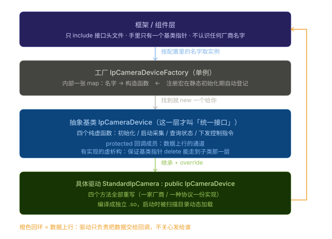

# AirOS 路侧感知系统 — 面试 QA 精简版（33 题）

> **这份是什么**
> 从 `0面试QA总表.md`（83 题）里挑出的**最核心 33 题**，用来考前突击、临场前快速过一遍。
> **题号沿用原表**（看到 Q2-3 就是原表的 Q2-3），想深挖某一题，回原表按题号查即可。
> **不替代原表**——原表是字典，这份是常用字表。
>
> **挑选标准**：`[必背]` + `★★` 高频 + **诚实题**（容易穿帮的）+ 每个条目的**总览题**。
> 砍掉的是同类重复题和纯加分储备题——**不是说不考，是优先级低**。
>
> **怎么用**
>
> 1. **每个条目的第 1 题是"目录"**：答案里抛出的每个词，下面都有编号追问，按真实面试被问的顺序铺好了。
> 2. 其余题保留 1 条主追问，用来接住"为什么 / 会怎样"。
> 3. 答案都能**直接念出口**，念完 20~30 秒；念超时说明你加戏了。
>
> 🔴 **四条全局红线（全文通用，先看完再背）**
>
> 1. 全程说「**参与**」，不说「我从零设计」。
> 2. 视频那条说「**拉流和拆包**」，**绝不说解码**——本驱动没有解码环节。
> 3. 部署工具写「独立开发并维护升级」；**口语里主动说用了 AI 辅助**，别等被问出来。
> 4. 交通参数检测那条**另有专属红线**，写在该条开头，**先看完再背题**。
>
> ⏱ **突击顺序建议**：开场 3 题 → 附录角色题 → 条目二 → 条目四 → 条目一 → 条目三。

---

## 目录

- [第 0 部分：开场自述（3 题）](#第-0-部分开场自述3-题)
- [条目一：设备抽象与插件化接入（7 题）](#条目一设备抽象与插件化接入7-题)
- [条目二：多路视频流接入（7 题）](#条目二多路视频流接入7-题)
- [条目三：设备与平台运维（5 题）](#条目三设备与平台运维5-题)
- [条目四：交通参数检测服务（7 题）](#条目四交通参数检测服务7-题)
- [附录：通用追问（4 题）](#附录通用追问4-题)

---

## 第 0 部分：开场自述（3 题）

---

### Q0.1 简单介绍一下你这个项目是干什么的？[必背]

**答**：
我参与的是一个车路协同的**路侧系统**，跑在路口的边缘盒子上，干的事就是把相机、雷达、信号机这些设备接进来，数据收上来再发给平台和车端。C++ 写的，跑在容器里，硬件是带 GPU 的嵌入式板子。
我主要做了两块。**设备接入**这块：设备的**插件化接入**、**多路视频流**的拉取和链路调试、边缘设备的**运维**（GPU 指标采集，加上一个给现场用的批量部署工具）。**交通参数检测**这块：订阅上游融合感知输出的目标流，算路口的**流量、排队、车速、车头时距**这些指标，包括检测器框架、数据管道和车辆过线判定。

**追问 1**：边缘盒子是什么？为什么算力要放在路口，不上云？

> 就是放在路口机柜里的一台小工控机，带 GPU。必须在本地算是因为**延时和带宽**——视频流全量回传带宽扛不住，而车路协同要的是毫秒级响应，绕一圈云端就来不及了。云只用来做管理和长期存储。

**追问 2**：你说的"接进来"，具体接了哪几类设备？

> 主要是**相机、雷达、信号机**这几类。相机出视频流，雷达出目标点云，信号机给的是路口的灯态相位。它们协议完全不一样，所以才需要那套统一接入接口把它们抹平。

**追问 3**：为什么用 C++？又为什么跑在容器里？

> C++ 是因为**要压榨边缘设备的算力**，而且要在多线程下稳定跑几个月不重启。跑容器是为了**部署和环境隔离**——几十个路口的硬件批次不同，容器能保证我这份代码在任何一台上跑起来都一样。

**追问 4**：你们这个系统是分层设计的吗？

> 是。上面应用层、中间服务层、下面硬件抽象层。分层的好处是：加一个新设备不用动上面的代码，按标准实现一个"插件"挂上去就行。

**追问 5**：「插件化接入」具体是什么意思？

> 驱动编译成独立的动态库，框架启动时扫目录加载，驱动里一行注册宏把自己登记进工厂。所以加一款新设备是**加一个文件 + 改一行配置**，框架代码不用动。
> 👉 深挖见**条目一 Q1-1**。

**追问 6**：多路视频流是怎么组织的？

> **一路流 = 一份私有状态 = 一个独立线程**，一个设备管理多路。路跟路之间互不干扰，一路断了不影响别的路。
> 👉 深挖见**条目二 Q1-1**。

**追问 7**：运维具体运维什么？部署工具是干嘛的？

> 两块：一是**采 GPU 利用率、显存、温度**这些指标上报，看设备健不健康；二是我独立做的一个**桌面批量部署工具**，把"运维拿 Excel 一台一台 SSH 敲命令"变成"选表 + 点按钮"。
> 👉 深挖见**条目三 Q1-1 / Q3-1**。

**追问 8**：交通参数那块，你订阅的到底是什么数据？

> 订阅的是**上游融合感知输出的结构化目标流**——一帧里所有目标的清单，每条带 id、车型、经纬度、速度、车道号。**我从头到尾没见过像素**，解码和检测跟踪是算法团队做的。
> 👉 深挖见**条目四 Q1-1**。

**追问 9**：你这两块之间是什么关系？

> 是同一条业务链的**首尾两端**。前面我负责把设备数据接进来，中间解码、目标检测跟踪、多传感器融合是算法团队做的，他们产出结构化结果后我才在后面算交通参数。**中间那一棒不是我做的**。

---

> 📍 **这一答抛出了整张地图**——被追问时往哪儿走：
>
> - **"插件化接入"** → 条目一 Q1-1
> - **"多路视频流"** → 条目二 Q1-1
> - **"运维 / GPU 指标采集"** → 条目三 Q1-1
> - **"部署工具"** → 条目三 Q3-1
> - **"交通参数检测 / 订阅目标流"** → 条目四 Q1-1
> - **"两块什么关系 / 哪些不是你做的"** → Q0.3、附录 Q1

**八股补给**：

**Q1：边缘计算和云计算，本质区别是什么？**

> 就一条：**算力放在离数据多近的地方**。云是"数据送到远方的大机房算"，边缘是"在数据产生的现场就地算"。
> 选择边缘是因为两个硬约束：**带宽**——几十路视频全量回传，网络扛不住；**延时**——车路协同要毫秒级响应，数据绕一圈云端再回来就来不及了。
> 云并没有被取代，它负责的是**管理、配置和长期存储**这些不要求实时的事。

**Q2：容器和虚拟机有什么区别？**

> **虚拟机**是虚拟出一整台"电脑"——包括自己的操作系统内核，所以重、启动慢、占资源多。
> **容器**是**共用宿主机的内核**，只把应用和它依赖的库**打包隔离**起来。所以它轻、启动快（秒级）、一台机器上能跑很多个。
> 代价是**隔离不如虚拟机彻底**（毕竟共用内核），以及**容器内看到的内核就是宿主机的**，所以跨硬件平台不像虚拟机那么自由。

**Q3：为什么容器能保证"在哪台机器上跑都一样"？**

> 因为它打包的不只是你的程序，还有**它依赖的所有库和系统工具**。同一份镜像在任何一台装了容器运行时的机器上，看到的"环境"是**一模一样的**。
> 这在我们的场景里特别关键——几十个路口的设备**硬件批次和出厂系统版本都不一样**，靠容器才保证我这份代码在任何一台上行为一致。
> 一句话：**容器解决的是"在我机器上明明是好的"这个千古难题。**

**Q4：进程和线程有什么区别？**

> **进程**是操作系统分配资源的最小单位——每个进程有自己独立的内存空间，互相看不见。**线程**是 CPU 调度的最小单位——一个进程里的多个线程**共享同一块内存**。
> 所以：线程之间传数据极快（直接读写同一份变量），代价是**必须自己管好锁**；进程之间互不可见，安全，但要通信就得走专门的方式（管道、共享内存、消息队列这些）。
> 我们"每路流一个线程"就是看中线程**共享数据方便**；而"驱动做成动态库"是**在同一个进程里**被加载进来的，不是独立进程。

> 背法：Q0.1 是**全表目录**。开场这 40 秒答完，面试官接下来问的每一句，基本都落在上面这张表里。

---

### Q0.2 你说的「框架 + 组件」到底是什么意思？[必背] ★ 高频

**答**：
框架是**插座**，组件是**插头**。框架只规定"插头必须长什么样"，不管你插的是台灯还是风扇。所以以后加新设备、加新算法，框架代码一个字都不用改。
具体到相机：框架负责扫描加载驱动、创建实例、把数据发出去；驱动负责按标准实现某款设备。两层中间靠一套**抽象接口**衔接。

**追问**：这个设计有什么不好？

> 两个。一是接口一旦定死，扩展就要动所有实现，所以定接口得先想清楚粒度；二是加载失败报错不直接，现象是"配置里写了这个名字但框架说找不到"，得翻日志定位。这也是我想改进的地方。

**八股补给**：

**Q1：框架和库有什么区别？**

> 一句话：**你调库，框架调你**。
> 库是你主动去调它——你在自己的 main 里决定什么时候调、调几次。库只是给你一堆工具。
> 框架是**它把流程搭好了，留出几个口子让你填**，你填的东西由框架在合适的时机去调。所以我们写驱动是"实现那几个约定的方法"，什么时候被调、调几次，是框架说了算。

**Q2：那"面向接口编程"到底是什么意思？**

> 就是**代码里只依赖"约定"，不依赖"具体是谁"**。
> 框架手里拿的是基类指针，它只知道"这个对象一定能喂帧、一定能出数"，至于背后是流量检测器还是车速检测器，它不关心、也不需要关心。
> 好处很直接：**换一个实现，框架不用改**；坏处是**多了一次间接跳转**（要查表才知道该调谁），以及**调试时看不到"到底调的是哪个"**。

**Q3：接口定得太粗或太细，分别会怎样？**

> **太粗**（一个方法塞一堆事）：所有实现类都得把不用的部分也写一遍，而且一改就要全部跟着改。
> **太细**（拆成十几个方法）：调用方要连着调好几步才能办成一件事，**顺序错了就是 bug**，而且接口数量爆炸，谁都记不住。
> 判据是：**一个接口方法，应该刚好对应调用方的一次完整意图。** 我们那两个方法"喂一帧""出一次数"，就是按这个来的。

---

### Q0.3 你做的这些，和「交通参数检测」是一回事吗？[必背] ★★ 开场必被问

**答**：
两块都属于公司的路侧产品线，装在同一台边缘设备上，是同一条业务链的**首尾两端**：我前面负责把设备数据接进来、保证链路稳，后面负责订阅上游的感知结果算流量、排队这些指标。
中间那一棒**不是我做的**——数据接进来要解码、做目标检测跟踪、多传感器融合，那是算法团队的活。他们给我的是**结构化结果**：一条条参与者记录，带类型、经纬度、速度、车道号。

> 🔴 **红线**：绝不能说"我拉的视频流直接给了流量模块"。中间隔着解码和感知融合，一追问就穿帮。

**追问 1**：那你拉的数据到底发给谁了？

> 发到框架的**消息总线**上了，谁订阅谁收到。具体谁是订阅方属于感知融合那一块，是算法团队的模块，我没参与。我只保证这一棒是稳的——能连上、断了能重连、出问题能从指标上看出来。

**追问 2**：那为什么两边用的通信方式不一样？

> 不同团队的选型。主框架用一套通信中间件加 protobuf；交通参数检测那边的形态是**算法插件**，跑在一个宿主程序里，宿主给它的是 C 接口加另一套通信库，数据格式是 JSON。两边业务上靠**标准化的感知消息**衔接，通信各走各的。

**追问 3**：所以到底哪些是你做的？

> 我做的：多路视频流的拉取、设备的插件化接入、GPU 指标采集、部署工具，还有交通参数那边的检测器框架、过线判定、生产消费管道。**没做的**：图像解码、目标检测和跟踪、多传感器融合。

**八股补给**：

**Q1：把一个大系统切成好几个模块，边界该怎么划？**

> 判据是**看变化的方向**。会**一起变**的东西放一个模块里；**各自变**的东西拆开。比如"加一款新相机"只应该动驱动那一个文件，如果它还要动框架，那边界就划错了。
> 另一个判据是**依赖方向要单向**：下游认识上游，上游不认识下游。如果出现"A 要用 B、B 也要用 A"，那基本就是设计出了问题，得抽一层出来打破这个环。

**Q2：模块之间怎么传数据才算"解耦"？**

> 最低要求是**不直接认识对方**：不 include 对方的头文件、不调对方的函数、不知道对方的存在。中间靠一个**双方都认的东西**衔接——可以是一份消息定义（protobuf / JSON）、一个接口、或者一个消息队列。
> 好处是谁重写都不影响另一边；代价是**多一层转换**（要序列化、要约定格式），以及**调用栈断了，调试时要靠日志去串**。

**Q3：同一个进程内的两个模块，和两台机器上的两个服务，通信方式有什么不同？**

> 进程内最简单——**直接函数调用**，或者传个对象指针，最快。但两边就要互相依赖，耦合度高。
> 跨进程或者跨机器，就必须走**通信中间件**：共享内存、消息队列、socket、或者 DDS 这类。它们都能做到"两边不认识"，代价是**多一次序列化 + 一次传输**。
> 所以选型的问题其实是：**你更在乎快，还是更在乎两边能独立演进。**

📌 *自己复习：`6两个模块-合成一个故事.md` + 图 `imgs/07-两个模块怎么串成一条链路.svg`*

---

## 条目一：设备抽象与插件化接入（7 题）

---

> **简历原话**
> 设备抽象与插件化接入：为相机等路侧设备定义统一抽象基类接口（初始化、启停、数据下发、状态查询），各厂商驱动通过虚函数重写实现同一套接口；配合工厂模式 + 注册宏完成驱动自注册与动态库加载，新增设备型号只需新增驱动文件、框架代码零改动，接入方式从"改代码"变为"改配置"。
>
> 🔴 **本条两条红线**
>
> 1. 全程说「**参与**」——接口和工厂是 mentor 定的架构，我负责具体模块落地。
> 2. "框架代码零改动"指的是**新增一款设备**不用改框架；**新增一类能力还是要动接口**，被追问要能说清这个边界。
>
> ❗ **"统一"是按设备类型各一套**（相机 / 雷达 / RSU / 信号灯……各一份接口 + 工厂），**没有所有设备共用的公共基类**。
> ❗ **别把"厂商"说成"厂商 SDK"**：我做的是**通用 RTSP + FFmpeg** 协议层接入，**没对接任何厂商私有 SDK**。

---

### 技术点 1：统一接口与多态（1 题）

---

#### Q1-1 你说的「统一接入接口」，具体是怎么设计的？[必背]

**答**：
就三步。先写一个**抽象基类**，把四个**纯虚函数**列上去——初始化、启动采集、查状态、下发指令；再让每家厂商的驱动**继承**这个基类、把四个函数各自实现出来；最后框架手里只拿**基类指针**，只管调，不管跑的是哪一份实现。
另外留了一条**回调**给数据上行：设备采到数据就丢给它，至于交给谁由框架定，驱动自己不知道。
能统一成这四个函数，是因为不管哪家设备，一辈子干的事都一样——先配资源、再出数据、中间要能查健康、有的还得能反向下发指令。差别只在每一步具体怎么做。

> 看图要点：从上往下是「框架 → 工厂 → 抽象基类 → 具体驱动」，橙色回环是数据上行。上面三层只认**抽象基类**这一个类型，最底下那个驱动是后加的，框架一行都不用改。

> ❗ **别只答"虚函数基类 + 子类重写"**——那只讲了多态，没讲插件化。完整的是**三件套**：
>
> 1. **抽象基类**（纯虚函数）——定能力清单；
> 2. **工厂 + 注册宏**——驱动文件末尾一行注册宏，把"名字 → 构造函数"登记进表，**发生在 main 之前**；
> 3. **动态库加载**——驱动编译成独立 `.so`，启动时扫目录加载。
>
> ❗ **"统一"是按设备类型各一套**（相机、雷达、RSU、信号灯……各一份接口 + 工厂），**没有所有设备共用的公共基类**。被追问就诚实说：按类型分别统一，抽公共基类是后续优化点。
>
> ❗ **别把"厂商"说成"厂商 SDK"**：我做的是**通用 RTSP + FFmpeg** 的协议层接入，一套代码通吃各家，**没对接任何厂商私有 SDK**。

**追问 1**：那这个接口在代码里是怎么落地的？

> 就是一个**抽象基类**，四个方法全是**纯虚函数**——基类只声明不实现，谁继承谁就必须自己写。框架手里拿的是基类指针，调的时候自动跑到具体那份实现上，这就是运行时多态。

**追问 2**：为什么正好是这四个方法？不能多不能少？

> 因为不管哪家设备，**一生的动作都一样**：先配置资源、再开始出数据、中间要能查健康、有的还要能反向下发指令。这四个覆盖了设备全生命周期，差别只在每一步怎么做。
> ⚠️ 真遇到某家不支持其中某个，让它**空实现返回不支持**就行，不能为了迁就它去改接口——改接口会波及所有已接入的驱动。

**追问 3**：为什么用纯虚函数？普通虚函数不行吗？

> 不行。普通虚函数意味着基类**给了默认实现**，子类不写也能编译过——运行时就变成一个"什么都没干"的静默失败，现场查起来极其痛苦。纯虚函数把这件事**逼到编译期**：漏实现就编译不过。
> 而且基类本来也给不出有意义的默认实现——一台相机怎么初始化，基类怎么会知道。

**追问 4**：用基类指针销毁对象，要注意什么？

> **基类析构函数必须是虚函数。** 否则通过基类指针 delete 的时候，只会调到基类的析构，子类那部分资源就泄漏了——而且这种泄漏是静默的，跑几天才看出来。
> 这也是我判断一个"面向接口"的设计成不成熟时最先看的一点：**只要打算用基类指针持有对象，析构就必须虚**。

**追问 5**：那条回调为什么选择在构造函数里传进来？

> 这叫**构造期注入**。最大的好处是：回调变成对象一旦存在就**必然可用**，不会出现"建好了但还没设回调"这种半初始化状态。如果做成 setter，就多了一个必须记得调用的步驟，忘了就静默丢数据。

**追问 6**：这套接口最大的问题是什么？重做你会怎么改？

> 两个。一是**接口一旦定死，扩展就要动所有实现**，所以定接口得先想清楚粒度；二是**各类设备各有一套接口，没有公共基类**，同构代码重复了九份。重做的话我会先抽一层真正公共的基类，再往下按类型分化。

**✅ 一句话版本（面试照背）**

> 它的核心确实是抽象基类和虚函数重写——接口层把能力定成纯虚函数，驱动继承下来各自实现，框架只拿基类指针调。但光有这层还不叫插件化：我在接口之外还配了**注册工厂 + 动态库加载**，驱动里一行注册宏把自己登记进工厂，框架侧只认配置里的一个名字。所以新增一个型号，是加一个驱动文件 + 一行注册，框架代码一行都不动——这才是我说的「统一接入」。

**八股补给**（面试官爱往底层挖的，答不上很伤）：

**Q1：什么是多态？有哪几种？**

> 同一个调用、跑出不同结果。分两种：**编译期多态**——函数重载、模板，编译时就定死了调哪个；**运行期多态**——虚函数 + 基类指针，运行时才决定调哪份实现。我这块用的是后者。

**Q2：只有纯虚函数的类，能 new 出来吗？**

> **不能**，这种叫**抽象类**（接口类），只要有一个纯虚函数没实现就不能实例化。它的用途就是当"规格说明书"给别人继承的。

**Q3：那这个类里能写普通成员吗？**

> 能。可以有普通成员函数、也可以有成员变量（比如我们这个基类里就有一个回调成员）。"全是纯虚函数"只是我们这个场景的选择，不是抽象类的要求。

📌 自己复习（面试别说）：

- 接口：`base/device_connect/ipcamera/device_base.h` 的 `IpCameraDevice`，四个纯虚 `Init / Start / GetState / WriteToDevice`，`protected: IpCameraCallBack sender_`，回调由构造函数注入。
- 子类：`standard_ipcamera.h:44` `StandardIpCamera : public IpCameraDevice`，四方法全 override。
- 工厂：`device_factory.h` 单例 + `map<string, CONSTRUCT>`；宏 `V2XOS_IPCAMERA_REG_FACTORY(StandardIpCamera, "standard_ipcamera")`，注册点 `standard_ipcamera.cc:608`。
- 框架取实例：`ipcamera_component.cc:42` `GetUnique(conf_.device(), ...)`；同文件 :31 动态加载 `device/lib/ipcamera/`。
- 同构共 9 套（camera / ipcamera / lidar / radar / rsu / traffic_light / mec / ins / cloud），每类一份 device_base.h + device_factory.h。
- 老的 `modules/camera/ipcamera/include/camera.h`（按 `Vendor` 分海康/大华/仿真）走厂商 SDK 路线，跟 standard_ipcamera 不是一条路，别混讲。

---

### 技术点 2：工厂 + 自注册（3 题）

---

#### Q2-1 为什么要用工厂模式？直接在框架里判断类型创建对象不行吗？[必背] ★ 高频

**答**：
好处就一句话：**加一款新相机，框架不用动**。
不用工厂的话，框架里得写一串 **if-else**：配置里写 A 牌就 new A 牌那个类、写 B 牌就 new B 牌的——每来一款新相机都要打开框架加一个分支、整个重编一遍，而且框架得把各家驱动的**头文件**都 include 进来。
用了工厂，框架手里只有一张 **map**：**key** 是配置里写的设备名，**value** 是"这个对象怎么造"。框架报个名字，工厂在 map 里一查、new 出来交给它，框架压根不认识背后是哪个**类**。
那这张 map 是谁填的？**驱动自己填的**——每个驱动文件末尾写一行**宏**（`#define` 那套），宏展开后是个静态对象，动态库一加载它就自动把自己的名字和造法塞进 map。所以新相机就是加一个 .cpp 文件，框架一个字不改。
打个比方：map 就像前台的取件码本子——你报码、他查本子、把包裹递给你，你不用知道仓库在哪。

**追问**：那这不就是把 if-else 挪到工厂里了吗？

> 区别在于**那张 map 是谁填的**。挪进工厂的话，工厂还是得认识所有牌子，加一款照样要改工厂。我们这个是**驱动自己往 map 里塞**——新相机写一个 .cpp、末尾一行宏，工厂完全不知道世界上有哪些设备。所以代价从"改工厂"变成了"加个文件"。

**八股补给**（这块面试官爱往底层挖，答不上很伤）：

**Q1：什么是工厂模式？**

> 就是把"new 对象"这件事交给专门一个地方，调用方只说要什么、不自己 new。三种常见写法：**简单工厂**（一个类里写 if-else）、**工厂方法**（每个产品配一个工厂类）、**抽象工厂**（造一整族产品）。我这个是简单工厂 + 一张 map，再加个自注册。

**Q2：为什么用 map 存，不直接写 if-else？**

> 为了**好扩展**。if-else 是写死的，加一种就要改一次代码、重编一次；map 是运行时查表，加一种只是往表里多塞一条。查找上 map 是红黑树、O(log n)，几十种设备根本不是瓶颈。

**Q3：你这个工厂为什么是单例？单例怎么写线程安全？**

> 全进程只需要**一张** map，做成单例才能保证大家查的是同一张表。线程安全靠写法：C++11 之后，函数里的**局部静态变量**编译器会加锁，用到才构造，天然安全。老写法（new 个指针 + 双重检查锁定）特别容易写错。

**Q4：宏（#define）有什么坑？**

> 三个：**没类型检查**、**不好调试**（报错报的是展开后的代码）、**容易命名冲突**（所以我们宏里要用 `##` 把类名拼进变量名，不然多个驱动会重复定义）。这是我觉得这套设计里最该被换掉的部分。

**Q5：那单例有什么缺点？**

> 本质是个全局变量——测试的时候不好替换，依赖关系也被藏起来了。不是什么东西都该做成单例，只有**确实全局唯一的**才值得。

📌 *自己复习（面试别说）：工厂是 `device_factory.h` 单例 + `map<string, 构造方式>`；抽象基类 `IpCameraDevice` 四个纯虚方法；宏 `V2XOS_IPCAMERA_REG_FACTORY(...)` 注册点 `standard_ipcamera.cc:608`；框架侧 `GetUnique(conf_.device(), ...)` 只按配置名取，返回基类指针。其余术语（运行时多态 / 编译期依赖 / 自注册 / 静态对象 / 动态库加载）**心里有数就行，口播不抛**。*

---

#### Q2-3 你说的「一行注册宏」，它到底是怎么工作的？[必背] ★★ 高频

**答**：
每个驱动文件末尾写一行宏。这行宏展开之后，其实是定义了一个**静态对象**，它的**构造函数**干的事就是：把自己的设备名和"怎么造自己"塞进工厂那张 map。
关键就在"静态"两个字——C++ 保证静态对象的构造函数会在程序加载时**自动执行**，不需要谁手动去调。所以框架把驱动加载进来，注册就自动完成了，不需要在任何地方维护一份"设备清单"。

**追问**：但是静态对象的初始化顺序是不确定的，会不会出问题？

> 这个担心是对的，C++ 确实不保证不同 `.cpp` 之间静态对象的初始化顺序。但这里恰好安全，关键在于**工厂是用函数内的局部静态变量实现的单例**——用到的时候才构造，所以不存在"注册跑到一半、工厂还没建好"。
> 反过来如果工厂是个全局变量，注册可能在它构造之前发生，往一个还没初始化的 map 里塞东西就是**未定义行为**。

**八股补给**：

**Q1：宏展开之后大概长什么样？**

> 大致是 `static 某某注册器 g_某某注册器("设备名");`——一个静态对象，构造函数里干正事。那个变量名靠 `##` 把类名拼出来，保证每个驱动不重名。

**Q2：为什么非得用宏？写个普通函数不行吗？**

> 宏的好处是**一行搞定、不容易写漏**。但代价很实在：**没类型检查**、**报错信息是展开后的代码**、**调试器里看不到原样**。所以宏不算好设计，只是当时"让驱动作者少写几行"这个收益更大。要改我会换成显式注册函数。

**Q3：你说的"静态对象"和"静态成员变量"是一回事吗？**

> 不是。这里是**文件作用域的静态对象**（全局对象加了 `static`，作用域只限本 `.cpp`）；静态成员变量是类里的、属于类而不属于某个对象。两个概念别混着讲。

**追问 1**：静态对象到底什么时候构造？动态库呢？

> 可执行文件里的静态对象，在 **main 之前**就构造好了；动态库里的是**加载时才构造**——也就是框架扫描目录、把 `.so` 加载进来的那一刻。所以注册这个动作发生在框架真正开始工作之前，等它去查表时表里已经有东西了。

**追问 2**：宏里面要用符号拼接生成变量名，为什么？

> 因为宏在**每个驱动文件里都要用一次**，如果不拼接就会生成同名的全局变量，链接期直接报重复定义。拼接上类名之后，每个驱动拿到的是自己那份独一无二的变量名。

**追问 3**：工厂是单例，多线程同时调用安全吗？

> 要分两段看。**注册**发生在加载期，那时候还没起工作线程，天然串行；**查询创建**在运行期，多线程可能同时进来。所以查表那一步要加锁保护——这也是为什么我倾向于让注册越早完成越好，运行期只做只读查询。

**追问 4**：如果两个驱动注册了同一个名字会怎样？

> 后加载的那个会把先来的**覆盖掉**，运行时的现象是"配了这个名字但行为不对"，而且不报错、很难查。所以更稳妥的做法是**重复注册时直接报错退出**，而不是静默覆盖。

**追问 5**：宏用起来爽，代价是什么？

> 调试很痛苦——宏展开后的代码和看到的不一样，报错信息也难读。而且它是**编译期**的黑魔法，出了问题只能看预处理后的文件排查。这是我认为这套设计里最该被替换掉的部分，更好的做法是改成显式注册函数。

---

#### Q2-8 用具体流程说说：新来一款设备，你要做哪些事？[必背] ★★ 高频场景题

**答**：
四步，**全程不碰框架代码**。
第一，新建一个 `.cpp`，写一个类**继承**那套统一接口，把那几个纯虚函数实现出来；
第二，文件末尾加一行注册宏，名字填"厂商 + 型号"；
第三，把这个模块编译成独立的 `.so`，丢到框架会去扫描的那个目录下；
第四，改配置，把里面的设备名从老驱动改成新的。
重启之后框架扫描目录、加载 `.so`、注册自动完成，就按新配置创建实例了。**框架代码一行不改，也不用重新编译框架本身。**

**追问**：这套流程的瓶颈在哪？

> 两个。一是**接口是有限的**，遇到厂商有特殊能力就得回头扩展接口；二是**出问题只能靠日志排查**，没有"已注册清单"的时候比较绕。这两个都是我前面说的改进点。

**八股补给**：

**Q1：编译成 .so 要加哪些选项？**

> 两个都要：`-fPIC` 和 `-shared`。`-shared` 告诉链接器产出的是动态库而不是可执行文件；`-fPIC` 生成**位置无关代码**。64 位下少了 `-fPIC` 基本链接不过。

**Q2：为什么动态库必须用 -fPIC？**

> 因为同一个 `.so` 会被加载到**不同进程的不同地址**，代码里不能写死绝对地址。`-fPIC` 让所有跳转和取址都走**相对偏移**或者 GOT 表，这样放哪儿都能跑。

**Q3：静态库（.a）和动态库（.so）怎么选？**

> 静态库在**链接期**就被整个拷进可执行文件——程序变大，但部署简单、不依赖外部环境；动态库在**运行期**才加载，多个程序能共用一份，更新也不用重编主程序。我们选动态库，就是为了"加设备不用动框架"这一点。

---

### 技术点 3：动态加载（2 题）

---

#### Q3-2 加载失败会有什么现象？你怎么排查？[加分] ★ 有实战感

**答**：
现象是**设备名查不到**——配置里明明写了这个名字，但创建实例的时候失败，打一条错误日志。
麻烦的是失败原因不会直接暴露，要用 `dlerror()` 才能拿到人话的错误信息。我一般三步排查：用 `ldd` 看这个库是不是缺了某个依赖；确认那个依赖在搜索路径里能找到；把依赖补上，或者在加载目标库之前**先显式地把依赖加载进来**。

**追问**：你实际遇到过吗？

> 遇到过。有次一个 `.so` 始终加载失败，现象就是它的设备注册不上。后来发现它依赖了某个第三方库，而那个库当时还没被加载。解决办法是加载驱动之前先检查依赖在不在，不在就按顺序先加载。这类问题**编译期完全发现不了**，只能靠启动日志。

**八股补给**：

**Q1：`ldd` 是干什么的？**

> 列出这个 `.so`（或可执行程序）依赖哪些库、以及每个库**实际解析到了哪个路径**。输出里出现 `not found` 就是缺依赖，这是最常见的一类问题。

**Q2：找不到库的时候，系统会去哪儿找？**

> 大致顺序：可执行文件或库里写死的 `RPATH` / `RUNPATH` → 环境变量 `LD_LIBRARY_PATH` → `/etc/ld.so.cache`（由 `ldconfig` 生成）→ 最后才是 `/lib`、`/usr/lib` 这些默认路径。所以现场要么改环境变量，要么把库放到标准路径后跑一次 `ldconfig`。

**Q3：为什么这类问题编译期发现不了？**

> 因为编译期只检查"你代码里调的函数有没有声明"，而动态库加载是**运行期**的动作——库在不在、依赖全不全，只有真正加载那一刻才知道。这正是"灵活"换来的代价。

---

#### Q3-6 动态库到底是怎么被加载进进程的？底层做了什么？[必背] ★★ 八股必考

**答**：
就三步：**打开库 → 找到要用的东西 → 用完关掉**，对应 `dlopen`、`dlsym`、`dlclose` 这三个接口，出错的原因靠 `dlerror` 拿。
具体说：框架扫到某个驱动目录，读出目录里那个描述文件（里面写着这个驱动的动态库叫什么名字），拼出 `.so` 的完整路径，然后调加载接口**把这个文件映射进进程的地址空间**。
**就在这一刻**，库里那个全局静态对象被构造、注册宏被执行，驱动把自己登记进工厂——所以"**加载**"和"**注册**"是**同一步**发生的，不是两件事。
加载时传的标志位是 `RTLD_NOW`，意思是**立刻把库里所有还没解析的符号全部解析掉**，缺一个就整个失败。相对的那个是"用到才解析"，加载快但可能跑一半才炸。**我们选当场解析——宁可启动就失败，也别跑到一半崩。**

**追问**：那你这个项目是直接用 `dlopen` 吗？

> 不是，用的是它的升级版，多一个参数可以指定**加载到一个独立的命名空间**里。好处是两个库即使有同名符号也互不干扰——这对"各家厂商的库要塞进同一个进程"的场景挺关键。
> 还有个细节：真正加载之前，会先用"**只查询、不加载**"的标志**试探一次**，看这个库是不是已经在进程里了；已经在就直接跳过，避免重复加载。

**八股补给**：

**Q1：加载动态库一共要用到哪几个接口？**

> 四个，都声明在头文件 `dlfcn.h` 里：
> **`dlopen`**——打开并加载一个 `.so`，返回一个句柄（一个 `void*`），代表"这个库在这个进程里的一份实例"。
> **`dlsym`**——**按名字在库里查一个符号的地址**，函数或者全局变量都行。
> **`dlclose`**——关掉句柄，引用计数减一。
> **`dlerror`**——拿上一次失败的人话错误信息，没有错误就返回空。
> 还有个容易忘的：**编译的时候要链 `-ldl`**，不然会报这几个接口找不到。

**Q2：`RTLD_NOW` 和 `RTLD_LAZY` 有什么区别？**

> 它俩是 `dlopen` 的第二个参数，决定**什么时候去解析库里那些还没找到的符号**。
> **`RTLD_NOW`**：加载时就**全部解析完**，有一个找不到就整个加载失败。启动慢一点点，但**问题在启动那一刻就暴露**。
> **`RTLD_LAZY`**：**用到哪个才解析哪个**，加载快，但可能程序跑了一半、调用到某个没解析的函数时才炸。
> 长期跑的服务基本都选前者——**早点失败，比半夜崩好。**

**Q3：`dlsym` 是干什么的？我们这个项目里用到了吗？**

> 它是"**按名字在库里找东西**"的接口。编译的时候你根本不知道这个库将来会被加载到哪个地址，所以只能运行期拿着名字去查，查回来一个函数指针再调用。
> **设备驱动这块没用到它**——驱动是靠库里那个全局静态对象**自己报到工厂**的，框架不需要知道库里有什么函数。
> 而**算法插件那块用到了**：那边是显式地按名字去取一个"创建对象的函数"，取到之后才能造对象。两种路子的区别一句话：**一个是库主动报到工厂，一个是框架主动去库里找。**

**Q4：动态库加载进来之后，代码和数据是共享的还是每个进程一份？**

> **代码段是共享的**：同一个 `.so` 被十个进程加载，物理内存里**只有一份代码**，靠内存映射挂到各自的地址空间——这是动态库省内存的主要原因。
> **数据段是每个进程各一份**：库里的全局变量、静态变量，每个进程都有自己的副本，改了互不影响。
> 所以**别想靠动态库的全局变量做进程间通信**，那玩意儿根本不共享。

**Q5：用 `dlerror` 拿错误信息有什么要注意的？**

> 它返回的是**最近一次失败的**原因，而且**取一次就清空了**。所以必须**紧跟在失败的那个调用后面立刻取**，中间不能再插入别的动态加载调用，否则拿到的就是别的错误、甚至是空。
> 另外它返回空**不等于一定成功**，只代表"这次没有新错误"。判断成败还是要以 `dlopen` 的返回值是不是空为准。

---

### 技术点 4：改配置不改代码（1 题）

---

#### Q4-1 你说的「改配置」，具体改的是哪几层？[必背] ★

**答**：
一共三层，分工很明确。
第一层是**进程编排文件**：决定这个进程要加载哪个 `.so`、实例化哪个类、配置文件在哪；
第二层是**组件配置**：里面最关键的字段就是**用哪个驱动**，以及指向下一层配置文件的路径；
第三层是**驱动自己的业务参数**：比如这台设备要连哪几路视频流地址、每路输出到哪个通道、多久重连一次。
一句话：**第一层决定跑什么进程，第二层决定用哪个驱动，第三层决定这台设备具体怎么连。**

**八股补给**：

**Q1：这些配置文件一般用什么格式？**

> 常见三种：`JSON`（人好读、各语言都有库，我们交通参数那块用的就是它）、`protobuf`（和代码里的结构体强绑定，改字段编译期就能发现问题）、`YAML`（手写最省心，适合人经常改的场景）。

**Q2：配置读进来之后放哪？**

> 一般是解析到结构体里、由一个**全局单例**持有，**启动时读一次**，之后运行期不再读文件。我这个项目就是这样——只在 `init` 的时候加载，检测器构造时把需要的几何信息**值拷贝**进自己的成员。

**Q3：为什么只在启动时读一次？**

> 两个原因：一是**没必要**，每次用都去读文件纯浪费；二是**避免状态不一致**——读到一半配置变了，前面的模块用老值、后面的用新值，这种 bug 极难查。真要热更新就得整体切换，不能改一半。

---

## 条目二：多路视频流接入（7 题）

---

> **简历原话**
> 多路视频流接入：参与多路 RTSP 视频流的拉取与链路调试，每路流由独立线程承载，基于 FFmpeg 完成拉流与拆包并封装为 protobuf 消息统一发布；支持断线自动重连（外层重连、内层读帧的双层循环）与帧间隔统计，便于现场定位链路抖动。
>
> 🔴 **本条两条红线（最容易穿帮）**
>
> 1. **绝不说"解码"**——代码里**没有解码环节**，只说拉流 + 拆包 + 封装。
> 2. **绝不说"我拉的流直接给了流量模块"**——中间隔着解码 + 目标检测跟踪 + 融合，那是算法团队的活。
>
> ⚠️ **背诵优先级**：真正要背的只有三句——① 这模块干嘛的 ② 核心实现（每路一个线程 + 双层循环）③ 我具体参与了什么。

---

### 技术点 1：整体流程（1 题）

---

#### Q1-1 多路视频流，整体上是怎么跑起来的？[必背] ★★ 总览题

**答**：
启动入口是 `Start()`：它**遍历一张流表**（`streams_`），对每一路调一次 `StartStream`，**每路各起一个独立线程**，线程体是 `TaskPullRtspStream`。这张流表是 `Init()` 阶段读 yaml 配置建好的：一路相机一个条目，key 是流 ID（用输出话题名），value 是这路流的"档案"——RTSP 地址、输出话题、运行时的连接状态、帧计数、间隔统计和拉流线程都挂在它下面。
每个线程里跑的是**双层循环**：**外层管连接**——调 `ConnectRtspStream` 建连，失败就睡 `reconnect_interval` 秒再重试；**内层管读帧**——连上后用 `av_read_frame` 持续读包，只处理视频流，每帧检测关键帧、从 SEI 里解析曝光时间戳，封装成 `CompressedImage`（protobuf），通过 `sender_` 回调上行发布；同时统计帧间隔（avg/min/max），每 100 帧打一条日志定位抖动。
读帧失败（断流或出错）就标记断连、`break` 跳出内层，关掉旧连接、睡一会儿再回到外层重建——这就是**断线自动重连**。
一句话概括整条链路：**遍历建线程 → 外层连、内层读 → 封装 protobuf 上行 → 断线自动重连**。

**八股补给**：

**Q1：为什么用智能指针，不用裸指针？**

> 三个理由：一是**不用手动 delete**，多线程下不用猜"还有没有人在用"；二是**异常安全**，中间抛异常也能自动释放；三是**所有权写在了类型里**——`shared_ptr` 表示多方共同持有，看代码就知道谁在用。裸指针你得自己记得什么时候能删，多线程下极易出错。

**Q2：`shared_ptr` 的引用计数是线程安全的，那还需要加锁吗？**

> **需要。** 计数本身的加减是原子的、线程安全，但**它指向的那个对象不是**——多个线程同时读写对象里的成员，照样要加锁。这是个很常见的误解，别以为套了 `shared_ptr` 就万事大吉。

**Q3：`shared_ptr` 最大的坑是什么？**

> **循环引用**：A 持有 B、B 又持有 A，两边计数都降不到 0，谁也释放不掉，内存泄漏。解法是用 `weak_ptr` 打断这个环——它**不增加计数**，只是"看一眼还在不在"。

**追问 1**：那多路流是怎么组织起来的？每路之间什么关系？

> 一张**流表**（`streams_`）装着所有路，一路一个条目，key 是输出话题名、value 是这路的全部状态（地址、连接、线程、统计）。每路**各自一个独立线程**，互不干扰，一路断了不影响别的路。
> 👉 线程怎么建、怎么安全退出，深挖见**Q2-6**。

**追问 2**：FFmpeg 拉流拆包，具体调了哪几个接口？

> 打开流 → 探测流信息 → 循环读包 → 归还，四步。中间还遍历流信息找出"视频"那一路，之后只处理视频包。
> 👉 详细见**Q2-1**。

**追问 3**：封装成 protobuf、再通过回调发布，这两步怎么实现的？

> 编译期定好消息的字段（.proto），运行期每读一包就填一个 `CompressedImage` 对象，再连同通道名一起交给 `sender_` 回调，由框架投递。
> 👉 封装见**Q2-2**，发布见**Q2-3**。

**追问 4**：断线自动重连是怎么实现的？

> 双层循环：外层管连接、内层管读帧，读到失败就 break 回外层、关旧连接、睡几秒重连，而且**无限重试不退出**。
> 👉 详细见**Q2-4**。

**追问 5**：帧间隔统计怎么做的？有啥用？

> 每路维护 avg/min/max，每 100 帧打一条日志，用来现场定位链路抖动——哪路卡了看日志就知道。
> 👉 详细见**Q2-5**。

---

### 技术点 2：六个实现点（6 题）

---

#### Q2-1 用 FFmpeg 拉流和拆包，具体是怎么实现的？[必背] ★★

**答**：
就是按顺序调 FFmpeg 的几个接口，一共四步：**打开流** `avformat_open_input`（连上 RTSP 地址）→ **探测流信息** `avformat_find_stream_info`（读一小段，摸清有几路、各是什么编码）→ **循环读包** `av_read_frame`（每次读出一个压缩包）→ **归还** `av_packet_unref`（读完把数据缓冲区还给库）。第三步在内层循环里反复跑，一小时几十万次；其余是一次性的。
中间还要**找到视频那一路**：遍历流信息里所有路，看哪一路的类型是视频，记下它的编号，之后每读一个包就用编号比对，**只要视频、不要音频**。

**追问**：那为什么没做解码？

> 因为**职责边界**。我这个驱动只负责把压缩码流接下来、原样打包发出去，**不做像素级解压**——那是下游（算法/融合）的事，而且边缘设备上基本走 GPU 硬解。我这一层不做解码，好处是职责最轻、也不替下游决定解码策略。判断"做没做解码"就看有没有调 `avcodec_` 开头的接口，我们代码里一个都没有。

**八股补给**：

**Q1：FFmpeg 主要分哪几个库？**

> 常用的四个：`avformat`（**容器/协议层**，连地址、读写包）、`avcodec`（**编解码层**，真正的解压在这一层）、`avutil`（工具函数和数据结构）、`swscale`（图像缩放和像素格式转换）。**我们只用 `avformat` 这一层**，正好印证"没做解码"。

**Q2：RTSP 建连接，底层到底做了哪几步？**

> 四步握手：`OPTIONS`（问服务器支持哪些方法）→ `DESCRIBE`（拿 **SDP**，里面写有几路流、各是什么编码）→ `SETUP`（为每路流建传输通道，定 TCP 还是 UDP）→ `PLAY`（开始推流）。我们说的"探测格式"，主要就是解析 DESCRIBE 拿到的 SDP。

**Q3：RTSP 和 RTP 是什么关系？**

> **RTSP 管控制**（开始、暂停、结束），**RTP 才真正传数据**。类比：RTSP 是遥控器，RTP 是电视信号。所以"建连"是 RTSP 的事，`av_read_frame` 读到的是 RTP 包——两个协议是配合的两条通道。

**Q4：`av_read_frame` 读出来的包，为什么不一定是一帧？**

> 编码后的数据按 **NALU** 组织：一帧可能被切成多个 slice，SPS/PPS/SEI 也各自是独立 NALU。所以"一个包 = 一帧"是错的，`av_read_frame` 读的是**包**这一层，不是帧。这也是为什么简历写"帧间隔"其实是"相邻包间隔"的通俗说法。

**Q5：为什么"归还"这一步必须写在"是不是视频流"判断的外面？**

> 因为**过滤不等于不需要归还**。音频包同样被读出来、同样占着一块数据；如果归还写在"只处理视频"的判断里面，音频包那一趟就直接漏了，每来一个音频包泄漏一块。正确做法是：**只要读出来了，不管用不用都得归还**。

---

#### Q2-2 拿到一个包之后，怎么封装成 protobuf 消息的？[必背] ★★

**答**：
分两步，**编译期定图纸、运行期填字段**。
编译期先用一份**描述文件**（.proto）定义这条消息有哪些字段——帧 id、格式、是不是关键帧、曝光时间戳、数据本体、以及一个 header（时间戳、模块名、序列号等），编译时自动生成对应的 C++ 类。
运行期每读到一个包，就 `new` 一个 `CompressedImage` 对象，把字段一个个填进去：帧 id 用每路独立递增的计数器、格式写 `h264`、关键帧检测结果填 `frame_type`、从 SEI 解析出的曝光时间戳填 `exposure_time`，最后把**压缩数据原样拷进 `data` 字段，一个字节都不动**。
拷数据用 `shared_ptr` 持有而不是传裸对象——因为这一帧要分发给多个下游订阅者，共享所有权、零拷贝。

**追问**：为什么要分"编译期图纸 + 运行期填字段"两步？

> 因为要**跨进程、跨语言**。描述文件是双方共同认可的一份契约：我这边生成类、填字段、序列化成字节发出去；下游用同一份描述文件生成的类去反序列化。只要两边都认这份契约，C++ 发的别的语言也能收。如果只是程序内部随便定义个结构体，就没法保证下游能正确解析。

**八股补给**：

**Q1：为什么用 protobuf，不直接把内存里的结构体发出去？**

> 直接发结构体踩四个坑：**对齐填充**（编译器塞空字节）、**字节序**（大小端）、**指针**（发过去是个地址没用）、**版本**（加字段后老程序全错位）。protobuf 按**字段编号**认，不认识的编号跳过，加了字段老程序照样能读，而且体积小、跨语言。

**Q2：为什么要用 `shared_ptr` 传这一帧，不直接传对象？**

> 两个原因。一是**避免拷贝**：一包数据几十 KB 到几 MB，传对象要把整块复制一遍，一路三十帧就是每秒几十 MB 无效拷贝；传指针只是计数加一。二是**生命周期安全**：发送往往是异步的，回调返回时数据未必发完，裸指针这边对象已析构、那边还在读就崩。

**Q3：序列化和反序列化是什么？**

> **序列化**是把内存里的对象变成一串可传输的字节；**反序列化**是把字节还原成对象。为什么不能直接发内存里的对象——因为那串字节是本机内存布局，换个机器、换个语言就完全看不懂了。序列化约定一个双方都认的格式，把差异抹平。

**Q4：为什么要检测"是不是关键帧"、还要解析 SEI 曝光时间戳？**

> **关键帧（I 帧）**是能独立解压的完整帧，下游解码必须从它起步，所以要在消息里用 `frame_type` 标出来。**SEI** 是码流里带额外信息的 NALU（类型 6），相机会把**曝光时刻**塞进去，我解析出来填进 `exposure_time`，下游拿到的是"这一帧真实采集的时刻"，比"收到包的本地时间"准——因为网络有抖动，收到的时间会漂，这对后续多传感器时间对齐很关键。

---

#### Q2-3 封装好的消息，是怎么发布出去的？[必背] ★★

**答**：
通过一个**回调**（`sender_`）发出去。驱动本身**不持有发送器、不知道该往哪发**，它只做一件事：把**数据 + 这一路的输出通道名**一起交给回调，由框架去投递。
这个回调是**框架创建设备实例时、通过构造函数参数传进来的**，绑的是框架自己的一个成员函数——所以它一存在就必然可用，不会出现"建好了但还没设回调"的半初始化状态。
调 `sender_` 的时候传两个参数：**输出通道名**（告诉框架往哪个话题发）+ **消息对象**（要发的数据）。因为驱动不认识下游，它必须把通道名交给框架去发，好处是下游增加、删除、换一拨人，驱动一行代码都不用改。

**追问**：驱动自己拿着发送器直接发不行吗？为什么非要回调绕一圈？

> 不行。驱动是编译成**动态库**的，它根本不知道框架的发送器在哪、什么时候建出来的。更关键的是：一旦驱动直接依赖发送器，它就**再也离不开框架**——没法单独编译、没法单独拿假数据测试。回调的作用就是把"我产出数据"和"数据怎么发出去"两件事切开，驱动只管前者。

**八股补给**：

**Q1：回调函数到底是个什么东西？**

> 就是**把一段函数当参数传给别人，让别人在合适的时候回头调**。C 里是**函数指针**（存函数地址）；C++ 里多用 `std::function` 把函数"包"起来，能装普通函数、也能装**成员函数**。一句话：**回调 = 我定"什么时候调"，你定"调了干什么"。**

**Q2：为什么成员函数不能直接用裸函数指针当回调？**

> 因为成员函数调用时必须带着**对象地址**（那个 `this`），裸函数指针存不下这个。所以要用 `std::function` 或者 `std::bind` 把"对象 + 成员函数"一起打包成一个可调用对象。框架把自己的成员函数绑成回调传进来，就是这么做的。

**Q3：写回调要注意什么坑？**

> 三个。一是**生命周期**：回调里用到的对象可能在触发时已被释放，一调就崩。二是**别在回调里干重活**——这个回调在拉流线程里被调，做耗时操作这路帧就卡住。三是**线程安全**：多路就是多线程同时调同一个回调，碰了共享数据要加锁。

---

#### Q2-4 双层循环是怎么实现断线自动重连的？[必背] ★★

**答**：
**外层管连接、内层管读数据**，两个循环套在**同一个线程**里。
外层每次进来先 `ConnectRtspStream` 试着连：连不上就睡 `reconnect_interval` 秒，回到外层顶部重试；连上了就置连接标志、进入内层。
内层只要还连着就 `av_read_frame` 不停读包；一旦读失败（断流或出错），就**标记断连、`break` 跳出内层**，出来之后关掉旧连接，睡一会儿，再回到外层顶部重新连。
所以重连不是另起线程，而是**同一个线程里"内层掉出来、外层再连"**。如果一直连不上，它会**无限重试、永不退出**，直到设备整体停止——这是刻意的，因为现场网络抖动是常态，模块不能自己放弃；关键原则是**失败要可见**，每次都打错误日志。

**追问**：为什么要把"连接"和"读数据"拆成内外两层，而不是一个循环里混着写？

> 因为这是**两种完全不同的状态机**。连接是"有没有连上"，读数据是"这条连接上还有没有数据来"，它们的失败处理完全不同——连不上要重试建连，读到一半断了要先关旧连接再建新连接。拆成两层，各自的状态都很简单；混在一起就得到处用 if 判断"我到底是哪种失败"，代码很快乱掉。

**八股补给**：

**Q1：外层循环判断的是"连接状态"吗？**

> 不是，它判断的是**循环自己的退出条件**（停止标志）。真正标记"连没连上"的是另一个独立的状态位，由内层在断流时置掉。把这两件事分开，外层就不用关心连接怎么断的，只看"要不要继续重连"。

**Q2：连不上就睡几秒再重试，这算轮询吗？会不会占 CPU？**

> 不算，这是**带退避的重试**，不是轮询。轮询是转圈不停检查、CPU 一直耗着；我这个是**真的睡过去**，线程挂起不占 CPU。而且睡一会儿能避免设备刚重启时被疯狂连，把本来能恢复的设备打得更死。

**Q3：睡眠那句外面还包着一个判断，你知道吗？**

> 知道，包的是**停止标志**——睡之前先看一眼要不要停，要停就立刻退出，不再继续睡。不这么做的话，点了停止还得等这几秒睡完才响应，现场会觉得"点了没反应"。

**Q4：那个停止标志为什么不用普通 bool，要用原子类型？**

> 因为它是**两个线程同时读写**的：工作线程在循环里读，主线程点停止时写。普通 `bool` 会被编译器优化成"只读一次放寄存器"，永远看不到更新。原子类型（`std::atomic`）保证读写原子、且禁止这种优化。

---

#### Q2-5 帧间隔统计具体是怎么实现的？[必背]

**答**：
每一路流自己维护一组统计字段：**上一帧的发送时间**、累计间隔、最小值、最大值、帧数。
每发出一帧，先算"这一次 - 上一次"的间隔，跟已有 min/max 比一比更新，累加到总和，再把"上一次时间"改成现在。平均值**不是每帧现算**，而是每 100 帧打日志时**现算**（总和除以帧数），省掉每帧做除法的开销。
有两个细节：**第一帧不参与统计**（因为"上一次时间"初值是 0，第一帧算出的"间隔"其实是"程序启动到收到第一帧"的时间，会污染统计）；**重连后统计不重置**（字段挂在每路状态上，不随连接重建清零）。

**追问**：这个统计在现场有什么用？为什么要做它？

> **链路诊断**。正常三十帧的视频，相邻包间隔应该在三十几毫秒；某路最大值突然到几百毫秒甚至几秒，说明这条链路有抖动或丢帧。现场套路：画面卡顿 → 翻这路日志 → 最大值大但平均值正常是偶发抖动（网络瞬时问题），平均值也偏大是带宽或相机本身的问题。**不用抓包、不用接显示器，看日志就能定位到哪一路**。

**八股补给**：

**Q1：求最大值/最小值的初值，为什么方向要"相反"着取？**

> 这是求极值的标准起手式：求最小值，初值取**可能达到的最大值**，第一个真实数据一定能把它顶下来；求最大值，初值取**可能的最小值**（间隔不为负，取 0）。反过来写就永远得不到正确结果——最小值初值给 0 结果恒为 0。

**Q2：为什么平均值不每帧都算？**

> 纯省开销。每帧做一次除法，一路三十帧、一小时几十万帧，就是几十万次除法。而平均值只用在打日志的那一刻，所以改成"累计总和 + 帧数，打日志时现除一次"。这是很典型的"**把昂贵操作推迟到真正需要时**"的优化。

**Q3：这个统计有什么可以改进的？**

> 三点。一是**改滑动窗口**——现在全量累计，跑几天后早期异常会永久留在最大值里，反映不了"当下"。二是**加重连重置**——现在重连后第一帧会带着整段断线时间，污染最大值。三是**加阈值告警**——现在被动等人翻日志，应该超阈值就主动告警甚至触发重启。前两条本质是一件事：**数值要能反映当下、能自动触发使用，而不是等运维想起来去看。**

---

#### Q2-6 每路流为什么用独立线程承载？线程是怎么建、怎么安全退出的？[必背] ★

**答**：
**为什么独立线程**：拉流是**阻塞式读取**——`av_read_frame` 在没数据时会一直等在那儿。如果塞进线程池，一路流卡住就永久占一个工作线程，几路卡住池子就满了，剩下的正常路也没人处理（线程饥饿）。独立线程的好处是**一路卡住不影响其他路**，谁断了、谁卡了都很清楚。
**怎么建**：`StartStream` 里给这路 `new` 一个 `std::thread`，线程体是 `TaskPullRtspStream`，用**独占智能指针**持有（线程对象不能拷贝只能移动，且需要表达"这路当前没有线程"这个状态）。
**怎么安全退出**：不是强杀，是**置停止标志 + join 等它自己退**。线程跑双层循环，每轮都检查停止标志，看到就跳出、关连接、正常结束；主线程 `join()` 等它收尾。强杀线程会留下没关的连接和没释放的资源。

**追问**：多路线程同时跑，那张流表是怎么保证线程安全的？

> 用一把**互斥锁**（`streams_mutex_`）保护流表。`Init` 建表、`Start` 遍历、`Stop` 清理，凡是碰这张表的动作都先加锁，保证同一时刻只有一个线程在改它。但注意：**锁只管流表本身**，每路流自己的私有状态（连接、统计）是各自线程独占的，不需要共享锁——这正是"一路一份私有状态"的好处。

**八股补给**：

**Q1：`join` 和 `detach` 有什么区别？**

> `join` 是"**我等你做完**"，主线程阻塞直到子线程结束、并回收资源；`detach` 是"**你自己跑吧，我不管了**"，子线程脱离主线程独立运行。我们停止时用 `join`，因为要按顺序把连接、上下文收干净。不用 `join` 也不 `detach`，程序结束时会直接崩（还有线程没回收）。

**Q2：线程多了不是有调度开销吗？这个方案的上限在哪？**

> 有。每路一线程的适用前提是**路数固定、量级个位数到几十**。现场一个路口一般四到八路，这个量级下简单性远大于开销。真要上百路，就该换成 **IO 多路复用（epoll）** 或异步 IO，一个线程盯很多连接。**知道方案的适用边界，比方案本身更重要。**

**Q3：进程和线程有什么区别？这里为什么用线程不用进程？**

> **进程**是资源分配的最小单位，各自独立内存空间；**线程**是调度最小单位，同进程内**共享内存**。这里用线程是因为：多路流之间要共享"那张流表"、要共用框架的回调，线程之间共享内存、传数据几乎零成本；用进程的话，跨进程通信又是另一套开销和复杂度。

---

## 条目三：设备与平台运维（5 题）

---

> **简历原话**
> 设备与平台运维：读取 Tegra 系统接口采集 GPU 利用率、显存与温度并周期上报，支撑边缘设备健康度监控；独立开发 GUI 批量部署工具（PyQt5），支持多路口配置批量生成与远程下发：Excel 工参经映射规则生成配置，经 SSH/SFTP 并行下发并软重启生效；耗时操作置于线程池、结果经信号槽回传主线程刷新表格，避免界面卡顿；工具已迭代至 V3 并由我独立维护升级。
>
> ⚠️ **本条是两块拼起来的**：**硬件监控**（参与）+ **部署工具**（我独立做的）。部署工具要重点准备——它是唯一能体现"能独立完成一个东西"的部分。
>
> 🔴 **本条两条红线**
>
> 1. **GPU 数据没有落库**：采集完直接上报，别说是"存进数据库再做字段比对"。
> 2. **主动说用了 AI 辅助**（部署工具），别等被问出来。

---

### 技术点 1：硬件指标采集（1 题）

---

#### Q1-1 你是怎么拿到 GPU 这些硬件指标的？[必背]

**答**：
没有调任何厂商的私有接口，就是**读文件**。Linux 会把硬件的状态以**文件**的形式暴露在一个特定的系统目录下，所以想知道 GPU 忙不忙、显存占多少、温度多少度，直接打开对应的文件读出来就行，不需要接任何 SDK。

**追问 1**：为什么读文件就能拿到硬件信息？原理是什么？

> 这是 Linux 的设计哲学——**一切皆文件**。内核把硬件状态以伪文件的形式挂在一个系统目录下，读这个文件本质上是**触发一次内核查询并返回结果**，不是真的在读磁盘。所以开销极小，随便读。

**追问 2**：一共采哪几个指标？读法一样吗？

> 四个：**利用率、显存占用、显存占用率、温度**，读法各不相同。有的是一次能读出全部字段，有的要按行解析，有的本身就是个整型值。

**追问 3**：单位换算上有什么坑？

> 有两个地方必须换算，不做的话报出来的数是荒谬的：一是**字节到 MB** 要除两次 1024，少除一次就是一千倍的误差；二是**温度**有的接口给的是毫摄氏度，得再除 1000。这种错误不会崩，只会让监控图看着很离谱。

**追问 4**：为什么不直接调厂商的 SDK？读文件会不会不稳定？

> 调 SDK 要引入一整套依赖，还得跟着厂商版本走，边缘设备上多一个依赖就多一分风险。读文件的好处是**零依赖、跨版本稳定**——内核暴露的接口不会随便变。稳定性上做过长时间验证，没出问题。

**追问 5**：采集完之后数据去哪了？落库了吗？

> **没有落库**，采集完直接走上报。这里要说清：我负责的是"采得到、报得出去"，**后面平台怎么存、怎么展示不是我做的**。

**追问 6**：如果某个指标读不到怎么办？

> 读不到就**跳过这一个、不影响其他指标**，同时打一条日志。不能因为温度读不到就把利用率也丢了——监控最怕的是"整条数据断了"，而不是"少一个字段"。

**八股补给**：

**Q1：读一个文件，底层到底发生了什么？**

> 你写的那句"读文件"，最后会走到一次**系统调用**——就是让操作系统内核替你去干。CPU 会从**用户态切到内核态**：你的代码没有权限直接碰硬件，只有内核有。
> 所以一次读涉及**两次切换**（进去一次、出来一次）加**一次数据拷贝**。这也是为什么高频读小文件不划算——切换本身的开销比读那几个字节还大。
> 我这个场景是**几秒采一次、读几个小文件**，开销完全可以忽略。

**Q2：打开文件之后拿到的那个"句柄"是什么？**

> 是**文件描述符**，本质是一个**整数**。内核给每个进程维护一张表，你打开一个文件它就在这张表里占一行，返回的整数就是行号；后面读写都只报这个数字，内核自己去表里查。
> 关键坑：**这张表是有上限的**，打开之后不关就会一直占着，占满了之后再打开任何文件都会失败——这就是**句柄泄漏**。读系统文件这种"打开、读一行、关掉"的高频动作尤其容易漏。

**Q3：读出来的是字符串，怎么变成数字？**

> 文件里存的都是**文本**，读出来是字符串，要转数字。C 里用 `atoi`，C++ 里更推荐 `stoi` 这类。
> 区别是：**`atoi` 转换失败会静默返回 0**，你分不清"文件内容是 0"和"内容根本不是数字"；而 `stoi` 会**抛异常**，你能明确知道这行读坏了。
> 放到我这个场景，区别就是"温度 0 度"和"温度读失败"——这两件事必须能分开，所以宁可用会报错的那个。

**Q4：什么叫"一切皆文件"？**

> 就是 Linux 把**硬件、进程信息、网络连接**这些东西，都包装成"文件"的样子给你看：打开、读、关掉，操作的接口完全一样。所以你不需要为每种硬件学一套专门的 API，**会读文件就会读硬件状态**。
> 但"长得像文件"不代表"是文件"：它们**不占磁盘**、读的时候才由内核**现算**出来，所以每次读到的都是实时值。这也是为什么读它们几乎不花时间——没有磁盘 I/O。

---

### 技术点 3：部署工具整体设计（2 题）

---

#### Q3-1 这个部署工具是干什么的？为什么要做它？[必背] ★ 最重要的开场题

**答**：
现场有大量路侧设备要配参数、升版本、查状态。原来的做法是运维拿着一份 Excel **一台一台 SSH 上去敲命令**——慢，还特别容易漏，一个路口配错了可能很久才发现。
所以我做了这款 Windows 桌面工具，把「看参数表 → 生成配置 → 远程下发 → 看结果」集中到一个界面。一句话说它的价值：**把"一台一台敲"变成"选表 + 点按钮 + 导出结果"。**

**追问 1**：为什么做成桌面工具，不做成网页？

> 现场同事在办公电脑上用，桌面工具能**直接读本地的 Excel**，也不用额外部署服务器；而且他们拿到的就是一个 exe，**双击就能跑**，不用装环境、不用配浏览器。

**追问 2**：配置是怎么从 Excel 变成设备上的配置文件的？

> 中间有一层**映射规则**：Excel 的列名 → 配置项的路径。我改的是映射层那几个文件，主流程完全不用动。这样现场说要加两个字段，我只改映射，不用碰生成逻辑。

**追问 3**：你怎么保证生成出来的配置是对的？

> 两层。一是**生成时校验**：必填项、取值范围、格式先卡一遍，生成不过就不出文件；二是**下发后比对**：把设备上实际在用的配置读回来跟本地这份对比，不一致会把具体差异项打出来——这才是真正能证明"生效了"的手段。

**追问 4**：是怎么连到那些设备上去的？

> 用 Python 的 SSH 库连上去，文件传输走另一条通道。连接本身做了超时和重试——现场网络环境差，没有超时的话一个连不上的设备能把整批卡死。

**追问 5**：几十台一起操作，界面会不会卡死？

> 不会。耗时操作都丢进**线程池**，结果通过信号回传主线程刷新表格。界面线程永远只做刷新，不干重活，所以几百台下去界面照样能拖能点。
> 👉 深挖见**条目三 Q4-1**。

**追问 6**：这个工具是你独立做的吗？用了 AI 辅助吗？

> 工具是我**独立开发并维护升级**的，已经迭代到 V3。开发过程中**用了 AI 辅助**——主要是搭界面和写重复的胶水代码，业务逻辑和现场适配是我自己做的。
> 👉 完整版见**条目三 Q3-8**。**主动说，别等被问出来**。

**八股补给**：

**Q1：连接设备为什么要设超时？不设会怎样？**

> 因为默认的连接会**一直卡在那里等**，直到对端响应或者操作系统自己放弃——后者可能是**几分钟**级别。
> 放到批量场景里，一台设备网络不通，这个任务就**永久占着线程池的一个位置**；来几台不通的设备，池子就被占满，后面所有的任务都排队等着，**整批处理直接堵死**。设了超时，它最多卡那么久就失败返回，位置立刻还回来。
> 一句话：**超时不只是"怕慢"，更是防止一个坏节点把整体拖死。**

**Q2：SSH 和 SFTP 是什么关系？是两个服务吗？**

> 不是两个服务，是**同一条连接上的两套用法**。SSH 那套协议里有个"**开子通道**"的能力，SFTP 就是在这条已经认证过的连接上再开一条通道来传文件。
> 好处是**只认证一次、只占一个端口**（默认 22），防火墙好开，也省去再连一次的开销。所以工具里是"连一次，命令和传文件都走它"。

**Q3：为什么要做"下发后把配置读回来比对"这一步？**

> 因为**发出去成功不等于生效了**。文件传上去了、命令也返回成功了，但设备那边可能没重启、可能加载的是旧文件、可能配置里有个字段它不认直接忽略了。
> 只有**把设备上真正在用的那份读回来跟本地对一遍**，才能证明"生效了"，而且不一致时能把**具体差在哪一项**打出来。这比"返回成功就打勾"可靠得多。

**Q4：配置文件为什么一般用 JSON / YAML，不用自己定格式？**

> 三个原因。一是**不用自己写解析器**，现成的库直接把文本变成程序里能用的结构，省一大堆解析 bug。二是**层级表达能力强**，嵌套的设备、通道这种结构用缩进或者括号写得很清楚，自己定的"每行一个键值对"根本表达不了嵌套。三是**通用**，别的语言、别的工具、甚至人肉看，都能直接读。
> 代价是**人写起来容易出错**（少个逗号、缩进错一格），所以才要在生成时先**校验**一遍、生成完再**回读比对**一遍。

**Q5：这种批量操作，怎么做才不会"做一半"？**

> 核心是**让它可重跑**。每一步都设计成"跑一次和跑三次结果一样"（也就是**幂等**），失败了不用回滚，直接再跑一遍就行。
> 我这个工具里：传文件是覆盖写、创建目录是"没有才建"、校验不过根本不出文件——都是幂等的。真出问题，现场同事重新点一次按钮就好，不需要我教他怎么清理现场。**给现场用的工具，"重跑一次"必须是最安全的解法。**

---

#### Q3-8 这个工具是你独立做的吗？用了 AI 辅助吗？[保底] ★★ 诚实题，必答

**答**（照实说，这题诚实比包装值钱）：
工具是我**独立开发并持续维护**的，从第一版迭代到第三版。开发过程中我大量使用了 AI 辅助。
说清楚比较准确：**需求、架构、字段映射规则是我定的**，AI 帮我快速产出界面的骨架和一批样板代码，我再**逐行读、改、调**，最后自己打包分发给现场，后续迭代和维护也都是我在做。
第三版主要解决三个现场反馈的问题：域 ID 和订阅主题改成界面可配；证书目录没写权限导致上传失败；把配置的生成和部署合并成一个按钮，避免有人忘记点其中一步。
能佐证的是：它有完整的开发维护记录、有说明文档、有给现场用的操作手册，产物是现场正在用的东西。

**追问**：AI 写的代码你怎么保证它是对的？

> 三条。第一是**我逐行读过**——AI 出的东西我不直接用，界面骨架和样板代码我会一行一行看，看不懂的地方就查，看懂了才留。第二是**靠现场验收**：工具是给真人在真设备上用的，配置生成错一个字段，设备那边就起不来，所以每次迭代我都在现场环境上跑一遍全流程。第三是**我自己写的那部分才是核心**——Excel 列名到配置项路径的映射规则、连接和重试、权限兜底，这些是业务最关键也最容易错的地方，是我自己写的。
> 一句话：**AI 提高的是产出速度，判断对错的责任还在我身上。**

**八股补给**：

**Q1：Python 写的程序，怎么变成现场能双击运行的 exe？**

> 靠**打包工具**（比如 PyInstaller）。它做的事是：把你的代码、你依赖的第三方库、还有一个**精简版的 Python 解释器**全塞进一个目录或者一个文件里。所以那个 exe 本质是"自带运行环境的压缩包"，运行时会先把自己解开到一个临时目录，再用自带的解释器去跑你的代码。
> 这也解释了为什么**只拷那个 exe 跑不起来**——依赖目录没跟着走。

**Q2：为什么会有"写到了当前目录"这种坑？**

> 因为代码里如果写的是**相对路径**（比如直接写个文件名或者 `./logs`），它是相对**当前工作目录**的，不是相对程序所在目录。从桌面双击启动，工作目录可能是桌面；从命令行 `cd` 到别的地方启动，工作目录又是别处——于是日志和产物就散落在不同的地方。
> 正确做法是**用程序文件自己的位置去算路径**，然后所有读写都基于它。这个坑在 C++ 里一模一样，也属于"部署到别人机器上才会暴露"的典型问题。

**Q3：一个要交给别人长期用的工具，除了"能跑"还该有什么？**

> 四样。一是**日志**——现场出问题时你不在旁边，只能靠日志复现，而且日志要分级别，别把调试信息也全量写出去。二是**配置外置**：域 ID、订阅主题这些后来就是改成界面可配的，不然现场每换一个场景就得让我重新打包一次。三是**版本号**，出问题能定位"你用的是哪版"。四是**操作手册**——使用者不是你，他不看代码。

> 💡 **说"用了 AI"不减分，说不清自己贡献了什么才减分。** 主动给出"规则我定 / 代码我读我改 / 迭代我维护"这三点，反而说明你能把 AI 用在刀刃上。

---

### 技术点 4：并发与界面不卡（1 题）

---

#### Q4-1 几十台设备一起操作，界面会不会卡死？[必背] ★★ 高频

**答**：
会卡——所以**所有耗时的操作一律不放在界面线程**（也就是主线程）。
具体做法是：点按钮之后，主线程里只干两件轻活——读取参数表、把每台设备的连接信息和要传的文件清单组装成一个**任务对象**；然后按一个并发上限**分批**，**每一台设备一个任务**，投进**线程池**里去跑。
后台线程里连上去、传文件、执行命令，干完之后**发一个信号**把结果对象带出去；主线程那边的**槽函数**收到信号，只负责往表格里写一行、打一条日志，**不做任何耗时的事**。
一句话概括：**重活全在后台线程，主线程永远只刷界面。**

**追问**：那个并发上限是怎么定的？定多少算合适？

> 是**在现场试出来的**，不是算出来的。先定一个小值，拿一批真实设备跑一遍，看总耗时、看有没有大面积超时；再往上加，加到"再加也不快了"就停。
> 定这个数的目的不是"越快越好"，而是**给下游留余量**——几十台设备同时被连接、同时被传文件，对网络和目标设备都是冲击，冲得太狠会大面积超时，反而比慢慢来更慢。

**八股补给**：

**Q1：Python 有多线程吗？那个 GIL 到底是什么？**

> 有线程，但有个叫 **GIL（全局解释器锁）** 的东西：**同一时刻只允许一个线程执行 Python 字节码**。所以 Python 的多线程**不是真正的多核并行**，是"轮流执行"。
> 它是为了**简化内存管理**才加的——有了它，引用计数就不用到处加锁，单线程程序也更快。代价就是多核利用率上不去。

**Q2：既然有 GIL，那我用线程池还有意义吗？**

> **有，而且非常大。** 关键要分清任务是 **I/O 密集**还是 **CPU 密集**。
> 我这个场景是**连 SSH、传文件、等命令返回**——线程绝大部分时间**卡在等网络上**，这时候它会**把 GIL 放掉**给别人用。所以 30 个线程一起等网络，是真的省了 30 倍时间。
> 反过来，如果是**大量计算**，那线程全程占着 GIL，多线程就白搭，得换**多进程**才能真正用上多核。

**Q3：线程池和"来一个任务就起一个线程"有什么区别？**

> 两个区别。一是**开销**：起线程要分配栈、要进内核，任务一多光起线程就耗掉不少；线程池是**预先起好一批反复用**。二是**保护**：线程数不受控的话，几百个任务就是几百个线程，系统会直接被拖垮；线程池把并发数**卡在一个上限**，超出的任务排队等着。
> 这也是为什么我在工具里要**分批投**，而不是一次性把几百个任务全塞进去。

**Q4：信号槽为什么是跨线程安全的？它背后是怎么实现的？**

> 原理是**事件队列**。后台线程"发信号"这个动作，本质上是往接收方所在线程的一个**队列里塞了一个事件**；接收方线程在自己的循环里取到这个事件，再执行对应的槽函数。
> 所以槽函数**是在接收方线程里跑的**，从头到尾只有一个线程碰那些界面控件，自然就不用加锁。这也是它比"自己搞个队列 + 一把锁"省事的地方。

**Q5：C++ 里没有信号槽，同样的需求怎么做？**

> 思路一样：**后台线程算完，把结果塞进一个加锁的队列，主线程去取**。Qt 的信号槽本质就是把这个模式封装好了。自己写的话要自己管三件事：队列要加锁、要有条件变量通知"有东西来了"、还要有一个"退出"的标志让线程能收尾。

---

### 技术点 5：远程下发与现场坑（1 题）

---

#### Q5-3 你们传文件遇到过权限问题吗？怎么解决的？[加分] ★★ 最有含金量的一个坑

**答**：
遇到过。现象是目标目录属主是 root、我用的普通账号没写权限，传输直接报**权限不足**。
一开始我判断的是"目录在不在，不在就创建"，很快就发现不对：目录**明明存在**，就是写不进去。所以我把判据改成了**"当前用户能不能写"**——这才是真正的成功判据。
解决套路是分级的：可写就直接过；不可写先试普通用户创建；还不行就走**提权**——用 `sudo` 把目录建出来、再把属主改成当前用户，之后同一账号走 SFTP 就能写了。密码走标准输入，**不拼进命令行**（避免转义，也避免被 `ps` 看到）。
还有个坑：部分设备的 sudo 要求必须有终端，第一次提权会失败，所以失败之后**自动带着终端重试一次**。好处是：现场不用在每台设备上手工配免密 sudo，也不用改成 root 登录。

**追问**：为什么一开始判断"目录在不在"是错的？

> 因为**"存在"和"能写"是两件事**。目录确实在，但它的属主是 root，我用的普通账号只有读和执行权限、没有写权限——所以判据必须换成"**当前用户到底能不能写**"。
> 这类 bug 的共同点是：**你检查的是成功的前提，不是成功本身**。后来我养成的习惯是，凡是"检查一遍再动手"的代码，都要问一句——我检查的这个条件，是不是就等于能成功？

**八股补给**：

**Q1：Linux 的文件权限是怎么表示的？**

> 每个文件挂着三组权限，每组三个字母：**属主、属组、其他人**，每组的三个字母是 **r（读）、w（写）、x（执行）**。用命令看到的是 `rwxr-xr-x` 这种九个字符。
> 也可以写成数字：r=4、w=2、x=1，加起来。**755** 就是"属主可读可写可执行，其他人可读可执行但不能写"——所以别人创建的文件，我这个"其他人"是写不进去的，这正是我遇到的那个坑。

**Q2：`chmod` 和 `chown` 有什么区别？**

> `chmod` 改的是**权限位**（那九个字母），`chown` 改的是**属主**（这个文件归谁）。
> 我那次的处理是**两个都用**：先用提权把目录**建出来**（因为父目录我没权限写），再 `chown` 把它的属主**改成我这个账号**，之后我走普通连接就能写了。只改权限不改属主也行，但把属主改成自己更彻底，后面所有操作都不用再提权。

**Q3：`sudo` 凭什么能让普通用户干 root 的事？**

> 因为 sudo 这个程序文件上有个特殊的权限位，叫 **setuid**。带这个位的程序，运行时**不是以启动它的用户身份跑，而是以文件属主的身份跑**——sudo 的属主恰好是 root，所以它跑起来就有 root 的权限。
> 也正因为这么危险，sudo 才会额外要求**输密码**、要求配置白名单（谁能 sudo、能跑哪些命令），有的环境还要求**必须有终端**——我遇到的就是最后这条。

**Q4：为什么在命令行里传密码是不安全的？**

> 因为**命令行是公开的**。Linux 上任何一个用户都能通过进程列表看到别人进程的完整命令行参数，密码就明晃晃地挂在上面。
> 正确做法是**走标准输入**（比如给 sudo 加一个"从 stdin 读密码"的参数），这样密码只存在于进程的内存和输入管道里，不出现在命令行中。顺带还解决转义问题：密码里要是有个空格或者特殊字符，拼进命令行就会被 shell 解释成别的意思。

**Q5：把用户填的内容拼进 shell 命令，除了注入还有什么坑？**

> 最常见的是**空格把命令截断**。比如文件名里有个空格，拼出来就变成两个参数，命令直接执行错。还有引号、通配符这些特殊字符也会被 shell 先解释一遍。
> 通用解法是**统一走一个转义函数**，用单引号把参数整个包起来，再处理内部的单引号，这样无论填了什么奇怪的字符串，shell 都只把它当成**一个完整的参数**。

---

## 条目四：交通参数检测服务（7 题）

---

> **简历原话**
> 4. **检测器框架与数据管道**：负责车头时距、流量检测器的实现，参与抽象基类 + 工厂模式的检测器框架搭建，各类复用同一套「逐帧累积、到点结算」多态流程；并以生产者-消费者模型实现数据链路——上游目标流经 DDS 订阅后写入有界阻塞队列，由独立工作线程消费，数据接收与检测计算解耦。
> 5. **车辆过线判定**：实现基于停止线几何相交的车辆过线判定，并叠加质量门控（位移阈值 + 横穿方向约束）过滤目标抖动与擦边误判，支撑流量与车头时距统计。
>
> 🔴 **本条三条红线**
>
> 1. **输入是结构化目标流，从没见过像素**。解码、检测跟踪、融合是算法团队的活。
> 2. **通信是 Fast-DDS，不是 CyberRT**（跟设备接入那块是两套中间件）。
> 3. **"上报"不是我做的**：口播讲到"独立工作线程消费、逐帧累积、到点结算"为止。
>
> ⚠️ **三条诚实口径**
>
> 1. 检测器实际是 **6 类**（还有排队 / 车速 / 过街 / 溢流），**没有逆行**；简历收敛写成"负责车头时距、流量检测器"。
> 2. **质量门控只对行人和非机动车严格生效，机动车不拦**（详见 Q3-5）。"支撑流量与车头时距统计"站得住，但**绝不能说成"所有过线目标都过了这道门"**。
> 3. "**负责**…检测器的实现"和"**参与**…框架搭建"是**有意分开**的，别说反、别升格。

---

### 技术点 1：整体流程（1 题）

---

#### Q1-1 这个交通参数检测服务，整体上是怎么跑起来的？[必背] ★★ 总览题

**答**：
它跑在边缘设备上，形态是一个**算法插件**（一个动态库，宿主框架按 C 接口加载它）。
数据从**上游融合感知**进来：我通过 **DDS 订阅**收到一帧**结构化目标流**（JSON 报文，里面是一帧所有目标的清单，带 id、车型、经纬度、速度、车道号），在回调里把它**解析成一帧、写进一个有界阻塞队列**，立刻返回。
队列那头是一个**独立的工作线程**在消费：每取出一帧，就**广播给一组检测器各自累加**（流量、车头时距、排队……都继承同一个基类，统一走"喂一帧"的接口），到了配置的周期就**统一结算**出数，再**聚合 + 拼成 JSON 报文**，通过发布回调交给宿主框架。
一句话概括整条链路：**DDS 订阅 → 解析入队 → 工作线程消费 → 逐帧累积 → 到点结算 → 聚合发布**。

**八股补给**：

**Q1：这个插件是怎么被宿主框架加载、调用起来的？**

> 通过一套**约定好的 C 接口**：插件编译成动态库，导出几个固定的函数（初始化、接收数据、释放资源），宿主启动时加载它、拿到函数指针后按约定调用。数据到达时，宿主回调插件的"数据到达"函数，把报文递进来。
> 为什么用 C 接口而不是 C++ 类——因为 **C++ 的 ABI 不稳定**：不同编译器、不同版本编译出的对象布局、符号名不一样，跨模块直接传类会出问题；C 的函数调用约定是稳定的，所以跨模块边界都用 C 风格接口。

**Q2：进程和线程在这里是怎么分工的？**

> 简单说：**DDS 回调线程**负责"收"（把数据解析后塞进队列），**独立工作线程**负责"算"（出队、累积、结算）。两个线程靠**阻塞队列**衔接，谁也不直接调谁。
> 为什么拆两个线程——因为"收"和"算"的速度、节奏都不一样：收要快（慢了会堵住 DDS 回调、丢帧），算可以慢一点（有队列缓冲着）。拆开之后各自按自己的节奏跑，互不拖累，这就是简历说的"数据接收与检测计算解耦"。

**追问 1**：上游给的数据到底是什么？是图像吗？

> **不是图像，是结构化目标流**——一帧里所有目标的清单，每条带 id、车型、经纬度、速度、车道号。解码、目标检测跟踪、多传感器融合那一整套是算法团队做的，我拿到的是他们的结果，**从头到尾没见过像素**。

**追问 2**：检测器框架是怎么把这么多类检测器统一起来的？

> 一个**抽象基类**规定两个动作"喂帧""出数"，所有检测器（流量/车头时距/排队……）都继承它各自实现；一个**工厂**读配置把它们 new 出来挂到各输出通道。上层主循环只认基类指针，调哪个自动跑到哪个子类。
> 👉 深挖见**Q2-1**。

**追问 3**：数据是怎么"收"和"算"解耦的？

> DDS 回调线程只做"解析 + 入队"，独立工作线程负责"出队 + 累积 + 结算"，中间靠一个**有界阻塞队列**衔接。队列满了丢最老一帧，保证接收端永不被堵住。
> 👉 深挖见**Q2-3**。

**追问 4**：车辆过线是怎么判定的？

> 两帧连成线段，看它跟虚拟停止线相不相交；再叠两道防抖（位移要够大、方向要够横穿），并且同一辆车周期内不重复计。
> 👉 深挖见**Q2-4 / Q2-5**。

**追问 5**：那这几类检测器，你具体做了哪些？

> 我**亲手实现的是流量和车头时距这两个检测器**（分车型计数、PCU 折算、跟车时距），框架是跟 mentor 一起搭的、我出具体模块。其余排队/车速/过街/溢流是别的同事做的。
> 👉 深挖见**Q2-6**。

---

### 技术点 2：六个实现点（6 题）

---

#### Q2-1 检测器框架的「抽象基类 + 工厂」是怎么搭的？[必背] ★★

**答**：
**抽象基类**定义一个 `AccumulateDetector`，只规定两个**纯虚函数**：`update(frame)`（逐帧累积）和 `calculate_once()`（到点结算），所有检测器都继承它、各自实现这两个方法。
**工厂**（`TrafficFlowFactory`）在启动时读 JSON 配置，按配置里写的检测器类型，逐个 `new` 出对应的子类（流量、排队、车速、车头时距、过街、溢流），挂到对应的**输出通道**上。所谓"输出通道"= 一种统计周期（比如 5 分钟 / 信号周期）+ 挂在这个周期下的一组检测器。
上层主循环手里只拿**基类指针**，调 `update` / `calculate_once` 时自动跑到具体子类的实现上——这就是多态。**加一类检测器，主循环一行都不用改**。

**追问**：为什么非要抽象基类 + 工厂？写一堆 if-else 不行吗？

> 不行，因为那会让主循环跟每一类检测器**绑死**。写 if-else 的话，加一类检测器就要打开主循环改一遍，改六类主循环就膨胀成一团，谁都不敢动。
> 用抽象基类之后，所有检测器在**主循环眼里长得一样**——都是"喂一帧、出一次数"这两个动作，所以主循环一个 for 循环统一调度，具体是哪一类它根本不需要知道。工厂解决的是"该造哪一个"，由配置决定，主循环连这步都不用管。

**八股补给**：

**Q1：为什么要用纯虚函数？普通虚函数不行吗？**

> 不行。普通虚函数意味着基类**给了默认实现**，子类漏实现也能编译过，运行时就变成一个"什么都没干"的静默失败。纯虚函数把这件事**逼到编译期**：漏实现就编译不过。而且基类本来也给不出有意义的默认实现——一个"流量检测器"怎么累积、怎么结算，基类怎么会知道。

**Q2：通过基类指针销毁对象，要注意什么？**

> **析构必须是虚函数。** 否则通过基类指针 delete 的时候，只会调到基类的析构，子类那部分资源就泄漏了。这个基类里就是 `virtual ~AccumulateDetector() = default`，保证能正确析构到派生类。

**Q3：工厂里怎么从"配置字符串"找到"要 new 哪个子类"？**

> 配置里写的是**类型字符串**（比如 "volume"、"headway"、"queue"），工厂里用一个 **switch/if-else 分支**：读到 "volume" 就 `new AccumulateVolumeDetector`，读到 "headway" 就 `new AccumulateHeadwayDetector`……也就是"字符串 → 具体子类"的映射，靠代码里的分支表实现。这套工厂跟设备接入那套"注册宏自注册"不一样——**这边是手写分支**，所以加一类检测器得在工厂里加一个分支，严格说算不上"零改动"（这也是后面 Q2-6 里改进点之一）。

---

#### Q2-2 「逐帧累积、到点结算」这套多态流程是怎么跑的？[必背] ★★

**答**：
消费一帧就是**两拍**。
第一拍**逐帧累积**：工作线程每取出一帧，就用一个 for 循环把它广播给所有通道的所有检测器，每个检测器调自己的 `update(frame)`，只往自己的账本里累加（比如流量检测器数过了几辆车、车头时距检测器记下每辆车的过线时刻），**这一步不出数**。
第二拍**到点结算**：用**帧的时间戳**判断这个通道有没有跨过统计周期边界（比如 5 分钟到了没、信号周期翻没翻页），跨过了才让这个通道的每个检测器调 `calculate_once()`，把账本算成结果、**并且算完就清零**；没跨过就继续等下一帧。
好处是**窗口干净**：算完即清零，相邻两个周期不重叠、不重复计数。

**追问**：那"周期"是怎么定的？到没到点怎么判断？

> 周期写在**配置文件**里，每个输出通道各配各的（5 分钟、15 分钟、或信号周期）。判断"到没到点"有两种：
> **固定周期**用**时间栅格对齐**——用帧时间戳除以周期长度、看商有没有变，变了就说明跨进了新窗口（而不是"上次时间加一个周期"那种会累积误差的算法）；
> **信号周期**是**由信号灯报文驱动的**——信号相位管理器收到真实的灯态数据、检测到"参考相位从红翻绿"才推进一个边界，没有信号数据这个通道就不出数，**不做定时模拟**。触发逻辑是框架既有能力，我参与的是让服务支持可配置周期。

**八股补给**：

**Q1：判断周期边界，为什么用"时间戳除以周期"而不是"上次时间加周期"？**

> 因为后者会**累积误差**：如果某一帧时间戳跳变很大（比如重连后时间跳了一下），用"上次 + 周期"去比，可能**一帧跨好几个周期却只结算一次**，中间几个周期凭空消失。用"除以周期、看商有没有变"，商一变就是跨进新窗口，天然正确处理跨多窗口的情况。

**Q2：算完之后为什么要手动清零，不能让它自己重建？**

> 可以重建，但**重建要重新分配内存**，清零是**复用同一块**。周期结算是每隔几分钟就来一次的，跑几个月就是成千上万次，每次都重新分配内存对边缘设备是一笔不必要的开销。所以做法是**容器留着、只清空里面的元素**，容量还在，下次接着用。

**Q3：为什么平均值/结果不每帧都算？**

> 纯省开销。每帧做一次除法或复杂计算，一路目标流一秒几十帧、跑一天就是几百万次。而结果只用在"到点结算"那一刻，所以改成"逐帧只累积、到点才现算"。这是很典型的"**把昂贵操作推迟到真正需要时**"的优化。

---

#### Q2-3 生产者-消费者数据管道是怎么实现的？[必背] ★★

**答**：
三个角色：**生产者**是 DDS 回调线程，**消费者**是独立工作线程，中间靠一个**有界阻塞队列**衔接。
生产者（`update_new_frame`）只做两件事：把收到的 JSON **解析成一帧结构化数据**，然后 `put` 进队列，立刻返回——**不做任何检测计算**，避免拖慢 DDS 回调。
消费者（`detect()`）在独立线程里跑一个 while 循环：`take()` 出一帧，广播给检测器累积、到点结算。队列空的时候，`take()` **阻塞等待**，线程睡眠不占 CPU，有数据进来被唤醒。
队列是**有界**的（上线版本容量 60），满了之后 `put` 不阻塞，而是**丢弃最老的一帧**——这叫"丢弃式背压"，保证生产者永不被堵住。

**追问**：为什么不直接在 DDS 回调里算完，非要加个队列隔一层？

> 因为**回调里做重计算会堵住接收**。感知数据是持续来的，回调线程一旦被计算占住，后面的帧就收不进来，直接丢帧。加队列之后"收"和"算"拆成两段，各自按自己的节奏跑，互不拖累——这就是简历上说的"数据接收与检测计算解耦"。队列还顺带带来三个好处：削峰填谷（上游瞬间密集出目标，队列先缓存着）、背压保护（有界，内存不会无限涨）、线程安全由队列内部的锁保证（生产消费不用各自加锁）。

**八股补给**：

**Q1：阻塞队列内部是怎么实现的？**

> 三个零件：**互斥锁**（保护队列本身，生产消费互斥访问）+ **条件变量**（消费方在队列空时等它、生产方 put 后唤醒它）+ 一个**双端队列**（底层存储）。生产方 `put`：加锁 → 压入队尾 → 满了丢最老 → 唤醒消费方。消费方 `take`：加锁 → 空则等在条件变量上 → 有数据被唤醒 → 取队首。

**Q2：为什么消费方判断队列空要用 `while`，不能用 `if`？**

> 因为存在**虚假唤醒**——线程可能在没有收到任何通知的情况下被唤醒（操作系统层面允许的行为）。用 `if` 的话，被虚假唤醒后就直接往下走去取数据了，而队列其实还是空的，一取就出错。用 `while` 的话，醒来第一件事是**再检查一遍条件**，不成立就继续睡。所以标准写法永远是 `while (queue.empty()) wait()`。

**Q3：队列满了，除了丢最旧的还有别的选择吗？**

> 四种：**① 阻塞等着**（生产者卡住，等有空位再进，不丢但会拖慢上游）；**② 丢新的**（新来的扔掉，保住老的）；**③ 丢最旧的**（我们这个，适合"新数据更值钱"的实时统计）；**④ 扩容**（内存会涨，边缘设备不划算）。判据就一句：**你是更在乎"不丢"，还是更在乎"拿到的是最新的"**。我们选丢最旧，因为交通统计是持续采样，丢一帧老数据比堵住上游、或者内存爆掉都划算。

**Q4：为什么队列要设容量上限（有界）？**

> 防**内存无限涨**。如果无界，上游出目标的速度一旦超过下游消费速度，队列会越堆越大，最后把边缘设备内存吃光。有界 + 丢最旧，把内存占用**卡死在一个固定上限**，代价只是极端情况下丢几帧老数据——对统计来说这是可接受的。

---

#### Q2-4 车辆过线判定，几何相交是怎么算的？[必背] ★★

**答**：
核心是**两帧连成一条线段、看它跟停止线相不相交**。
记每辆车**上一帧的位置**，本帧到了，就把"上一帧位置 → 当前帧位置"连成一条**移动线段**，然后用线段相交算法判断这条移动线段跟**虚拟停止线**（配置里给这条检测断面画的一条线段）相不相交。相交只是必要条件，还得再过两道闸（位移要够大、方向要够横穿）并且这辆车**之前没被计过数**，三条都满足才算真正过线。
**为什么用两帧连线段、不直接看当前帧位置**——因为只看单帧会**漏掉高速车**：30 帧的视频两帧间隔几十毫秒，快车一帧能挪出去一米多，很可能上一帧还在线这边、下一帧已经跳到线那边，两帧的位置都不在线上，单帧判断就认为它压根没过线。连成线段才能覆盖这种"跨帧跳过去"的情况。

**追问**：相交是怎么用代码算出来的？

> 数学上是**线段参数方程 + 二维叉积**。把两条线段都写成参数形式，用叉积的符号判断"一条线段的两个端点是否分别落在另一条线段的两侧"，两边都"分居两侧"才是真相交。再用参数 t 判断交点是不是**真的落在线段上**（t 在 0~1 之间），排除"延长线相交但线段本身没挨着"的情况。用的库是工程里自带的一个**轻量 2D 几何库**（`segment2d` / `vec2d` 那套），我**调用它的相交接口，没改这个库本身**。

**八股补给**：

**Q1：叉积为什么能判断"点在线的哪一侧"？**

> 二维叉积（两个向量构成的二阶行列式）的**符号**告诉你"这个点在有向线的左边还是右边"。判两条线段相交，就是看：第一条线段的两个端点，是否分别落在第二条线段的两侧；反过来再看一次。两边都"分居两侧"，才是真相交。好处是**全是乘法和减法、没有除法**，所以又快又不会除零。

**Q2：浮点数为什么不能直接用 `==` 比较？**

> 因为**浮点数的表示本身就不精确**（比如 0.1 存不准），两次不同计算路径算出来的"同一个值"，末位可能差一点点，`==` 就判不相等。标准做法是**比差值**：看两个数差的绝对值是否小于一个很小的容差（代码里叫 `EPSILON`，1e-9）。几何计算里到处是浮点，判断"是不是零""是不是相等"都必须用这个方式。

**Q3："每辆车上一帧的位置"在代码里用什么存？**

> 一个**键值对容器**，**key 是目标 id，value 是它上一帧的位置 + 最后出现的时间戳**。每来一帧，先按 id 查上一帧位置、连成线段算一遍，算完更新成当前帧。纯按 id 查用哈希表（`unordered_map`）最快。另外会做**过期清理**：目标超过一定时间（10 秒）没再出现，就从表里删掉，防止位置表无限增长。

---

#### Q2-5 质量门控（防抖两道闸）是怎么实现的？[必背] ★★

**答**：
两道闸，滤掉"停在停止线附近抖一下就算过线"的误判。
**第一道闸是位移阈值**：这一帧挪动的距离要超过 0.5 米，不到半米视为原地抖动，直接不算。**第二道闸是方向**：移动方向跟停止线法线的夹角要 ≤ 60°（也就是 cos ≥ 0.5），那些**沿着停止线方向平移**的（比如车贴着线往前蹭）方向是平行的、夹角太大，不算过线。
还有一个**去重**：每辆车判过一次就记进一个集合（`_crossed_ids`），**同一个统计周期内不再重复计**，防止同一辆车连续几帧跨着线被计好几次。

**追问**：这两道闸对**所有**目标都生效吗？

> **不，只对行人和非机动车严格生效，机动车不拦**。代码里是按目标类型决定要不要走这道门控的：行人和非机动车 `strict=true` 走严格门控，机动车 `strict=false` 直接放行。
> 原因也合理：机动车移动干脆、轨迹稳定，不需要卡这么严；行人走两步就来回抖、还经常沿停止线方向移动，不卡会大量误判。所以简历那句"支撑流量与车头时距统计"要这么理解：**这道门护的是这两份统计里"行人 + 非机动车"那部分口径**，机动车总流量那一栏本来就不受门控影响——**绝不能说成"所有过线目标都过了质量门控"**。

**八股补给**：

**Q1：判断方向为什么用余弦，不直接把角度算出来？**

> 因为**算角度要调反三角函数**（acos），它很慢——这段逻辑每一帧、每个目标都要跑一遍，能省就省。而余弦在 0~180° 是单调递减的，所以"夹角 ≤ 60°"和"cos ≥ 0.5"完全等价，没必要真算出角度。**比较夹角大小，一律比余弦，不要比角度**。

**Q2：余弦怎么算出来的？点积是什么？**

> 两个向量的**点积**（对应分量相乘再相加）等于"两个向量的长度相乘、再乘夹角的余弦"。所以点积除以两个长度，就得到余弦。几何意义很直白：**方向越一致点积越大**，垂直是 0，相反是负的。代码里就是算"移动向量在停止线法向上的投影占比"，越接近垂直穿越占比越大。

**Q3：这种"写死的阈值常量"（0.5 米、60°）该怎么定义？为什么不该用 `#define`？**

> 用 `constexpr`。三个写法优先级：`constexpr`（编译期确定、有类型）> `const`（运行期只读）> `#define`（宏，**不推荐**——没有类型、不参与作用域、预处理阶段被简单替换，容易出各种怪问题）。这些阈值提成常量主要是为了**好找、好改**，它本质上是个经验值，你不可能推导出"为什么正好半米"。

---

#### Q2-6 流量、车头时距这两个检测器，具体是怎么算的？[必背] ★★

**答**：
**流量检测器**（`AccumulateVolumeDetector`）：每帧调用过线追踪器拿到"本帧刚过线"的目标，按车型分类（行人 / 非机动车 / 小车 / 面包车 / 大车）分别计数，同时累加 **PCU**（标准车当量——小车系数 1.0、面包车 1.25、大车 1.8，把不同车折算成统一的"标准车数"）。到点结算时，把机动车三类（小车+面包车+大车）加起来就是协议里的"机动车总流量"（Volume），再输出 Volume1~Volume5 的分车型明细。
**车头时距检测器**（`AccumulateHeadwayDetector`）：记录每辆车**过线的时刻**，同一车道前后两辆车过线时刻的差值就是"车头时距"（跟车时间间隔）。到点结算时算出这一周期的平均车头时距。
两者都复用过线追踪器，只是"累积"和"结算"的逻辑不同——这正是"统一接口 + 各自实现"多态的价值：**上层主循环不用知道下面是流量还是车头时距，喂帧就行**。

**追问**：那 PCU 折算系数是怎么定的？为什么大车要乘 1.8？

> 这是交通工程里的**标准折算**，不是代码随便写的：一辆大车占用的道路资源、对通行能力的影响，比一辆小车大，所以要折算成"等效小车数"才能公平比较。系数是行业约定值（小车 1.0、面包车 1.25、大车 1.8），代码里写死成一张表，按车型查。这属于"**业务常量**"，跟"质量门控的 0.5 米"一样，是领域知识，不是算法推导出来的。

**八股补给**：

**Q1：为什么分类计数要用 `switch` 而不是一串 `if-else`？**

> 如果判断的是**枚举或整数**，用 `switch` 更合适——一眼看出"一共就这几种情况"，可读性好。而且编译器可能把它编译成**跳转表**，一次比较都不用。如果判断的是字符串、浮点数或范围，那只能用 `if-else`。判据：**分支依据是离散整数值 → switch，否则 if-else**。代码里按 `inner_type` 分类就是 switch。

**Q2：为什么"算机动车总流量"是"三个分类相加"，而不是单独再记一个计数器？**

> 因为**别重复计数**。分车型明细（Volume1~Volume5）是必须出的，机动车总流量其实就是"小车 + 面包车 + 大车"这三个分类之和——如果单独再维护一个计数器，两套数字就得保证同步，任何一处漏加就对不上。**能由已有数据推导出来的，就不要单独存**，避免数据不一致。

**Q3：`unordered_map` 和 `map` 怎么选？**

> 就看**要不要有序**。只按 key 查（比如"按 id 查上一帧位置""按车道 tag 查累加器"），用 `unordered_map`（哈希表，查找 O(1) 平均）；需要按 key 顺序遍历（比如输出时要按车道号排序），用 `map`（红黑树，有序，但查找 O(log n)）。代码里过线追踪的位置表是纯按 id 查，用哈希表；车道累加器也是按 tag 查，同样哈希表。

---

## 附录：通用追问（4 题）

---

### Q1 你在这个项目里具体是什么角色？哪些是别人做的？[必背] ★★ 最重要的一题

**答**：
我是实习生，主要做了两块：**设备接入与数据链路**，以及**交通参数检测服务**。
具体的：**接口怎么抽象、工厂和自注册怎么设计、多路拉流这一块的实现和调试、GPU 指标的采集，还有交通参数这边的检测器框架、数据管道和车辆过线判定**，这几块是我在 mentor 指导下负责开发和调试的。整体架构是 mentor 定的，我负责把具体模块落地。
部署工具是我独立完成的。中间的解码、目标检测跟踪、多传感器融合那部分是算法团队做的，我不参与——我拿到的是他们的结构化结果。

> 💡 这题的打分点在于**边界清晰**。说"我参与了 X、Y，Z 不是我做的"，比含糊地说"这个项目我都接触过"靠谱得多。

**八股补给**：

**Q1：多人协作写代码，怎么避免互相改坏？**

> 靠两样：**分支**和**评审**。
> **分支**：每个人在自己的分支上改，改完再合并回主线。这样你写一半的东西不会影响别人，也不会出现"我这边正在改、他那边也在改同一个文件然后互相覆盖"。
> **评审**（Code Review）：合并之前必须有人看过你这版改动。它抓的不只是 bug，还有"这段以后别人能不能看懂""这个做法跟现有的一致不一致"。

**Q2：评审的时候到底看什么？**

> 按优先级：第一**对不对**（边界条件、空指针、资源有没有释放、多线程有没有加锁）；第二**好不好改**（命名、重复代码、有没有把常量写死在逻辑中间）；第三**跟现有的一致不一致**（同一个项目里两套风格，后面的人最痛苦）。
> 一个很实用的经验：**一次评审的改动别太大**。几百行的改动没人能认真看完，评审就变成走形式了。

**Q3：怎么知道某一行代码是谁、什么时候、为什么改的？**

> 用版本管理工具的追溯功能（Git 里的 `blame`），它能显示**每一行的最后一次修改是哪个提交、谁提的**。配合提交信息，就能知道当时为什么这么改。
> 这在实际排查里特别有用：看到一行奇怪的代码，先查它被改的历史，往往注释里没有的原因就出来了。**所以提交信息要写"为什么改"，而不是只写"改了什么"**——后者看代码就知道，前者看不出来。

---

### Q2 你遇到过最难的调试是什么？怎么定位的？[加分] ★

**答**（重点是"怎么查"而不是"多难"）：
印象最深的是加载失败那个。现象是某个设备类型在目标机器上就是注册不上，但**在我自己的开发机上是好的**——这种"环境相关的失败"最难查。
我的排查三步：先确认不是代码问题（同一份代码在开发机跑得通）；再缩小到环境差异（是不是依赖库缺失）；最后用查依赖的工具对比两台机器，发现目标机上少了一个间接依赖。解决办法是**把依赖检查前置**——加载之前先确认依赖都在。
教训是：**凡是"在某台机器上不行"的问题，八成是环境的锅，先把环境差异列出来比对，比闷头看代码有效得多。**

**八股补给**：

**Q1：程序崩溃之后怎么查？那个 dump 文件是什么？**

> 程序崩的时候，操作系统可以把**崩那一刻整个进程的内存和寄存器状态**存成一个文件，这就是 **core dump**（核心转储）。
> 有了它，就能用调试器**把它打开、还原出崩的时候的调用栈**——看到是哪一个函数、哪一行、当时的变量是什么值。没有它的话，就只能靠猜。
> 前提是**要打开这个开关**（系统默认往往是关的，还要放开文件大小限制），这属于"出事前就该准备好"的东西。

**Q2：调试器看调用栈，到底在看什么？**

> 调用栈就是"**我是怎么一路走到这一行的**"——谁调了谁、谁又调了谁，从最外层一直排到崩的那一句。
> 有了它，即使是别人的代码崩了，你也能看出**是不是你的参数传错了**。这会比"看着代码想"高效得多。
> 有个前提：**编译的时候要带上调试符号**（`-g` 那个选项）。发布版本一般会去掉符号，文件小很多，但崩了之后栈里只剩地址、看不出函数名——所以**关键环境要留一份带符号的版本**。

**Q3：内存一直涨，怎么确认是不是泄漏？**

> 三步。第一步先**确认它真的在涨**：隔一段时间记一次内存占用，画个曲线，看是不是单调上升（程序正常时占用会上下波动，不会一直涨）。
> 第二步**缩小范围**：把功能一个个关掉，看关到哪个之后不涨了，就定位到那个模块了。
> 第三步**定位到代码**：用专门的内存检测工具跑一遍，它会告诉你是哪一行分配的内存最后没释放。
> 我那次是靠前两步定位到"读包那个分支没归还"的——**大多数时候不需要一上来就上工具，先能稳定复现、再二分缩小范围就够了。**

---

### Q3 你的视频流用的是什么协议？为什么选它？[必背]

**答**：
用的是 RTSP，实时流传输协议。选它主要有三个原因：第一它**支持双向控制**，除了拉流还可以发暂停、跳转这类控制指令；第二它**延迟比较低**，适合实时监控这种对时效敏感的场景；第三它是**安防监控领域的行业标准**，市面上绝大部分网络相机都原生支持，我们不用为了接某个厂商去做私有适配。
它的工作方式是：先通过协议完成握手和参数协商，然后视频数据才通过另一个通道持续过来，控制和数据是分开的。

**追问**：那跟 HTTP-FLV 有什么区别？

> HTTP-FLV 基于 HTTP，穿透性更好（走 80 端口基本不会被防火墙拦），但它只能单向拉流、没有控制能力，而且延迟相对高一些。路侧监控看重低延迟和控制能力，而且设备本身原生支持 RTSP，所以选它比较自然。

**八股补给**：

**Q1：RTSP、RTP、RTCP 这三个到底是什么关系？**

> 分工不同：**RTSP 管控制**——握手、协商参数、发播放暂停这些指令，它本身**不传视频数据**。真正传数据的是 **RTP**，它是另一条通道。
> **RTCP** 是给 RTP 打辅助的，负责汇报"发出去多少包、丢了几个、网络抖不抖"，让你能知道链路质量。
> 一句话记：**RTSP 是遥控器，RTP 是水管，RTCP 是水表。**

**Q2：控制走 TCP，数据走 UDP，为什么分开？**

> 因为**要求不一样**。控制指令**一个都不能错、一个都不能丢**，所以用 **TCP**——它保证可靠、保证顺序，代价是有确认和重传，会慢一点。
> 视频数据**量大、实时性要求高，偶尔丢一包只是花一下**，如果用 TCP，一个包丢了后面的全得等着重传，画面就卡住了。所以用 **UDP**——不管到不到，到了就播。
> 这就是典型的**按需求选协议**：要可靠就 TCP，要实时就 UDP。

**Q3：TCP 和 UDP 最本质的区别是什么？**

> 四个。**① 要不要先连**：TCP 要三次握手建立连接，UDP 直接发。**② 保不保证到**：TCP 丢了会重传，UDP 丢了就丢了。**③ 保不保证顺序**：TCP 保证按发送顺序收到，UDP 不保证（后发的可能先到）。**④ 有没有流控**：TCP 会根据网络情况自动降速，UDP 不管，有多少发多少。
> 所以 TCP 像**打电话**（先接通、说清楚、没听清让你重复），UDP 像**喊话**（喊完就完，听见多少算多少）。

**Q4：那视频用 UDP 丢了包，画面不会花吗？**

> 会，但**可控**。视频是压缩过的，一个包往往不是一个完整画面（可能只是画面的一部分，也就是一个分片），丢一个只是**那一块花一下**，下一帧就补回来了。
> 而且关键帧（完整的那一帧）会周期性重发，最多卡一下就恢复。真正不能丢的是**关键帧和参数信息**（解码必需的那几个），这些一般会走可靠的通道单独保证。

---

### Q5 你觉得自己这个项目里有哪些做得不够好的地方？[加分] ★ 必问收尾

**答**：
坦诚说有几点。第一**可观测性不够**：加载成功与否、注册了哪些设备、每路流当前健康状态，这些都应该在启动时一目了然地打出来，现在是出事了才去翻日志。
第二**统计是全量累计而不是滑动窗口**：像帧间隔这种，跑久了早期数据会一直留着，反映不了"当下"的状态。
第三**缺少主动告警**：现在基本都是"采集了、记录了、等人来看"，理想情况应该是超阈值就主动推送。
第四**测试不足**：当时的验证主要靠实际部署环境和手工构造场景，**没有系统性的单元测试**——有些边界条件如果当时有单测，根本不会拖到现场才发现。

**八股补给**：

**Q1：单元测试到底测什么？为什么大家都说要有？**

> 测的是**最小的那一个单元**（一般是一个函数或者一个类），给它一个输入，断言输出是不是你预期的。
> 最大的价值不是"现在能不能跑通"，而是**以后改代码时有人替你把关**——你改了一处，跑一遍测试就知道有没有把别的弄坏。这在边界条件多的代码上尤其明显：周期正好卡在某一帧、目标突然消失，这些**靠手跑很难稳定复现，但写成测试就是几行的事**。

**Q2：C++ 里写单元测试一般用什么？**

> 常用的是 **GoogleTest**（gtest）配 **GoogleMock**（gmock）。前者管断言和用例组织，后者用来造"假的对象"——比如你想测一个依赖网络的函数，就用假对象把网络那层替掉，测试就不用真的连网。
> 配合 CMake 的话，用它的测试模块注册一下，就能一条命令跑完全部用例并出报告。

**Q3：什么叫 CI？为什么要有它？**

> CI 就是**每次提交代码，自动帮你编译 + 跑测试**的一套流水线。
> 没有它，"能不能编过、测试过不过"全靠每个人自觉跑一遍——忙起来就有人忘，坏了的代码就悄悄进去了。有了它，**提交之后几分钟就知道结果**，坏了立刻发现，改的成本最低。
> 对长期项目来说，它的价值不在"高级"，而在**把"应该做但会忘的事"变成自动的**。

**Q4：日志为什么要分级别？一般有哪几级？**

> 因为**全打太多、不打又查不了**。分了级别就能**按场景开关**：现场正常跑只看警告和错误，出问题了再把调试级打开。
> 常见的几级，从粗到细：**错误**（出问题了，必须看）、**警告**（不正常但还能跑）、**信息**（关键节点，比如"启动完成""连上了哪台设备"）、**调试**（排查用的细节，正常时不打）。
> 还有一条容易忽略的：**日志要带上下文**——哪一路流、哪个设备 id、第几帧。光打一句"出错了"，几十路流同时跑的时候根本没法查。

> 💡 主动承认问题 + 给出改进方案 = 有反思能力。比"我觉得挺好的"强一百倍。
