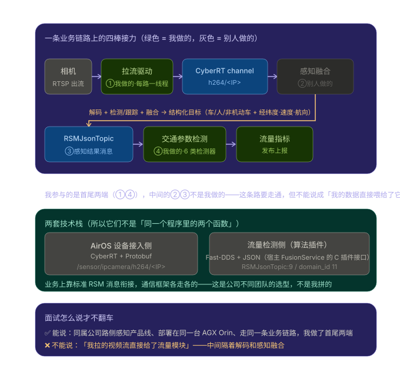

# 两个模块怎么合成一个故事（相机拉流 ↔ 交通参数检测）

> **一句话结论**：能合成一个项目讲——但只能讲「**业务链路是同一条**」，**不能**讲「我拉的视频流直接给了流量模块」。
> 中间隔着 **解码 + 目标检测/跟踪 + 多传感器融合**，那一棒不是你做的。



---

## 1. 真相：不是直连，中间有一棒是别人的

### 流量模块的输入是什么？

`traffic_flow` 的 README 第一句就写死了：

> "TrafficFlowService，即交通流量服务，**根据前模块（VS、后融合或高精地图等）输出的交通参与者信息**……"

VS = VisionStream（视觉感知）。也就是说它吃的是**已经结构化好的目标列表**，不是视频。

### 代码证据（三处，都对得上）

**① 它订阅的不是视频 topic，是 RSM 消息**

`config/traffic_flow/traffic_flow_service.json`：

```json
"subscribers": [
  { "id": 0, "name": "JsonSubscriber:0",        "topic": "RSMJsonTopic:9",        ... },
  { "id": 2, "name": "TrafficLightSubscriber:0","topic": "TrafficLightJsonTopic:11", ... }
],
"publishers": [
  { "id": 1, "name": "TrafficFlowPublisher:0",  "topic": "RSMJsonTopic:6",        ... }
]
```

⚠️ **RSM = Roadside Safety Message**（路侧安全消息），是车路协同国家标准里定义的结构化消息，**里面是一个个交通参与者的属性，不是图像**。

**② 收到消息后解析成什么？**

- `src/plugin/traffic_flow_service_impl.cpp:123` `on_data_available()` —— 宿主框架回调（C 插件接口 `FP_MAIN_API` 里的 `OnDataAvailable`，见 `src/plugin/FusionPlugin.h:253`）
- `:153` 把消息体原样转字符串 → `traffic_flow_factory.update_new_frame(contents)`
- `src/traffic_flow/traffic_flow_factory.cpp:187-215`：`nlohmann::json::parse()` → 直接赋给 `PerceptionResult`（`from_json` 反序列化）→ `_input_buffer.put()` 丢进有界队列

**③ `PerceptionResult` 里装的是什么？**（`src/common/perception_data.h:239-249`）

```cpp
struct PerceptionResult {
    std::string dev_no;              // 设备号
    uint64_t timestamp = 0;
    uint16_t object_count = 0;
    std::vector<TrafficObject> traffic_objects;   // ← 目标列表
};
```

每个 `TrafficObject`（`:199-230`）是：`id` / `inner_type`（车/公交/卡车/行人/自行车…）/ `speed` / `heading` / `longitude` / `latitude` / `lane_no` / `plate_num` …

> **大白话**：流量模块拿到的是一张**表格**——「3 号车道，一辆小汽车，经纬度 xxx，时速 42km/h，航向 90°」。
> 它**从来没见过像素**。把像素变成这张表，是感知算法干的活。

### 反向验证：流量模块里有没有任何视频痕迹？

```bash
grep -rn -i "h264|ipcamera|airos|rtsp" src/ config/
```

结果：**零命中**。唯一带 `cyber` 字样的是 `src/base/Singleton.h` 里的 `cybertron::base::Singleton`——那是作者个人开源库（github ThorfromAsgard/cybertron），**跟 Apollo CyberRT 没有半点关系**；`RTSP 地址无法解析` 只是 `CommonDefineV2.h` 里的通用错误码枚举。

---

## 2. 那还能不能合成一个项目？

**能。** 因为它们在**业务上确实是一条链**，而且部署在同一台设备上：

| | AirOS 设备接入侧 | 交通参数检测侧 |
|---|---|---|
| 部署位置 | AGX Orin（路侧边缘设备） | 同一台 AGX Orin |
| 通信 | **CyberRT + Protobuf** | **Fast-DDS + JSON**（宿主 FusionService 的 C 插件接口） |
| 数据形态 | H.264 压缩包（字节流） | RSM 结构化目标列表（JSON） |
| 我的角色 | 参与设备接入与链路调试 | 参与检测器与数据管道开发 |

**可以这样包装**（这是真话，也经得起问）：

> 都是公司路侧感知产品线里的东西，装在同一个路口的边缘盒子上，走的是同一条业务链：
> **相机 → 数据接入 → 感知融合 → 交通参数计算 → 上报**。
> 我参与的是**首尾两端**：前面做相机等设备的接入与运维，后面做交通参数检测服务。
> 中间的解码、目标检测跟踪、多传感器融合是算法团队做的，他们产出的结构化感知结果（RSM 消息）通过 DDS 喂给我的服务。

> ❗ **误区：以为「合并成一份简历项目」就等于「我的输出直接是它的输入」。**
> 合并是**业务层面**的包装（同产品线、同设备、同一条链），**不是技术层面的直连**。
> 这两者搞混，面试官一追问「那你的数据怎么传给它的？」就会当场穿帮。

---

## 3. 三个必被追问的问题，怎么答

### 追问 A：「那你拉的流到底给了谁？」

> 给了 CyberRT 话题总线上的 h264 channel，谁订阅谁收到。**具体是谁在订阅属于感知融合那块，是算法团队的模块，我没参与那部分**。
> 我只保证上游这一棒稳定：能连上、断了能重连、帧间隔能统计出来便于定位抖动。

**诚实且专业的点**：主动承认边界，比硬说"我全链路都熟"强得多。

### 追问 B：「为什么两个模块用的通信框架不一样？」

> 这是公司不同团队的选型：AirOS 主框架用的是 CyberRT + Protobuf；交通参数检测是**算法插件**形态，跑在宿主的 FusionService 里，宿主给它的是一套 C 插件接口 + Fast-DDS，数据格式是 JSON。
> **业务上靠标准 RSM 消息衔接**，通信框架各走各的。我在这两边都做过，所以两套我都接触过。

**加分点**：能说清"插件 + 宿主"这个形态，说明你理解的不只是自己那一块。

### 追问 C：「那你干脆说清楚，哪些是你做的？」

> 我做的两块：
> 1. **设备接入侧**：多路 RTSP 拉流（每路独立线程 + 双层循环重连 + 帧间隔统计）、设备抽象与插件化接入、边缘设备 GPU 运维指标采集；
> 2. **交通参数检测侧**：检测器框架与 6 类检测器的多态实现、车辆过线判定与误触发抑制、生产者-消费者数据管道。
>
> 没做的：解码、目标检测与跟踪、多传感器融合、感知结果的序列化。

---

## 4. 面试口播版（两个时长，挑一个背）

**30 秒版**

> 这两块都属于公司路侧感知产品线，部署在同一台 AGX Orin 上，走的是同一条业务链：相机数据接入 → 感知融合 → 交通参数计算 → 上报。我参与的是首尾两端——前面做设备接入，把多路相机 RTSP 流拉进来、保证链路稳定；后面做交通参数检测服务，订阅上游的感知结果算流量、排队这些指标。中间的解码和目标检测融合是算法团队做的，通过结构化的 RSM 消息在 DDS 上把结果喂给我。

**1 分钟版（追问展开时用）**

> 上游我做的是设备接入：相机通过 RTSP 出 H.264 流，我的驱动每路一个线程，用 FFmpeg 的 libavformat 拉流拆包，封装成 protobuf 发到 CyberRT 的 h264 channel 上，支持断线自动重连和帧间隔统计。
>
> 然后中间那一棒不是我做的：感知侧拿到 H.264 之后要解码、做目标检测和跟踪、再做多传感器融合，最终产出结构化的感知结果——RSM 消息，里面是一条条交通参与者记录，带类型、经纬度、速度、航向、车道号。
>
> 下游我做的交通参数检测服务订阅这个 RSM 消息，按预先标定好的车道和停止线，判断目标有没有过线，再按配置周期算出流量、排队长度、车速这些指标发布出去。中间用有界阻塞队列做生产消费解耦，避免感知回调的速率波动影响计算线程。

---

## ✅ 一句话版本（面试照背）

> 两块同属公司路侧感知产品线，装在同一台边缘设备上，是同一条业务链的首尾两端：我前面做设备接入把多路相机流拉进来，后面做交通参数检测服务订阅上游的感知结果算指标；中间的解码和目标检测融合是算法团队做的，通过结构化的 RSM 消息在 DDS 上把结果交给我——所以我能保证的是上下游两棒，中间那一棒不在我的范围内。

---

## 5. 附：代码速查

| 想证明什么 | 看哪个文件 |
|---|---|
| 流量模块的输入是结构化感知结果，不是视频 | `README.md` 第 3 行「根据前模块（VS、后融合或高精地图等）输出的交通参与者信息」 |
| 它订阅的是 RSM topic，不是 h264 | `config/traffic_flow/traffic_flow_service.json` 的 `subscribers` |
| 数据怎么进来的 | `src/plugin/traffic_flow_service_impl.cpp:123` `on_data_available()` → `:153` → `src/traffic_flow/traffic_flow_factory.cpp:187-215` |
| 数据结构长什么样 | `src/common/perception_data.h:199-230`（TrafficObject）、`:239-249`（PerceptionResult） |
| 插件形态（宿主给接口） | `src/plugin/FusionPlugin.h:237-260` `FP_MAIN_API` 宏；`:253` `OnDataAvailable` |
| 它没有消费任何视频 | `grep -rn -i "h264\|ipcamera\|airos\|rtsp" src/ config/` → 零命中 |
| 它跟 Apollo CyberRT 无关 | `src/base/Singleton.h:22` `cybertron::base` 是作者个人开源库 |

> ⚠️ **别讲错**：`cybertron::base::Singleton` **不是** Apollo CyberRT 的东西，是 GitHub 上 ThorfromAsgard/cybertron 这个个人库。说成 CyberRT 会被懂行的人当场纠正。
