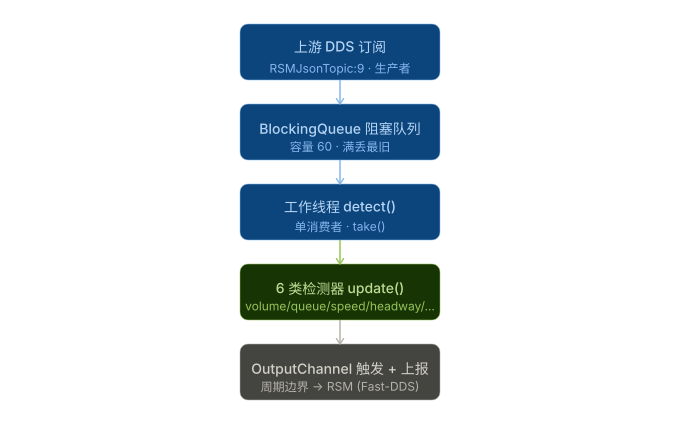
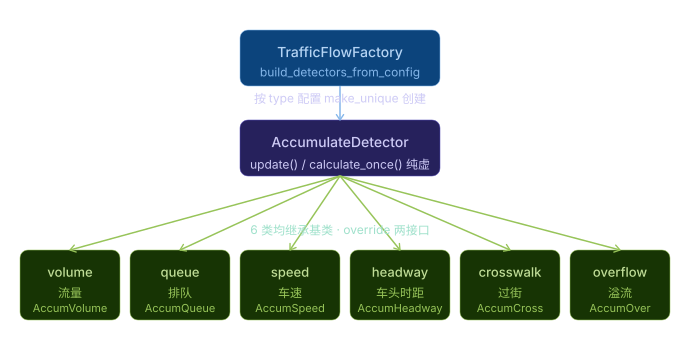
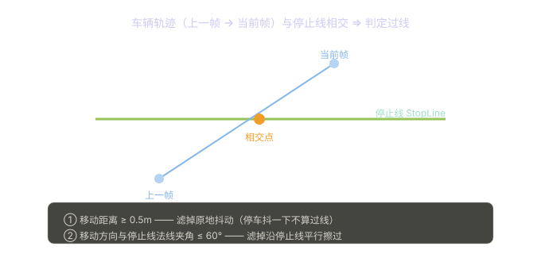
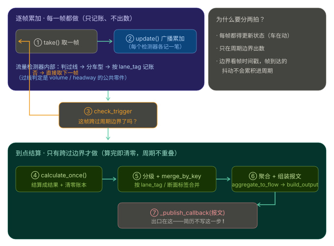

# 交通流量检测模块 知识点笔记（基于简历三条）

> 代码目录：`traffic_flow-main/src/`（C++17，Fast-DDS，AGX Orin）
>
> 简历（现行版，2026-10 起合并为「路侧感知系统 AirOS」组 2）：
>
> - **检测器框架与多类检测器**：*参与交通参数检测服务的设计，基于抽象基类 + 工厂模式统一管理 6 类检测器（流量 / 排队 / 车速 / 车头时距 / 过街 / 溢流），主循环统一调度。*
> - **车辆过线判定**：*实现基于停止线几何相交的车辆过线判定，滤除抖动与擦边，支撑流量与车头时距统计。*
> - **生产者-消费者数据管道**：*上游感知目标流经 DDS 订阅后写入阻塞队列，由独立工作线程消费并周期聚合上报，生产消费解耦。*
>
> ⚠️ **红线速记**：输入是结构化目标流（`PerceptionResult`/`TrafficObject`），从没见过像素；通信是 **Fast-DDS（非 CyberRT）**；检测器 **6 类非 5 类**（含 `overflow` 溢流）；**无**逆行检测、**无**卡尔曼滤波、**无**单元测试；`Singleton` 是作者个人开源库（`cybertron::base`），**不是** Apollo CyberRT。

> ❗ **本文标注约定**：凡带 `❗` 的段落，都是我**自己踩过或差点踩的理解误区**，后面紧跟代码里的准确答案。复习时优先扫这些地方。总表见第 10 节。
>
> ✅ **背诵版约定**：每讲完一个小节，末尾都用 `**✅ 一句话版本（面试照背）**` 收尾——把这一节的准确说法压成一段可直接口述的话。**复习时只扫 ❗ 和 ✅ 两种标记即可**。

---

## 0. 一句话概括



> 看图要点：**模块是一条"订阅 → 消费 → 累加 → 上报"的流水线**。上游融合感知把结构化目标流推过来，我这边用 Fast-DDS 订阅收下，丢进阻塞队列；一个工作线程不停取帧，广播给 6 类检测器各自累加；到上报周期，各检测器出一次数，聚合成 RSM 报文发出去。

> **给每个输出周期开若干检测器，上游每来一帧就广播给所有检测器累加；到周期边界由输出通道统一触发出数并上报。**

所有看起来复杂的类（工厂、基类、Tracker、队列），都只是为了服务这句话。

**✅ 一段话骨架（面试照背）**

> 交通参数这块我参与做了一个插件化的检测服务。上游融合感知通过 Fast-DDS 把结构化目标流推给我，我订阅收下后写进一个阻塞队列，由一个工作线程消费；线程每取一帧就广播给一组检测器各自累加，到配置的周期边界由输出通道统一触发出数、聚合成 RSM 报文上报。检测器我用"抽象基类 + 工厂"统一管理，一共六类，主循环不关心具体类型。

---

## 1. 零件清单（核心类与结构体）

### 1.1 抽象基类 `AccumulateDetector`（`traffic_flow_detector.h:59`）

| 成员 / 接口 | 类型 | 大白话 |
| --- | --- | --- |
| `update(const PerceptionResult&)` | 纯虚 | 喂一帧进来 |
| `calculate_once()` | 纯虚 | 出一次统计（返回 json） |
| `VolumeCategory` 枚举（:31） | `NONE/PEDESTRIAN/NON_MOTOR/CAR_SMALL/VAN/LARGE` | 把目标按车型分成 5 类（对应协议 Volume1~5） |
| `classify_volume_category()`（:42） | 函数 | 按 `inner_type` + `vehicle_subtype` 分类 |

**关键认知**：基类只定合同不定实现——所有 6 类检测器都长"喂帧 / 出数"这个样，主循环才能 `for` 循环统一调。

### 1.2 工厂 `TrafficFlowFactory`（`traffic_flow_factory.h:173`）

| 成员 | 类型 | 作用 |
| --- | --- | --- |
| 继承 `Singleton<T>` | — | 全局单例（**个人库 `cybertron::base`，非 Apollo**） |
| `_input_buffer` | `BlockingQueue<PerceptionResult>` | 阻塞队列，生产消费之间的缓冲（:210） |
| `_working_thread` | `unique_ptr<thread>` | 唯一的工作线程，跑 `detect()`（:208） |
| `_output_channels` | `vector<OutputChannel>` | 每个输出周期一组检测器 + 上报参数 |
| `_signal_phase_manager` | `SignalPhaseManager` | 信号相位，给 signal_cycle 周期用 |

### 1.3 过线追踪 `StopLineCrossingTracker`（`stop_line_crossing_helper.h:14`）

| 成员 | 作用 |
| --- | --- |
| `_stop_line` | 这条检测断面的停止线（一条线段） |
| `_prev_positions` | 每辆车上一帧的位置（map: id → 位置 + 时间戳） |
| `_crossed_ids` | 已经判过"过线"的车（避免重复计数） |
| `process_frame()` | 返回这一帧**新过线**的车辆列表 |

### 1.4 阻塞队列 `afl::BlockingQueue`（`base/BlockingQueue.h:18`）

muduo 风格。`put()` 入队 + `notify()`；`take()` 队列空就阻塞等；**容量满则丢最旧的**（`pop_front`，:25-27）。

### 1.5 数据类型 `PerceptionResult` / `TrafficObject`（`common/perception_data.h:199/239`）

> **一帧 = 一个 `PerceptionResult` 结构体**（`perception_data.h:239`），里面用 `std::vector<TrafficObject> traffic_objects` 装着这一帧里**所有目标**；每个目标是一个 `TrafficObject` 结构体（:199）。上游给的是**目标级数据**，**全是结构化目标，没有一帧像素**——再次印证红线。

**`PerceptionResult`（一帧）关键字段**：

| 字段 | 作用 |
| --- | --- |
| `timestamp` | 帧时间戳，驱动所有周期 / 窗口计算 |
| `object_count` | 这一帧目标数 |
| `traffic_objects` | 这一帧所有目标（vector） |
| `dev_no` / `mec_no` | 设备 / MEC 编号 |

**`TrafficObject`（单个目标）关键字段**：

| 字段 | 被谁用 |
| --- | --- |
| `id` / `inner_id` | 目标唯一标识，`StopLineCrossingTracker` 用它记上一帧位置、记是否已过线 |
| `inner_type` | 车型（车/人/自行车/三轮车…）→ 分类计数 |
| `vehicle_subtype` | 车型子类（如 MINIVAN）→ 体积分类（CAR_SMALL vs VAN） |
| `speed` | 速度 km/h → 车速检测器、排队判定（速度阈值） |
| `longitude` / `latitude` | 经纬度 → 过线判定（轨迹线段端点，见 `stop_line_crossing_helper.cpp:62`） |
| `lane_no` | 车道号 → 按车道聚合 |

> 处理一帧（`detect()`，`traffic_flow_factory.cpp:350`）：`take()` 取出 `PerceptionResult` → 遍历所有 channel 的所有 detector 调 `update(这一帧)` → 各检测器从帧里提取信息**累加** → 到周期边界 `check_trigger` 才 `calculate_once()` 出数。

---

## 2. 数据流与启动

- **订阅（生产者）**：宿主框架 FusionService 的 DDS 插件收到 `RSMJsonTopic:9`（domain 11）的 JSON，调 `update_new_frame()`（:187）解析成 `PerceptionResult`，`_input_buffer.put()` 入队。
- **起线程（消费者）**：构造函数（:64）里 `_working_thread = make_unique<thread>(&TrafficFlowFactory::detect, this)` 起一个线程跑 `detect()`。
- **消费主循环 `detect()`（:350）**：`take()` 取一帧 → 遍历所有 channel 的所有 detector 调 `update()` → `check_trigger()` 判断到没到周期（:91）→ 到则 `calculate_once()` 出数 → `build_output()` 组装 → `_publish_callback()` 上报。
- **信号旁路**：信号灯报文走另一条 topic，由 `on_signal_data()` 喂给 `SignalPhaseManager`，只用于 `signal_cycle` 这种"看红绿灯变绿才出数"的周期。

### 2.1 配置读什么、怎么流转

**先记住三点**（比"读配置存结构体"更精确）：

1. **不是一个结构体**，是一个**全局配置单例**（`GlobalConfig`，继承项目里的 Singleton）里装了一堆结构体；
2. **读两个文件**：主配置 + 它指向的车道几何文件；
3. **只在启动时读一次**，运行期不再碰文件——检测器构造时把需要的部分**拷贝进自己成员**。

**文件一：`traffic_flow_config.json`（主配置）全部字段：**

| 配置项 | 示例值 | 用途 |
| --- | --- | --- |
| `lane_info_path` | `./config/traffic_flow/lane_info_212.json` | **指向第二个文件**（车道/线圈几何） |
| `dev_no` / `mec_no` | `MEC-sy289` | 设备号 / MEC 号，进报文 |
| `region_id` | `"0"` | 区域编号 |
| `ensemble_mode` | `true` | 融合模式开关 |
| `time_align` | `true` | 时间栅格对齐 → 就是 §3.5 那个"防帧抖动累积"的开关 |
| `queue_rules` | 见下 | 排队 / 溢流的判定门限 |
| `detector_cycles` | 见下 | **核心**：周期 + 检测器类型 + 空间粒度 |

`queue_rules` 五项：`entry_speed_kmh=10`（排队速度门限）、`entry_hold_frames=10`（连续多少帧才算排队）、`entry_gap_body_ratio=1.0`（跟车间距 < N 倍车长才算连在队里）、`overflow_speed_kmh=10`、`overflow_hold_ms=5000`。

**`detector_cycles`——配置里的三个周期（正好是 §3.5 的实物证据）：**

| `cycle_type` | `cycle_duration_ms` | 实际周期 | 开的检测器 | `spatial_output` |
| --- | --- | --- | --- | --- |
| `snapshot` | 1000 | **1 秒** | queue / volume / crosswalk / speed / headway / overflow（6 类全上） | FLOW+LANE+BRANCH |
| `accumulate_5min` | 300000 | **5 分钟** | volume / crosswalk / headway | FLOW+LANE+BRANCH |
| `signal_cycle` | 无（看信号） | 红绿灯"非绿转绿" | volume / headway | FLOW+LANE |

⚠️ 注意：`snapshot` 和 `accumulate_5min` **都配了 volume** —— 这就是 §3.5 说的"两个独立的 volume 实例"的**直接证据**（1s 一个、5min 一个，各攒各的账）。

**文件二：`lane_info_212.json`（车道几何）**
每个车道一组数据：`contour`（经纬度轮廓，两条边）+ `pixel_contour`（图像像素轮廓，调试用）。**停止线就是从这里推出来的**（见 §4.5）。

**读到哪去——`GlobalConfig` 缓存的那些结构体：**

| 成员 | 装什么 | 谁用 |
| --- | --- | --- |
| `_road_section_infos` | 断面信息（map: tag → info） | 分组、报文 meta |
| `_coil_infos` | **线圈/车道几何（含推导出的停止线）**，map: 断面 tag → 线圈列表 | volume / queue / speed / headway |
| `_exit_lane_infos` | 出口道 + 三级溢流区域 | overflow |
| `_crosswalk_infos` | 斑马线断面 | crosswalk |
| `_detector_cycle_configs` | 上面那张表的 `detector_cycles` | 工厂建通道 |
| `_queue_rules` | 排队/溢流门限 | queue / overflow |
| `_dev_no` / `_mec_no` / `_region_id` / `_time_align_flag` / `_ensemble_mode` / `_working_mode` | 标量配置 | 报文组装、栅格对齐 |

加载入口：`GlobalConfig::init(config_path)` → `load_global_config()` + `load_lane_info()` + `load_detector_cycle_config()`。

> ✅ **一句话版本（面试照背）**
>
> 配置分两个文件：主配置里是设备号、区域、时间对齐开关、排队门限，还有一个周期数组——每个周期写清时长、开哪几类检测器、报文出哪几个空间粒度；另一个文件是车道几何，每个车道一组经纬度轮廓点。启动时这两个文件被解析进一个全局配置单例，缓存成线圈、出口道、过街断面、周期配置这些结构体；工厂再按周期配置建通道、给每个通道造一套检测器，构造时把需要的几何**拷进检测器自己的成员**。之后运行期不再读文件——检测器带着自己的配置副本跑。

---

## 3. 核心①：检测器框架与多类检测器



> 看图要点：**工厂读配置 `type` 字符串 → `make_unique` 造对应子类**；所有子类继承 `AccumulateDetector`，override `update` / `calculate_once`。

### 3.1 基类只定接口（traffic_flow_detector.h:59）

两个纯虚函数 `update` / `calculate_once`（后面是 `= 0`，**基类里一行函数体都没有**）。这是"岗位说明书"：不管数流量还是算车速，都得会这两招。

> ❗ **误区：以为基类"把共有的功能写成虚函数"，子类只是"重写"一份现成的。**
>
> 准确说：`update` / `calculate_once` 是**纯虚函数（`= 0`）**，基类**没有任何实现**——它只提供"合同 / 接口"，具体逻辑 **100% 由 6 个子类各自从零实现**。所以子类不是"覆盖基类现成的实现"，而是"**必须实现**；不实现就是抽象类，`make_unique` 直接编译不过"。
>
> 换个说法：这里抽象/复用的是**接口**（调用方式统一，主循环才能 `for` 循环统一调度），**不是实现**。6 类检测器算的东西本来就不同（流量数过线、车速求平均、排队看速度阈值），根本没有"共有实现"可往基类塞。
>
> 基类里真正算"共用"的只有三样，而且**都不是虚函数**：① 构造函数存 `_detector_id` + `get_detector_id()`（普通成员函数）；② 继承 `afl::Noncopyable` 禁用拷贝；③ 同文件里的**自由函数** `classify_volume_category()`（车型分类，inline 而非虚函数，谁都能调）。
>
> "把共有实现写进基类虚函数、子类只填空"是**另一种**做法（模板方法模式，基类写**带函数体**的普通虚函数）；本项目**没用**这种，别把它当成本项目的设计。

**✅ 一句话版本（面试照背）**

> 基类 `AccumulateDetector` 只定了个接口——两个**纯虚函数** `update` 和 `calculate_once`，基类里一行实现都没有。六种检测器都继承它、各自 override 这两个接口，把自己独特的成员和算法（比如流量检测器的过线 tracker、车道累加账本）加在子类里。所以这里抽象的是**统一接口**——好处是主循环能 `for` 循环一把调，加新检测器不用改主循环——而不是"把共有逻辑抽到基类复用"。真要找共用，只有构造里存 detector_id、`get_detector_id()`、以及那个做车型分类的自由函数。

#### 3.1.1 对照：模板方法长什么样（⚠️ 假设代码，本项目没用这套）

模板方法的核心就一句话：**基类里写一个"非虚"的骨架函数，把流程顺序锁死；骨架里留几个"虚"的钩子给子类填。**

假设用模板方法写这个检测器框架，会是下面这样（**仅为对照，不是项目代码**）：

```cpp
class BaseDetector {
public:
    // ① 模板方法：注意没有 virtual —— 顺序写死在这里，子类改不了
    void run_cycle(const PerceptionResult& frame) {
        on_frame(frame);                        // 钩子1（子类必须填）
        if (should_flush(frame.timestamp)) {    // 钩子2（有默认实现，可覆盖）
            flush(calculate_once());            // 钩子3（子类必须填）+ 固定步骤
        }
    }

protected:
    virtual void on_frame(const PerceptionResult&) = 0;   // 纯虚 → 子类必须实现
    virtual nlohmann::json calculate_once() = 0;          // 纯虚 → 子类必须实现
    virtual bool should_flush(uint64_t ts) {              // 普通虚 → 带默认实现
        return ts - _last_flush >= _interval_ms;
    }

    uint64_t _last_flush = 0;
    uint64_t _interval_ms = 1000;
};

class VolumeDetector : public BaseDetector {
protected:
    void on_frame(const PerceptionResult& f) override { /* 只写"怎么累加" */ }
    nlohmann::json calculate_once() override { /* 只写"怎么出数" */ }
};

// 调用方只有这一行，完全不知道"什么时候该出数"：
detector->run_cycle(frame);
```

注意最后那行调用：**调用方只管喂帧，出数时机是基类内部决定的**——这就是模板方法的标志。

而本项目实际长这样（**流程在工厂手里，不在基类手里**）：

```cpp
// 本项目真实形态（traffic_flow_factory.cpp 的 detect() 主循环）
detector->update(frame);                                // 基类纯虚接口
if (channel.check_trigger(now, ...)) {                  // 出数时机由"输出通道 + 配置"判
    auto result = detector->calculate_once();           // 基类纯虚接口
    // ... 按车道/断面合并 → 聚合 → 组装报文 → 交给发布回调
}
```

**对照表：**

| 对比项 | 纯接口（本项目） | 模板方法 |
| --- | --- | --- |
| 基类里有什么 | 只有 2 个纯虚接口，**零实现** | 1 个非虚骨架函数 + 若干虚钩子（部分带默认实现） |
| 流程（何时累加 / 何时出数）在哪 | 在**工厂主循环**里 | 在**基类骨架函数**里，锁死 |
| 子类要做什么 | 实现两个接口，逻辑自由 | 只填钩子 |
| 子类能改流程顺序吗 | 无所谓（流程本来不归它管） | 不能 |

**本项目为什么不用模板方法？三条：**

1. **"什么时候出数"不是检测器的内在逻辑**——它由配置的周期（固定时间窗栅格对齐 / 信号周期）决定，是**输出通道 + 框架**的职责。塞进基类等于把框架的活儿塞进算法类。
2. **检测器是成组被驱动的**——主循环是「for 每个 channel → for 每个 detector」，同组检测器要在**同一时刻**一起结算、再合并聚合。这种"批量同步驱动"天然属于外层循环。
3. **子类差异太大**——溢流检测用的是多边形区域、过街检测用过街断面，压根没有"过线"概念；硬套一条统一骨架就得留一堆空钩子或特例分支，反而更糟。

> ✅ **一句话版本（面试照背）**
>
> 模板方法是"基类写一个**非虚**的骨架函数锁住流程，中间留几个**虚**函数当插槽让子类填"。我们没用它——因为"什么时候出数"由配置和输出通道决定，属于框架职责，不是某个检测器自己的逻辑；而且检测器是成组被主循环同步驱动的，流程放外层循环更自然。所以基类只留两个纯虚接口，**流程交给工厂**。一句话：模板方法把流程放基类，我们把流程放工厂。

### 3.2 工厂按配置造类（`build_detectors_from_config`，traffic_flow_factory.cpp:237`）

工厂读配置里的 `detector_item.type`，用 `make_unique` 实例化对应子类。6 类映射：

| 配置 `type` | 实际类名 | 算什么 |
| --- | --- | --- |
| `"volume"` | `AccumulateVolumeDetector` | 流量 |
| `"queue"` | `AccumulateQueueDetector` | 排队 |
| `"speed"` | `AccumulateSpeedDetector` | 车速 |
| `"headway"` | `AccumulateHeadwayDetector` | 车头时距 |
| `"crosswalk"` | `AccumulateCrosswalkDetector` | 过街 |
| `"overflow"` | `AccumulateOverflowDetector` | 溢流 |

> ❗ **误区：以为 5 类检测器。**
>
> 准确说：代码配置里支持 **6 种 `type`**（`traffic_flow_factory.cpp:279-332`），多出来的那一类是 `overflow`（溢流），别在面试官面前少说这一类；也别把"逆行检测"塞进去——**代码里没有逆行检测**。

**工厂模式的价值**：加一类检测器只需 ① 写子类继承基类实现两接口；② 工厂里加一个 `type` 分支；③ 配置加对应项。**主循环零改动**，符合开闭原则。

**✅ 一句话版本（面试照背）**

> 六种检测器不是硬编码 new 的，而是工厂 `build_detectors_from_config` 按配置里的 `type` 字符串（volume/queue/speed/headway/crosswalk/overflow）用 `make_unique` 创建，再统一塞进输出通道。它们都继承抽象基类、override `update` 和 `calculate_once` 两个接口，所以主循环能统一调度——加一类检测器只加子类 + 加一个 `type` 分支，主循环一行都不用改。

---

### 3.3 简历那句话怎么拆：三层 + 多态落在哪两行

简历原句：

> 参与交通参数检测服务的设计，以**抽象基类 + 工厂模式**统一管理流量、车头时距类检测器，各类复用同一套「**逐帧累积、到点结算**」多态流程。

这句话不是只说基类，而是**三件事捆在一起**：

| 简历里的词 | 落在代码哪 | 一句话 |
| --- | --- | --- |
| 抽象基类 | `AccumulateDetector`（`traffic_flow_detector.h:59`）两个**纯虚**接口 | 定"喂帧 / 出数"两张合同 |
| 工厂模式 | `build_detectors_from_config`（`traffic_flow_factory.cpp:237`） | 按配置 `type` 造出对应子类 |
| 「逐帧累积、到点结算」多态流程 | `detect()` 主循环（`traffic_flow_factory.cpp:350-377`） | 用基类指针批量驱动所有检测器 |

> 💡 **"统一管理"= 造 + 装 + 驱动 三件事，不只是"创建"。**
>
> ① **造**：`build_detectors_from_config()` 按配置 `type` 用 `make_unique` 造出具体子类；
> ② **装**：把它**以基类指针的形式**存进 `OutputChannel::detectors`——工厂**持有**它（`unique_ptr` 自动析构，不用手动 delete）；
> ③ **驱动**：`detect()` 主循环统一调 `update` / `calculate_once`——**调度**也是工厂的活。
>
> 所以"工厂统一管理"= 造 + 持有 + 调度。只会 new 那叫"简单工厂"，这个类管的更多。
>
> ⚠️ 顺带一个可以主动交代的点：严格说 `TrafficFlowFactory` **不只是个工厂**——它还持有阻塞队列 `_input_buffer`、工作线程 `_working_thread`、信号相位管理器 `_signal_phase_manager`，整个检测服务以它为中心。所以它更像"**工厂 + 主循环调度器**"的合体。面试官若问"你这工厂是不是职责过重"，就诚实承认"它确实承担了模块级调度职责，不是纯粹的创建型工厂；好处是入口单一、生命周期集中，代价是类偏大"——这比硬说"它就是标准工厂模式"显成熟。

**① 「逐帧累积、到点结算」就是对这两个接口：**

| 简历措辞 | 接口 | 调用频率 | 干什么 |
| --- | --- | --- | --- |
| 逐帧累积 | `update(frame)` | 上游**每来一帧**调一次 | 只累加、不出数 |
| 到点结算 | `calculate_once()` | **跨过周期边界**才调一次 | 出数 + 清零 |

> ❗ **但"到点"这个判断不在检测器里。**
>
> 见过有人答"检测器自己判断什么时候到点"——错。判定在**输出通道**：`channel.check_trigger(current_time, _signal_phase_manager.get())`（`traffic_flow_factory.cpp:367`），拿**帧时间戳**和配置的周期比。检测器只是"被调到时干活"，它**不知道时间**。
>
> 这正是"流程归工厂"的直接证据：**时机归通道，动作归检测器。**

**② 多态落在哪两行（面试八股必答点）**

```cpp
// 第 1 处：容器类型 —— 存的是【基类】指针，不是具体子类
struct OutputChannel {
    std::vector<std::unique_ptr<AccumulateDetector>> detectors;   // factory.h:72
};

// 第 2 处：调用点 —— 用【基类指针】调【虚函数】
for (auto& channel : _output_channels) {
    for (auto& detector : channel.detectors) {
        detector->update(detected_result);       // factory.cpp:358-362
    }
}
// 结算那一段同理：detector->calculate_once()   // factory.cpp:372
```

**多态成立要三条同时满足**：① 有继承（子类 `: public AccumulateDetector`）；② 有虚函数且被子类 override；③ **通过基类指针 / 引用调用**。第 ③ 条最容易被漏——如果写 `AccumulateVolumeDetector v; v.update(...)`（用对象名直接调），那是**静态绑定**，编译期就把函数地址定死了，不叫多态。

所以完整因果链是：

> 工厂 `make_unique<AccumulateVolumeDetector>(...)` 造出子类 → 立刻**以基类指针的身份**塞进 `vector<unique_ptr<AccumulateDetector>>`（子类身份"藏"起来了）→ 主循环只看得见"这是个检测器" → `detector->update(...)` 在**运行时**按对象真实类型跳到对应实现。合起来就是"一套多态流程驱动 N 种检测器"。

> ✅ **一句话版本（面试照背）**
>
> 那句话是三件事：抽象基类提供 `update` 和 `calculate_once` 两个纯虚接口；工厂按配置 type 造出具体子类；工厂主循环用基类指针批量驱动所有检测器——每来一帧调一次 `update` 做逐帧累积，跨过周期边界才调 `calculate_once` 结算出数，这就是「逐帧累积、到点结算」。多态体现在**容器存的是基类指针、循环里用基类指针调虚函数**，所以一套代码能驱动六种不同检测器。补一句：**"到点"不是检测器自己判的**，是输出通道拿帧时间戳跟配置周期比出来的。

---

### 3.4 检测器不是"你"调的，是 `detect()` 调的；而 `detect()` 也不用谁调

很多人的心智模型是"库"的用法：我要用检测器 → 我自己 `new` 一个 → 我自己调它的 `update` / `calculate_once`。**本项目不是这种用法。**

**真相：宿主（主程序）从头到尾没创建过检测器，也没调过检测器的任何函数。**

宿主侧只有三个入口（`FusionPlugin.h` 的 C 接口）：

| 宿主调插件的入口 | 什么时候调 | 插件里干了啥 |
| --- | --- | --- |
| `TrafficFlowService_Init(config_path, params)` | **启动时一次** | 内部：读配置、造好全部检测器、**起工作线程** |
| `TrafficFlowService_OnDataAvailable(id, msg, params)` | 上游**每来一帧** | 解析 JSON → `update_new_frame()` → `_input_buffer.put()` → **立刻返回** |
| （宿主提供的）`TrafficFlowService_Publish` | 结果算好时 | 由工厂**主动调用**，把结果交出去 |

看出关键了吗——`OnDataAvailable` 里**只做"解析 + 塞队列"就返回了**，一帧业务计算都没干。真正的计算发生在**另一个线程**里，那个线程就是工厂构造时起的 `_working_thread`，跑的是 `detect()`。

**所以两个"谁调谁"的答案：**

| 问题 | 答案 |
| --- | --- |
| 谁调 `update` / `calculate_once`？ | **`detect()`** 调 |
| 谁调 `detect()`？ | **没人调**——工厂构造时 `make_unique<thread>(&TrafficFlowFactory::detect, this)`，它自己在 `while` 循环里一直转 |

对比一下两种写法就懂了：

```cpp
// ❌ 你以为的用法（"库"模式：什么都得调用方自己写）
auto det = new AccumulateVolumeDetector("v1", coil);   // 自己造
while (true) {
    auto frame = get_frame();            // 自己搞数据
    det->update(frame);                  // 自己调累加
    if (time_to_report()) {              // 自己判周期
        auto r = det->calculate_once();  // 自己调结算
        send(r);                         // 自己发结果
    }
}

// ✅ 实际用法（"框架"模式：调用方只喂数据）
int  TrafficFlowService_Init(...);                            // 一次性：造检测器 + 起线程
void TrafficFlowService_OnDataAvailable(id, msg, params) {    // 每帧：塞进队列就完事
    factory.update_new_frame(contents);                       // 之后全是异步的
}
// 结果出来时，工厂通过宿主给的 Publish 回调主动交出去
```

**`detect()` 到底解决了什么？（5 条）**

1. **自动循环**——不用任何人在外面写 `while`；线程一起就永远在转。
2. **一键广播**——一帧进来一次 `for` 就分发给该通道全部检测器，6 类并行累加，调用方不用逐个点名。
3. **周期判断只写一份**——"到点没到点"的逻辑集中在 `check_trigger`，不是每个调用点各抄一遍（这正是 §3.1.1 里说的"流程归工厂"）。
4. **线程隔离**——计算在独立线程，`OnDataAvailable` 塞完队列立刻返回，**不阻塞 DDS 回调**，后续帧不会因为算得慢而丢。
5. **生命周期集中**——检测器由工厂用 `unique_ptr` 持有，随工厂一起释放，调用方不用管 delete。

> 也就是说：**检测器的函数不是"你"调的，是 `detect()` 调的；而 `detect()` 也不是"你"调的，是它自己的线程在跑。** 你使用这个模块的方式不是"调它"，而是"**喂它数据**"。

> ✅ **一句话版本（面试照背）**
>
> 我们这块对外只有三个入口：初始化、有数据可用、发布回调。宿主每来一帧只在回调里把数据解析一下塞进队列就返回了，真正的计算在工厂自己起的**工作线程**里——那个线程跑一个循环，把帧广播给所有检测器累加、到周期边界再结算出数，算完通过宿主给的发布回调交出去。所以**宿主从头到尾没见过检测器对象**，它不知道有几类检测器、也不知道什么时候出数。这也是为什么它能做到"加一类检测器，上层一行都不用改"。

> ❗ **两个容易被说错的措辞（面试高频，务必抠准）**
>
> **1. "不用调用"** ❌ → 准确说："**宿主不用调，工厂的工作线程替你调**"。
> 代码里就是明明白白一行 `detector->calculate_once()`——**有人调**，只不过调用者不是上层，而是工厂自己的 `detect()`。说"不用调用"会被追问"那它怎么出数"而当场卡住。
>
> **2. "有数据就输出"** ❌ → 准确说："**跨过配置的周期边界才输出**"。
> 每帧都干的是 `update`（只记账）；出数是**攒够一个周期才结算一次**，不是有帧就出。而且判定是**按通道**做的——一个通道到点了，它下面所有检测器才一起出数；没到点的通道整条 `continue` 跳过：
>
> ```cpp
> for (auto& channel : _output_channels) {
>     if (!channel.check_trigger(current_time, _signal_phase_manager.get()))
>         continue;                                    // 这个通道没到点，整条跳过
>     for (auto& detector : channel.detectors) {
>         auto results = detector->calculate_once();   // 到点了：每个检测器都出一次
>     }
>     ...
> }
> ```
>
> **记账类比**：账房先生**每来一笔都记账**（`update`），但**只在结账点出一次报表**（`calculate_once`）；喊"结账"的不是客户（宿主），是店里的闹钟（工厂线程 + `check_trigger`）。

### 3.5 一个周期一套检测器实例（为什么 1s 清零不影响 5min）

**疑问**：如果同时有 1s 周期和 5min 周期，1s 算完就把账本清零了，那 5min 的用哪来的数据？是不是提前存到别处了？

**答案是：根本没有"存到别处"这回事。每个周期有自己独立的一套检测器对象，各攒各的账。**

看 `build_detectors_from_config`（`traffic_flow_factory.cpp:237`）的循环层次——**最外层循环的就是"周期配置"**：

```cpp
for (const auto& cycle_config : cycle_configs) {          // ① 外层：遍历【每个周期】
    OutputChannel channel;
    channel.cycle_type   = cycle_config.cycle_type;
    channel.interval_ms  = cycle_config.cycle_duration_ms;

    for (const auto& detector_item : cycle_config.detectors) {   // ② 每个周期配了哪些检测器
        for (... coils ...) {
            std::string detector_id = cycle_config.cycle_type + "_volume_" + coil_info.tag;
            channel.detectors.push_back(                         // ③ 【各造一份全新实例】
                std::make_unique<AccumulateVolumeDetector>(detector_id, coil_info));
        }
    }
    _output_channels.push_back(std::move(channel));       // ④ 一个周期 = 一个通道
}
```

注意 ③ 那行：**每个周期配置都会把检测器从头 `make_unique` 一遍**。而且 `detector_id` 里带了周期前缀——同一段线圈在 1s 通道里叫 `"1s_volume_coil1"`，在 5min 通道里叫 `"5min_volume_coil1"`，**从 ID 就能看出这是两个不同的对象**。

所以完整流转是这样：

| 时刻 | 一帧进来后发生了什么 |
| --- | --- |
| 每帧 | `detect()` 的双层 `for` 把这一帧**广播给所有通道的所有检测器**——实例 ① 和实例 ② **都收到同一帧** |
| 每帧 | ① 记进账本 A，② 记进账本 B（**两本账，互不相干**） |
| 到 1s | 通道 A 到点 → ① 的 `calculate_once()` 出数 + **清空账本 A** |
| 到 5min | 通道 B 的账本 B **一直在攒**，完全不受账本 A 清零影响；攒满 5min 才出数 |

**类比**：两个账房先生，同一笔生意**两人都各记一笔**；一个管日结、一个管月结。日结那位每天把**自己的**账本清零，月结那位照旧往下记——不是把单据复制一份存起来，而是**两个人各记各的**。

> 顺带一个加分储备（框架既有设计，不是你做的）：`OutputChannel` 里维护 `window_open_ms` / `window_stop_ms` / `align_to_grid`，栅格模式下按**绝对时间槽**对齐边界——目的是防止帧到达抖动累积（5min 不会变成 5min+Δ、且只增不减）；启动时切进来的头一段不完整窗口会**清零丢弃不上报**，避免第一条 5min 报文只有几分钟数据却标称 300 秒。被问到"周期怎么保证准"可以说这个，但要说明是框架设计。

> ✅ **一句话版本（面试照背）**
>
> 不是全局一个周期，而是每个周期配一个输出通道，**每个通道里有自己独立的一套检测器对象**。同一帧会被广播给所有通道的所有检测器，所以 1s 通道和 5min 通道各有一份流量检测器实例、各攒各的账本；1s 那个到点出数清零，只清它自己的账，5min 那个继续攒。是"两个对象、两本账"，不是"把数据存两份"。

---

## 4. 核心②：车辆过线判定


![相交的数学：叉积算分母 d + 解参数 r/s ∈ [0,1]](imgs/07-相交数学.svg)

> 看图要点：**把每辆车"上一帧位置 → 当前帧位置"连成一条线段，看它是否与停止线相交**；相交且质量门通过（移动够远、方向够"横切"而非擦边）→ 判定为过线。相交的底层数学（叉积 + 参数方程）见下 §4.3。

### 4.1 判定逻辑（`process_frame`，stop_line_crossing_helper.cpp:44`）

- 记每辆车的上一帧位置 `_prev_positions`；本帧算"移动线段"，与停止线 `_stop_line.has_intersect()`（:68）。
- **三个条件同时满足才算过线**：① 线段与停止线相交；② 该车 id 还没记录过（`_crossed_ids`，防重复）；③ `passes_quality_gate()` 质量门通过。
- **质量门**（`passes_quality_gate`，:21）：滤掉原地抖动（移动 `< 0.5m` 不算，距离用 `geo_distance_to` 球面距离）、滤掉沿停止线平行擦过（移动方向与停止线法线夹角 `cos < 0.5`，约 60° 以内才认）。
- ❗ **质量门只对"行人 / 非机动车"生效**：`:60` `strict = (category==PEDESTRIAN || category==NON_MOTOR)`，对**机动车** `strict=false`，`passes_quality_gate` 直接 `return true`（门控形同虚设）。机动车移动干脆、不卡这么严；人走两步就抖、必须卡。你简历讲车流量，车的门控其实没拦你——但要知道这层。
- **目标 TTL**（:9 / :48）：超过 10s 没见到的车，从 `_prev_positions` 清掉，避免拿很老的位置做相交判断。

### 4.2 为什么讲过线判定是"底层公共能力"

流量（`volume`）和车头时距（`headway`）检测器内部都持有 `StopLineCrossingTracker`（分别见 `accumulate_volume_detector.h:26`、`accumulate_headway_detector.h:23`）——只有"过了停止线"的目标才计数 / 才记到达时刻。所以**过线判定不是独立模块，是这两类检测器的零件**。

> ❗ **误区：以为过线判定是单独一块、和检测器无关。**
>
> 准确说：它就嵌在 `volume` / `headway` 检测器里被复用，是它们的依赖项；简历上"车辆过线判定"这条，本质上是在讲这两类检测器怎么判断一辆车"过了断面"。

### 4.3 相交的数学：叉积 + 参数方程（`segment2d.hpp:57` `has_intersect`）

把两条线段都参数化，交点**同时落在两条线段上**才算真相交：

1. **分母 `d`（二维叉积）**：`d = d1.x*d2.y − d1.y*d2.x`，其中 `d1 = P2−P1`（移动方向）、`d2 = P4−P3`（停止线方向）。`d == 0` ⇒ 两线平行，直接 `return false`。
2. **解参数 `r`、`s`（分子也是叉积，即三角形有向面积 ×2）**：
   - `r = [ (P1.y−P3.y)*d2.x − (P1.x−P3.x)*d2.y ] / d`
   - `s = [ (P1.y−P3.y)*d1.x − (P1.x−P3.x)*d1.y ] / d`
3. **判定**：`0 ≤ r ≤ 1 且 0 ≤ s ≤ 1` ⇒ 交点同时落在两条线段范围内 ⇒ 真相交（不是两条无限直线交叉、但线段没挨着）。

> 一句话：相交判定就是用叉积算两方向向量的分母，再解出交点在两条线段上的参数 r、s，都在 [0,1] 内才算真交叉。同文件 `get_intersect()` 走"跨立实验"（4 个叉积判两端点是否在对方两侧），也是叉积法，用来求交点坐标。`Vec2D::cross_product` 即 `_x*other.y − _y*other.x`（正=逆时针，负=顺时针）。

### 4.4 那个数学库到底是什么来头 ❗（面试诚实度坑）

- 位置 `src/math/`：`vec2d.hpp` / `segment2d.hpp` / `polygon2d.hpp` / `util.hpp` / `test_math.cpp`，**header-only（纯头文件）**，命名空间 `fusion_perception::math`。
- 文件头作者都是 `FengWenxi (ThorfromAsgard@outlook.com)`——**和项目里那个 `cybertron::base::Singleton` 是同一个人**（GitHub 名 ThorfromAsgard）。
- 它是**作者自研的轻量 2D 几何库**，**不是** Eigen / Boost.Geometry / CGAL 那种知名开源库的 fork。

> ❗ **误区：以为数学库是"开源改的"或"我写的"。**
>
> 准确说：它是项目内作者自研的小工具库，我参与的部分是**调用它的线段相交接口**做车辆过线判定，**没改数学库本身**。面试被追问"是不是开源改的"→ 诚实答"不是知名开源库的改版，是项目内自研的轻量几何库，和那个 Singleton 是同一位作者"。❌ 别拍胸脯说"这库是我写的 / 我改的"。

**✅ 一句话版本（面试照背）**

> 过线判定我做成了一个 Tracker：每辆车记上一帧位置，本帧连成一条线段去和停止线做几何相交；相交、且车没重复计过、且移动够远、方向够横切（不是原地抖、不是擦边平行），才判定为过线。流量和车头时距检测器都复用它，只有真正过了停止线的车才参与计数。

### 4.5 停止线从哪来：不是单独配的，是从车道轮廓推出来的

**常见误解**：配置里有一个"停止线"字段，读出来塞进变量就完事。

**实际**：配置里**没有**这个字段，停止线是从**车道轮廓**推出来的。完整链路：

| 步 | 在哪 | 干了什么 |
| --- | --- | --- |
| ① | `traffic_flow_config.json` | 只写了 `lane_info_path`，指向车道信息文件（如 `lane_info_212.json`），**没有 stop_line 字段** |
| ② | `lane_info_212.json` | 每个车道有一个 `contour`——**两组点（经纬度）**，是车道的两条边 |
| ③ | `config.cpp` 的 `from_json(CoilInfo)`（:63） | `contour[0]` → `contour_segment_1`；`contour[1]` → `contour_segment_2`；**停止线两点 = `contour_segment_1[0]` 与 `contour_segment_2[0]`**，连成 `stop_line_segments` |
| ④ | 工厂 `build_detectors_from_config` | 按断面取 `get_coil_infos(section_tag)`，传给 `make_unique<AccumulateVolumeDetector>(id, coil_info)` |
| ⑤ | 检测器构造（`accumulate_volume_detector.cpp:6`） | `_tracker(coil_info.stop_line_segments)` |
| ⑥ | Tracker 构造（`stop_line_crossing_helper.cpp:16`） | 取 `stop_line_segments.front().start()` 与 `.back().end()`，组成一条 `Segment2D` 存进 `_stop_line` |

关键代码（③ 那步）：

```cpp
// 车道轮廓两条边，各取【第 0 个点】
coil_info.stop_line_points.push_back(coil_info.contour_segment_1[0]);
coil_info.stop_line_points.push_back(coil_info.contour_segment_2[0]);
for (int i = 0; i < coil_info.stop_line_points.size() - 1; ++i) {
    coil_info.stop_line_segments.emplace_back(coil_info.stop_line_points[i],
                                             coil_info.stop_line_points[i + 1]);
}
```

**为什么这么设计？** 车道轮廓的两条边的**起点**本身就是断面位置——轮廓数据已经有了，再单独配一条停止线就是冗余，还容易两边对不上。所以直接复用。

**两个可以说深、也要说实话的点：**

1. **坐标是经纬度**（如 `29.518..., 106.315...`）。所以防抖里的距离用的是**球面距离** `geo_distance_to`；而线段相交判定是在经纬度上直接按平面二维算的——**小范围内近似成立**，被问到就如实说这是工程近似。
2. **多段停止线会被简化**：tracker 构造里是"取首尾连成一条直线"，如果轮廓点数多于 2、理论上有多段，中间拐点会被忽略。当前配置每条停止线就 2 个点，所以等价于一条完整线段。

> ✅ **一句话版本（面试照背）**
>
> 停止线不是单独配的——配置里只有车道轮廓，每个车道有两条边的点序列，我取这两条边各自的起点连成一条线段，就是这条车道的停止线；解析成线圈信息后由配置单例缓存，工厂建检测器时传进去，过线追踪器拿它存成一条线段，之后每帧用车辆位移线段和它做相交判定。这样避免轮廓和停止线配两套数据、对不上。

---

## 5. 核心③：生产者-消费者数据管道

### 5.1 队列即缓冲（`base/BlockingQueue.h`）

- `_input_buffer` 容量 60（DEBUG 60 万），上游 `put`、工作线程 `take`。
- **容量满丢最旧**：`put` 时若超容量 `pop_front()`（:25-27）——这是有损缓冲，目的是防止慢消费时内存爆掉。

**为什么要用阻塞队列、而不是直接在收到数据时处理（队列的 5 个好处）：**

1. **解耦生产 / 消费节奏**：生产者是 DDS 订阅回调线程（收到就 `put`），消费者是检测工作线程（取出来慢慢算）。两者速度互不影响——若直接在 DDS 回调里做检测计算，会阻塞 DDS 接收，导致后续帧丢失 / 卡顿。
2. **削峰填谷（缓冲）**：上游某时刻密集出目标（感知算法突发），队列先缓存，消费者按自己能力匀速处理，不会被瞬间洪峰冲垮。
3. **背压保护（满丢旧）**：容量满丢最旧一帧，防止慢消费时内存无限增长爆掉——有损但稳健。
4. **线程安全**：`BlockingQueue` 内部用 mutex + condition variable（`base/BlockingQueue.h`），`put` / `take` 自动加锁，多线程安全，不用自己管锁。
5. **阻塞不空转**：队列空时 `take` 阻塞（condition variable `wait`），消费者线程不占 CPU（对比轮询）。

> 一句话：队列把"收到数据"和"处理数据"两段拆开，各自独立、互不拖累，还顺手解决了多线程安全和突发缓冲。

> 💡 **"有界"两个字的分量：满时丢最旧，而不是阻塞生产者。**
>
> 经典阻塞队列的语义是"满了 `put` 就阻塞，等消费者腾位置"（背压）；**本项目不是这样**——`put` 发现已超容量上限（默认 60）时，直接 `pop_front()` **丢掉最旧的那一帧**，然后照常入队，**从不阻塞**：
>
> ```cpp
> void put(const T& x) {
>     MutexLockGuard lock(mutex_);
>     queue_.push_back(x);
>     if (limit_ && queue_.size() > limit_) {
>         queue_.pop_front();     // 满了：丢最旧，不阻塞调用方
>     }
>     notEmpty_.notify();
> }
>
> T take() {
>     MutexLockGuard lock(mutex_);
>     while (queue_.empty()) {    // 空：才阻塞
>         notEmpty_.wait();
>     }
>     ...
> }
> ```
>
> **为什么这么设计？** 因为**生产者是 DDS 回调线程**——它是实时数据链路上的一环，**阻塞它等于卡住上游的接收**，连锁反应比丢一帧严重得多。所以这里选的是"**有损但绝不断流**"。
>
> 于是这个队列的"阻塞"只体现在**空的时候**（`take()` 挂起等待，不空转烧 CPU）；**满的时候从不阻塞**。
>
> **两个常被追问的细节：**
>
> 1. **`take()` 里为什么用 `while` 而不是 `if`？** —— 防**虚假唤醒**（spurious wakeup）：条件变量可能在没有 `notify` 的情况下被系统唤醒，`while` 醒后重新检查队列是否真的非空，`if` 会直接往下走然后访问空队列。代码注释里写了 `always use a while-loop, due to spurious wakeup`。
> 2. **已经被 `take()` 取走的帧绝不会被丢** —— 它已经出队、在工作线程手里；会丢的只是"还排在队里、等得最久"的那一帧。

### 5.2 单生产者 / 单消费者

- **生产者**：DDS 回调线程（`update_new_frame` 被订阅回调调）。**消费者**：唯一的工作线程 `detect()`。
- **解耦价值**：上游推送节奏和下游聚合上报节奏互不干扰；队列平滑突发，掉帧也只丢最旧的不崩。

> ❗ **误区①：以为队列"不丢帧、保证可靠"。**
>
> 准确说：阻塞队列**满了会丢最旧的**（`pop_front`），是有损设计。面试别拍胸脯说"保证不丢"——真实场景断流保护优先于每帧必达。
>
> ❗ **误区②：担心"满了丢旧的，那旧的没处理完咋办"。**
>
> 要把"**还在队列里**"和"**已经被 take 拿走**"两种状态分开看：
> - 工作线程一旦 `take()`，那一帧就**出队**了，已经在它手里、正在被处理——这帧**绝不可能被丢**（压根不在队列里了）。
> - `put` 满了丢最旧的（`pop_front`），丢的是**还在队列里、排队等得最久、还没被 take 的那一帧**。
> - 所以"旧的没处理完"分两种：**已 take 的 → 安全正在算；还在排队的 → 可能因最旧被挤掉**。这是"有损但稳健"的背压取舍（AGX Orin 内存有限，优先保内存/稳定性，不保每帧必达）。
> - 类比快递柜：满了就退掉"柜子里还没人取的最旧那个"；**已被人取走拿在手里的，不可能被退**。

**✅ 一句话版本（面试照背）**

> 上游通过 DDS 订阅把目标流推给我，我解析后 `put` 进一个阻塞队列；一个独立工作线程 `take` 出来消费，广播给所有检测器累加，到周期再出数。这样生产和消费解耦，推送快了队列缓冲、慢消费也不会把模块拖垮——不过队列满会丢最旧的一帧，是有损缓冲。

#### 5.2.1 多通道是"同一个线程里串行"，不是多线程

**疑问**：1s 和 5min 两个周期是同时处理的吗？是多线程吗？

**不是多线程。整个模块只有两个线程：**

| 线程 | 角色 | 干什么 |
| --- | --- | --- |
| DDS 回调线程 | 生产者 | 收到报文 → 解析 → `put()` 入队 → 返回 |
| `_working_thread` | 消费者 | `take()` → 广播 update → 判周期 → 结算出数 |

所有通道、所有检测器（不管几个周期、几类检测器）**全部在同一个工作线程里、同一个 while 循环的同一轮里串行执行**：

```cpp
while (...) {
    auto frame = _input_buffer.take();
    for (auto& channel : _output_channels)              // 通道 A 先跑完
        for (auto& d : channel.detectors) d->update(frame);
    for (auto& channel : _output_channels) {            // 再逐个通道判要不要结算
        if (!channel.check_trigger(...)) continue;
        ...
    }
}
```

所以"两个周期同时处理"是**逻辑上同时**（同一帧被两个通道各记一遍），**不是物理并行**——顺序是 A 通道先处理完，B 通道再处理。

**为什么不用多线程？三条：**

1. **算得太轻**——一次 `update` 就是几个 map 加加减减，单线程绰绰有余，多开线程纯属浪费。
2. **状态会打架**——检测器有**跨帧状态**（比如过线 tracker 记的"上一帧位置"），累加和结算如果并发跑，账本必然算错，得加锁还得防死锁。
3. **顺序带来一致性**——同一帧在**一轮循环里**被所有通道处理完，不会出现"通道 A 记了、通道 B 还没记"的中间态。

**真正必须拆线程的地方已经拆了**：订阅回调和计算必须分开，否则慢计算会阻塞 DDS 接收、导致后续帧丢失——这正是阻塞队列存在的理由。

> 追问"那要提升性能怎么办"：可以按通道拆成多个工作线程并行计算，但那就得给每个检测器的账本和跨帧状态加锁（或按通道隔离状态），复杂度换来的收益在目前规模下不划算。

> ✅ **一句话版本（面试照背）**
>
> 不是多线程——整个模块只有两个线程：一个 DDS 回调线程负责收数据入队，一个工作线程负责消费计算。所有通道、所有检测器都在这同一个工作线程里串行跑，一帧在一轮循环里被所有通道依次处理。说是"同时"是因为同一帧被多个通道的实例各记了一遍，**逻辑上并行、物理上串行**。之所以不用多线程：计算量很轻、检测器有跨帧状态并发会算错、单线程天然避免竞态；真正必须分线程的是"订阅"和"计算"，那个已经用阻塞队列解耦了。

### 5.3 工作线程 take 到一帧后到底做了什么（`detect()`，`traffic_flow_factory.cpp:350-417`）



> 看图要点：**上面紫框是"每一帧都做"的（取帧 → 广播给所有检测器累加）；中间橙色节点问"这帧跨过周期边界了吗"，没跨就沿橙色回环回去取下一帧；只有跨过边界才进下面绿框做结算、合并、聚合、组装**。⑦ 那个灰框是出口（发布回调），**简历里不写这一步**。

先说清"一帧"是什么：是**结构化目标清单** `PerceptionResult`（这一帧里所有目标的 id / 位置 / 车型 / 所属车道），**不是图像**。

消费链是**两拍**：**逐帧累加** + **到点结算**，中间夹一个"周期边界检查"。

| 步 | 代码 | 干了什么 | 大白话 |
| --- | --- | --- | --- |
| 1 | `_input_buffer.take()`（:352） | 取出一帧；队列空就阻塞等 | 从快递柜取一件 |
| 2 | `for channel → for detector → detector->update(frame)`（:358-362） | 把这帧**广播**给该通道下**每个检测器**，各自累加 | 逐个账房先生过账（**只记账，不出数**） |
| 3 | `channel.check_trigger(current_time, ...)`（:367） | 问：这帧时间戳跨过周期边界没？没跨 → `continue`，回去取下一帧 | 看表：还没到结账点 |
| 4 | `detector->calculate_once()`（:372） | 到点了，把累加账本**结算成结果 JSON 并清零** | 合上账本、汇总一次、新账本从零开始 |
| 5 | 按 `_spatial` 分级 + `merge_by_key`（:385-400） | 结果分车道级 / 断面级，再按 `lane_tag` / `road_section_tag` 合并 | 按柜号归并同类单子 |
| 6 | `SpatialAggregator::aggregate_to_flow`（:402）→ `build_output`（:408）→ `_publish_callback(output.dump())`（:409） | 车道结果聚成断面流量 → 拼协议 JSON → 交给发布回调 | 出总账单，交给外发的人 |

**第 2 步里"累加"具体累加什么？**（以流量检测器 `AccumulateVolumeDetector::update`，`accumulate_volume_detector.cpp:30` 为例）

1. `_tracker.process_frame(frame)` —— 过线追踪：本帧哪些目标**真正跨过停止线**（底层就是第 4 节的线段求交 + 防抖）。
2. `classify_volume_category(obj)` —— 把过线目标**分车型**：行人 / 非机动车 / 小车 / 面包车 / 大车。
3. 按 `lane_tag` 找对应车道账本 `_lane_acc[lane_tag]`，**累加计数**。

到点结算时（`calculate_once`，:52）再把账本倒成 `Volume1~5` 明细 + 合计，顺带 `_tracker.clear_crossing_state()` 清过线状态——**"算完即清零"保证相邻周期不重叠、不重复计数**。

> ❗ **简历措辞红线：这一节第 6 步的"发布 / 上报"，简历里不写。**
>
> 代码里模块确实调了 `_publish_callback` 把结果交出去，但**上报链路（发到哪个 topic、平台侧怎么收、后续怎么处理）不是我参与的部分**。所以简历只写到"**独立工作线程消费**"为止，口播也只讲到"逐帧累积、到点结算"；被追问"数据怎么给平台"就诚实答：出数后由宿主框架的发布回调收走，**上报那一段不是我做的**，我不清楚细节。别硬编。

**✅ 一句话版本（面试照背）**

> 工作线程 take 到一帧后做两件事：先把这帧广播给通道下所有检测器 `update` 累加——以流量检测器为例，就是判本帧哪些车真正过线、按车型和车道记到累加账本里；然后看这帧时间戳有没有跨过配置的周期边界，**没跨就直接取下一帧，是纯累加不出数**。只有跨过边界了才调 `calculate_once` 结算：把账本算成结果、顺便清零，再按车道/断面合并、聚合成断面流量，组装成报文交给发布回调。所以是**"逐帧累积、到点结算"两拍**，这也是简历那句话的由来。

---

## 6. 6 类检测器差异速查

| `type` | 类 | 空间粒度 | 主要产出字段 | 关键依赖 |
| --- | --- | --- | --- | --- |
| `volume` | AccumVolumeDetector | LANE / FLOW | 五类车型流量 `Volume1~5` + `Volume` + `PCU` | StopLineCrossingTracker |
| `queue` | AccumQueueDetector | LANE / FLOW | 排队长度 / 排队数 / 转向排队数 | QueueRulesConfig（速度阈值判排队） |
| `speed` | AccumSpeedDetector | LANE | 区间平均车速 `SpaceMeanSpeed` | 目标速度直接平均 |
| `headway` | AccumHeadwayDetector | LANE | 车头时距 `Headway` + 明细 | StopLineCrossingTracker |
| `crosswalk` | AccumCrosswalkDetector | BRANCH | 行人过街数 / 非机动车过街数 | CrosswalkInfo（过街断面） |
| `overflow` | AccumOverflowDetector | BRANCH | 溢流发生 / 预测 / 死锁 | QueueRulesConfig + Polygon2D 区域 |

> 空间粒度：`FLOW`=断面级，`LANE`=车道级，`BRANCH`=路口分支级；`SpatialAggregator::aggregate_to_flow` 把 LANE 聚成 FLOW。配置里 `spatial_output` 决定这条通道出哪一级。

---

## 7. 简历两条 ↔ 代码 ↔ 讲多深

> 现行简历版本（2026-10-13 定稿）已把交通参数检测服务收敛成**两条**，下表按现行措辞对齐。

| 简历原句（现行） | 对应代码 | 讲多深 / 不能夸大 |
| --- | --- | --- |
| **检测器框架与数据管道**：参与设计，以抽象基类 + 工厂模式统一管理流量、车头时距类检测器，各类复用同一套「逐帧累积、到点结算」多态流程；上游目标流经 **DDS** 订阅写入**有界阻塞队列**，由独立工作线程消费，回调与检测计算解耦 | 基类 `traffic_flow_detector.h:59` + 工厂 `traffic_flow_factory.cpp:237` + 队列 `base/BlockingQueue.h:18` + 消费主循环 `traffic_flow_factory.cpp:350` | 讲**开闭原则 + 单生产者单消费者 + 满丢旧 + 逐帧累加/到点结算两拍**；代码里实际 **6 类（含 overflow）**，简历收敛成"流量、车头时距类"——被问"还有别的吗"要诚实说还有排队/车速/过街/溢流；通信是 **Fast-DDS 非 CyberRT**；输入是目标流**非像素**；**"上报"两字不写** |
| **车辆过线判定**：负责设计车辆过线判定方法——前后两帧连成**位移线段**与虚拟停止线做**线段求交**（相交计算复用工程自带的 2D 几何库），再叠加位移阈值与横穿方向**两级防抖过滤** | 判定 `stop_line_crossing_helper.cpp:44` + 求交 `segment2d.hpp:57` | 讲**线段求交 + 两级过滤**；**数学库只是调用、没改库**；质量门 0.5m / 60° 只对**行人/非机动车** strict 生效（机动车直接放行）；它是 volume / headway 的**零件**，不是独立模块 |

---

## 8. 面试口述脚本（照这个背）

> 我们交通参数这块做了一个插件化的检测服务，部署在边缘设备上。上游融合感知把结构化的目标流（不是图像）通过 Fast-DDS 推给我，我订阅收下写进一个阻塞队列，由一个工作线程消费；每帧广播给一组检测器累加（只记账），到配置周期边界才统一结算出数、按车道和断面聚合，组装成报文交给宿主框架的发布回调。检测器我用"抽象基类 + 工厂"统一管理，主循环不关心具体类型。其中流量和车头时距依赖一个过线判定模块——把每辆车前后两帧位置连成线段去和停止线做相交，再过位移阈值和横穿方向两道过滤滤掉抖动和擦边，才认作过线。

> ❗ **口播红线**：**"出数之后怎么上报/发到哪个 topic"不要说**——那不是你做的部分。被追问就答"出数后由宿主框架的发布回调收走，上报链路我没参与"。另外"一共六类"是**诚实**说法（代码确实 6 类），但简历上写的是"流量、车头时距类"，别自己说漏成"只有两类"。

---

## 9. 可能被追问的问答（预判）

**Q：为什么不用一堆 if-else 写死，要搞基类 + 工厂？**
> 开闭原则。基类把"喂帧 / 出数"两个动作抽象成统一接口，工厂按配置 `type` 决定实例化哪种子类。加一类检测器只加子类 + 加一个分支，主循环一行都不用改；而且主循环能 `for` 循环统一调度所有检测器，不用每类单独处理。

**Q：加一类新检测器要改哪几处？**
> ① 写 `AccumulateXxxDetector` 继承基类、实现 `update` / `calculate_once`；② 工厂 `build_detectors_from_config` 里加一个 `type` 分支 `make_unique`；③ 配置文件里加对应项（含 `spatial_output` 空间粒度）。

**Q：过线判定怎么避免"车停在停止线附近抖一下就算过线"？**
> 两道闸：一是移动距离要 ≥ 0.5m（原地抖忽略）；二是移动方向与停止线法线夹角要 ≤ 60°（沿停止线平行擦过忽略）；三是每辆车 `_crossed_ids` 记过就不再重复计。

**Q：过线判定里"两帧位置连线与停止线相交"具体怎么用数学判断相交？用的什么库？**
> 相交用的是"线段参数方程 + 二维叉积"法（`Segment2D::has_intersect`，`segment2d.hpp:57`）：把移动线段方向 `d1=P2−P1`、停止线方向 `d2=P4−P3` 的叉积当分母 `d = d1.x*d2.y − d1.y*d2.x`，`d==0` 即平行、直接判不相交；再解出交点在两条线段上的参数 `r`、`s`（分子也是叉积，三角形有向面积×2），只有 `0≤r≤1 且 0≤s≤1` 才说明交点真落在两条线段上。叉积库是项目里 `src/math/` 的**自研轻量 2D 几何库**（Vec2D/Segment2D/Polygon2D，header-only，作者和项目里那个 Singleton 是同一个人），不是 Eigen/Boost 那种开源 fork——我**调用**它的线段相交接口，**没改库本身**。

**Q：工作线程从队列里取出一帧之后，具体做了哪些处理？**
> 两拍。第一拍是**逐帧累加**：把这帧广播给该通道下所有检测器调 `update`——以流量检测器为例，先判本帧哪些目标真正跨过停止线，再按车型（行人/非机动车/小车/面包/大车）和所属车道累加计数，这一步**只记账、不出数**。接着用帧时间戳问 `check_trigger` 有没有跨过配置的周期边界，**没跨就直接取下一帧**。第二拍才是**到点结算**：跨过边界了才调 `calculate_once`，把账本结算成结果 JSON 并清零（算完即清零，保证周期不重叠不重复计数），再按空间粒度分级、按车道/断面合并，聚合成断面流量后组装成报文，交给发布回调。所以简历上那半句"**逐帧累积、到点结算**"指的就是这两拍分开。

**Q：数据算出来之后是怎么给到平台的？上报那块是你做的吗？**
> 诚实答：出数后我调的是宿主框架给的发布回调，报文交出去之后**走向（发到哪个 topic、平台侧怎么消费）不是我做的那块**，我只清楚到我这一层的输入与输出。别硬编上报链路细节。

**Q：队列会丢数据吗？**
> 会，是有损缓冲。容量满（默认 60）时 `put` 会丢最旧的（`pop_front`），优先保证模块不崩、不被慢消费拖死，而不是每帧必达。

**Q：上报周期（1s 流量还是 5min 流量）这种"周期选择"是你设计的吗？**
> 别夸成自己独创。周期是**配置项**——`cycle_duration_ms` 由 `GlobalConfig::get_detector_cycle_configs()` 从配置文件读出来，写到 `OutputChannel.interval_ms`（`traffic_flow_factory.cpp:239`）。触发逻辑（栅格对齐 `align_to_grid`、信号周期 `signal_cycle`、残窗丢弃、断流跨槽不补发）都在 `check_trigger`（`traffic_flow_factory.h:91`）里，是框架既有设计。诚实表述：*"我参与实现的交通参数服务支持可配置的上报周期——可以按固定时间窗（如 1s/5min，栅格对齐避免帧抖动累积）或按红绿灯信号周期聚合上报"*。这是参与框架的能力，不是你从零发明的机制。

**Q：通信框架是 CyberRT 吗？和 AirOS 那套怎么协同、能互通吗？**
> 不是，我们这块走 Fast-DDS。关键要讲清两点：① 你看到的 `topic sub/pub` 是 DDS（Fast-DDS）的发布订阅模型，**不是 ROS**——ROS2 底层中间件就是 DDS；② AirOS（CyberRT）和我们（Fast-DDS）**不直接互通**，中间隔着宿主框架 **FusionService** 这座桥。我们编译成 `.so` 插件挂到 FusionService 上，只实现一套 C 函数指针接口（`Init` / `OnDataAvailable` / `Publish`，见 `FusionPlugin.h`、`traffic_flow_service_impl.cpp:123`），通过 `FusionMsg` 收字节、回字节——代码零 `airos` / `air_service` / `cyber` 引用，与中间件彻底解耦。业务链是：相机 → AirOS(CyberRT 拉流/解码/融合) → FusionService(用 DDS 在 `RSMJsonTopic:9` 发布) → 我们(DDS 订阅) → 算完通过 `TrafficFlowJson` 上报。换中间件不用改算法代码。

---

## 10. 误区纠正总表（复习优先看这里）

| # | 我原来的理解 ❌ | 准确答案 ✅ | 位置 |
| --- | --- | --- | --- |
| 1 | 检测器是 5 类 | 实际 **6 类**，多 `overflow`（溢流）；且无逆行检测 | 第 3.2 节 / `traffic_flow_factory.cpp:279-332` |
| 2 | 过线判定是独立模块 | 它嵌在 `volume` / `headway` 检测器里被复用，是零件 | 第 4.2 节 / `accumulate_volume_detector.h:26` |
| 3 | 阻塞队列保证不丢帧 | 容量满会丢最旧的（`pop_front`），是有损缓冲 | 第 5.1 节 / `base/BlockingQueue.h:25-27` |
| 4 | `Singleton` 是 Apollo CyberRT 的 | 是作者个人开源库 `cybertron::base`，非 Apollo | 第 1.2 节 / `traffic_flow_factory.h:173` |
| 5 | 模块直接读图像 / 像素 | 输入是结构化目标流 `PerceptionResult`，从没见过像素 | 第 1.5 节 / `common/perception_data.h` |
| 6 | 通信是 CyberRT | 是 Fast-DDS（domain 11，RSMJsonTopic:9） | 第 2 / 9 节 |
| 7 | AirOS(CyberRT) 与 traffic_flow(DDS) 直接互通；topic sub/pub 是 ROS | 两块不直接通信，中间隔宿主框架 FusionService 插件桥；traffic_flow 编译成 .so 只实现 C 接口 + FusionMsg，零 CyberRT/DDS 头文件依赖；topic 模型是 DDS（Fast-DDS，ROS2 底层也是 DDS）非 ROS | 第 9 节 |
| 8 | 上报周期（1s/5min）选择是我独创设计的 | 周期是**配置项**（`cycle_duration_ms` 由 `GlobalConfig::get_detector_cycle_configs()` 读取），触发逻辑（栅格对齐 / 信号周期）是框架既有设计；可说"参与实现/支持可配置周期聚合上报"，别夸成自己从零设计 | 第 9 节 |
| 9 | 那个数学库是"开源改的"或"我写的" | 是项目内**作者自研的轻量 2D 几何库**（`src/math/`，header-only，Vec2D/Segment2D/Polygon2D），作者与 `cybertron::base::Singleton` 同一人；非 Eigen/Boost 等开源 fork；我**只调用**线段相交接口、**没改库** | 第 4.4 节 / `segment2d.hpp` |
| 10 | 质量门（0.5m/60°）对所有车都拦 | 只对**行人/非机动车**生效（`:60` strict）；**机动车** strict=false，门控直接放行 | 第 4.1 节 / `stop_line_crossing_helper.cpp:60` |
| 11 | 简历/口播里可以写"周期聚合上报" | 代码里确实调了 `_publish_callback` 交结果，但**上报链路（topic、平台侧）不是我参与的部分**；简历只写到"独立工作线程消费"，被问到就说"出数后由宿主框架的发布回调收走，上报那段不是我做的" | 第 5.3 节 / `traffic_flow_factory.cpp:409` |
| 12 | 基类"把共有功能写成虚函数"、子类只是重写一份现成的 | 基类两个接口是**纯虚（`= 0`）无任何实现**，只定接口；子类必须从零实现。"共有实现放基类"是模板方法模式的另一套做法，本项目没用。基类里非虚的共用项只有：构造存 `_detector_id` / `get_detector_id()` / `Noncopyable` / 自由函数 `classify_volume_category()` | 第 3.1 节 / `traffic_flow_detector.h:59-71` |

---

## 11. 精简措辞版 + 最小背诵集

### 11.1 最小背诵集（背这 3 句就够，其余都是储备）

1. **框架**：抽象基类 + 工厂，6 类检测器（含 overflow），主循环统一调度，加类零改主循环。
2. **过线**：前后两帧连线段与停止线**用叉积参数方程判相交** + 质量门（0.5m / 60°，但机动车 strict=false 实际不拦），是 volume/headway 的零件。
3. **管道**：DDS 订阅 → 阻塞队列（满丢旧）→ 单工作线程消费 → 周期聚合上报 RSM；Fast-DDS 非 CyberRT。

### 11.2 兜底：没写进简历的点，被问到时怎么答

- **信号周期（signal_cycle）**：看红绿灯相位非绿转绿才出数，由 `SignalPhaseManager` 管——这是储备，别主动提，被问到能说一句即可。
- **空间聚合（SpatialAggregator）**：把车道级结果聚成断面级（FLOW）——一句话带过。
- **PCU 折算**：流量按车型给不同折算系数（小车 1.0 / 厢货 1.25 / 大车 1.8）——被追问"流量怎么统计"时补。

---

## 12. 流量 & 车头时距：两个过程走一遍（问答版 · 按自己理解整理）

> 两个检测器同一句口诀：**`update` 每帧记账（只累加不出数），`calculate_once` 到点结账（拼报文 + 清零）**。
> 账本存在检测器对象里——对象初始化时创建、整个运行期一直活着，所以账本能跨帧一直攒。

### 12.1 流量检测器

**Q1：流量是怎么累加的？**

> 每帧把"本帧刚过停止线的车"按车型分桶计数：行人 / 非机动车 / 小车 / 面包车 / 大车，对应上报的 Volume1~Volume5 五个桶，过一个对应桶 +1；同时按折算系数累加 PCU（小车 1.0、面包车 1.25、大车 1.8，行人非机动车为 0）。
> 注意：**计数器存的是整个统计窗口开始到现在的累计总数**，不是"上一帧的"——它跨帧一直攒，直到窗口结束。

**Q2：`update` 和 `calculate_once` 各干什么？**

> `update` 是**每一帧的累积逻辑**：只往账本里记账（计数 + 累加 PCU），这一帧绝不出数。
> `calculate_once` 是**到点结账**：把已经累好的数读出来拼成 JSON 报文——机动车总流量 Volume = 小车+面包车+大车三桶相加，再带上 Volume1~5 明细和 PCU——返回给工厂，工厂聚合后通过发布回调发给宿主框架。
> **累加在 `update` 里就完成了，`calculate_once` 不再累加**，它就是"读 + 拼 + 清零"。

**Q3：清零怎么做的？**

> 报文拼完后，五个桶一次性全填 0、PCU 归 0，顺带清掉过线判定器里"已计车辆"的记录，防止影响下一个窗口。算完即清零，相邻两个周期不重叠、不重复计数。

**Q4：结果是写到配置文件里吗？** ⚠️ 易错

> **不是！方向是反的**。配置文件只在**初始化时读一次**（告诉工厂要哪些检测器、什么周期），运行时全程只读。
> `calculate_once` 产出的是 **JSON 结果报文**，交给工厂聚合并发布出去（发向 DDS/下游平台），**不写任何文件**。

### 12.2 车头时距检测器

**Q5：车头时距是什么？干嘛用的？**

> 同一条车道上，**相邻两辆车车头通过停止线的时间差**。它反映**车流密集程度**：时距小 = 车一辆咬一辆 = 拥堵/饱和；时距大 = 稀稀拉拉 = 通畅。

**Q6：平均值怎么算？过 1 辆、2 辆、3 辆分别是多少？**

> **N 辆车只有 N-1 段间隔**，平均 = 间隔累加和 ÷ (N-1)。
> 过 1 辆：没有前车可算，报 0；过 2 辆：就是那一段间隔本身；过 3 辆：两段间隔取平均。
> 每段间隔还单独存了一份明细，结算时拼成明细串一起上报。

**Q7：跨帧是怎么"记住"前一辆车的？**（连续帧的记录怎么实现）

> 靠前一辆车的过线时刻**存在检测器对象的成员变量里**——函数每帧跑完就返回，但对象一直活着，里面的账本不丢。
> 每辆过线车干两件事：**先用账本上存的"前车时刻"算一段间隔，再把自己的时刻写进账本留给下一辆**——一辆接一辆，间隔就链式地攒起来了。
> 所以哪怕前一辆车是 100 帧前过线的，它的时刻也一直在账本里等着。

**Q8：`update` 是每帧都调吗？没车过线的帧呢？**

> **每帧必调**（这是 `detect()` 主循环统一广播的），但没车过线的帧，账本原样不动——`update` 进来转一圈就出去了。
> 一句话：**`update` 是每帧的心跳，账本是跨帧的记忆**。

**Q9：一帧同时过了多辆车怎么办？** ⚠️ 细节坑

> for 循环**按顺序一辆一辆处理**。但同一帧的所有车共享**同一个帧时间戳**，所以同帧相邻两辆车算出来的间隔是 **0**——代码的时间分辨率就是帧间隔（30fps 约 33ms），分辨不出同帧内谁先谁后。
> 面试主动讲出这点 = 真的读过代码。

**Q10：Gap 是什么？和 Headway 什么关系？**

> Headway = 前车头 → 本车头的时间差（**含**前车车身通过停止线占用的时间）；
> Gap = 前车尾离开 → 本车头到达的**净间隔**（不含前车占用时间）。
> 关系：**Headway = 前车通过时间 + Gap**。所以代码里要算车尾时刻（到达 + 车长÷车速），把"前车占用"那部分剥掉。
> 只有"本车到达时前车已完全离开"才计 Gap（贴死跟车的情况不计）。

**Q11：结算和清零跟流量一样吗？**

> 一样。到点算平均 Headway / Gap（÷(N-1)，毫秒换算回秒）+ 明细串，拼 JSON 交工厂发布；然后清零——**连"前车时刻"也归零**，下个窗口的第一辆车重新走"第一辆"分支，不会拿上个窗口最后一辆车算跨窗口的间隔。

### 12.3 一张对照表收尾

| | 流量检测器 | 车头时距检测器 |
|---|---|---|
| 账本记什么 | 五桶车型计数 + PCU 累加 | 前车过线/车尾时刻 + 间隔累加和 + 明细 |
| 跨帧记忆 | counts 跨帧一直攒 | "前车时刻"链式传递：先算间隔，再存自己 |
| 结算算什么 | Volume（机动车三桶相加）+ Volume1~5 + PCU | 平均 Headway / Gap（÷(N-1)）+ 明细串 |
| 共同点 | update 每帧必调、只记账；calculate_once 结账 + 清零；结果都是 JSON 报文交工厂发布，不写文件 | 同左 |
