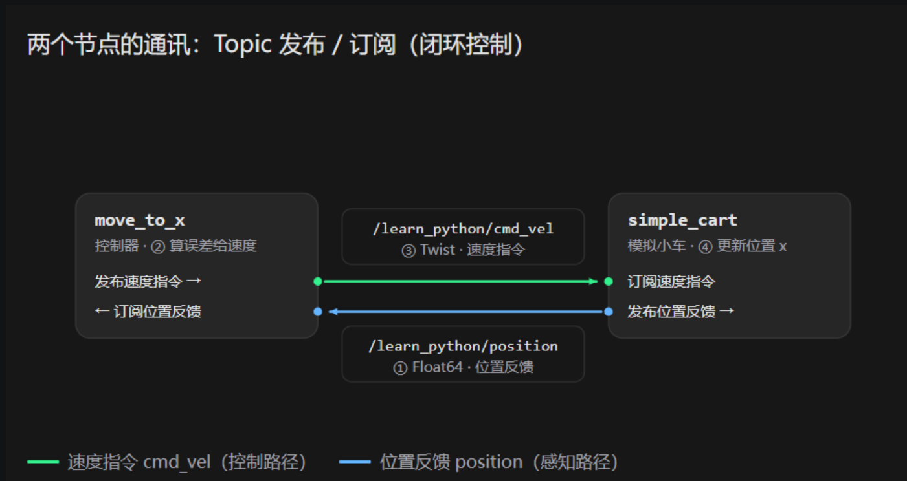

一、初识节点node 话题topic


1.1节点


node节点用来控制机器人 里面就是具体的编程的实现
举例子，node1是一个模拟车的一个点，里面有速度、小车的位置
node2是控制车的节点，里面是控制车的逻辑
两个节点可以进行通信


1.2通信方式Topic


通过订阅的方式来进行通信，一个节点发布pub 另一个节点订阅sub 就能实现二者的通信  


d订阅和回调的关系：

注意 传的是数据的复印件，不是变量本身 。发布时，ROS 把消息里的值序列化后发出去，订阅方收到的是一份 新拷贝 mak
如图所示：



1.3 ROS2类型
速度控制指令的类型叫做Twice

---

二、答疑笔记（问 AI 的问题）


2.1 两条 source 命令的区别 & 报错原因

> 疑问：source /opt/ros/jazzy/setup.bash 和工作空间的 source setup.bash 有啥区别？为什么 source 时报"没有那个文件或目录"？
> 结论：前者加载系统装好的 ROS2（全局）；后者加载自己编译的包。报错因为：① 在 src 子目录里用相对路径找 setup.bash，那里没有；② 还没 colcon build，install/ 不存在。

通俗解释：
- 系统的 setup.bash = 官方公共工具箱（ros2 命令、rclpy、Nav2 消息类型），装 ROS2 就有，每个终端先 source 它。
- 工作空间的 install/setup.bash = 把自己编译的包（nav_action_demo）拿在手上。这文件是 colcon build 之后才生成的，不是源码自带。
- 顺序：先 source 系统 → 再 source 工作空间（后者叠加，重名时自己的优先）。

正确顺序（第二课）：
```
source /opt/ros/jazzy/setup.bash
cd ~/ros2_python_lesson2_ws
colcon build --symlink-install
source install/setup.bash
ros2 run nav_action_demo go_to_point
```

顺手修的坑：外层 setup.py 的 console_scripts 是空的（入口错放在包内多余 setup.py 里），已把 `go_to_point = nav_action_demo.nav_client:main` 加进外层，多余文件改名 setup.py.bak，原文件备份 setup.py.orig。

关键点：
- install/setup.bash 是 build 产物，不是源码，没 build 就没有。
- source 相对路径只在当前目录找，用全路径或先 cd 到根目录。
- 每个新终端都要重新 source，只对当前终端生效。
- 流程图（已生成）：images/1笔记/q1_source两条命令.png、q1_正确操作顺序.png


2.2 source /opt/ros/jazzy/setup.bash 这一步的作用

> 结论：把 ROS2 工具箱当场摆到当前终端，让你能用 ros2 命令。

它干了四件事：
1. 把命令加进 PATH → 才能敲 ros2、colcon。
2. 设置环境变量 → ROS_DISTRO=jazzy、ROS_VERSION=2 等，程序靠这些判断环境。
3. 让 Python 能 import rclpy 等库。
4. 配置底层 DDS 通信默认值。

为什么用 source 而不是 ./setup.bash：
source 在当前终端窗口执行，改的是这个窗口的环境；./setup.bash 会开子进程跑，跑完窗口一关变量全没了，等于白跑。必须 source。

为什么每个新终端都要来一次：
环境变量不跨窗口保留，关掉或新开就清空了。所以每开终端第一件事就是 source 系统的。

它和工作空间 install/setup.bash 的关系：
- 系统的 = 公共基础（ROS2 本体）
- 工作空间的 = 在基础上叠加你 build 出来的包
- 工作空间的必须 build 之后才有
顺序：先 source 系统 → 再 build → 再 source 工作空间。


2.3 export ROS_DOMAIN_ID=0 与 export FASTDDS_BUILTIN_TRANSPORTS=UDPv4 是干嘛的

> 结论：前者决定"跟谁聊"（频道隔离），后者决定"走哪条路"（强制 UDP，避开虚拟机里不靠谱的共享内存）。两者都只对当前终端生效。

ROS_DOMAIN_ID（频道号）：
- ROS2 靠 DDS 通信，Domain ID 像收音机频段：同一 ID 的节点才能互相发现/通信，不同 ID 互相看不见。
- 默认就是 0，写 =0 等于用默认（可省）。多套 ROS2 在同一局域网时，给每台设不同 ID 防止串台干扰。

FASTDDS_BUILTIN_TRANSPORTS=UDPv4（强制传输方式）：
- Fast DDS 是 ROS2 默认中间件，默认会同时试共享内存(SHM，进程间最快)+UDP 等多种传输。
- 项目跑在虚拟机+无界面(headless)里，SHM 通道常不通/不可靠，优先走 SHM 会卡住或节点互找不到。
- 设成 UDPv4 = 只走 UDP 网络(IPv4)，关掉 SHM，通信稳定。所以 run_all.sh / replay_tour.sh 都写了这行。


2.4 go_to_point 是什么 & 运行命令逐段拆解（第二课第7步）

> 结论：go_to_point 不是 ROS2/Nav2 自带命令，而是自己写的导航客户端在 setup.py 登记的"启动名"；整条命令=启动该客户端并传目的地参数。

go_to_point 是什么：
- setup.py 里 'go_to_point = nav_action_demo.nav_client:main' → 运行 go_to_point 就执行 nav_client.py 的 main()。
- 它是"乘客"程序（Action 客户端），只给 Nav2(司机)下达"去某坐标"任务并收结果，自己不算速度、不发布 /cmd_vel；真正开车的是 Nav2 + Gazebo。

命令逐段（ros2 run nav_action_demo go_to_point --ros-args -p use_sim_time:=true -p x:=0.0 -p y:=-3.0 -p yaw:=0.0）：
- ros2 run <包> <可执行>：启动一个节点。nav_action_demo=包名，go_to_point=你的可执行名。
- \ = Linux 续行符，长命令拆多行。
- --ros-args：后面都是传给节点的参数（不是给 ros2 run 本身的）。
- -p 名:=值：给节点设参数(parameter)。
- use_sim_time:=true：用 Gazebo 仿真时钟(/clock)，否则时间对不上出 bug。
- x:=0.0 / y:=-3.0：目的地 map 坐标系坐标 (0,-3)。yaw:=0.0：到达后朝向(0=朝地图+x方向)。

参数来源 & 默认值（代码 __init__）：
- declare_parameter('x',0.0)/('y',-3.0)/('yaw',0.0)/('cancel_after',0.0)
- 默认值正好就是 (0,-3,0)，所以不加 -p 直接跑效果一样；显式写出是为好看、好改目的地。

代码整体流程：1.等 Nav2 导航服务上线 → 2.填任务单(目的地+朝向,map坐标系) → 3.发给 Nav2 等"接受"(GOAL_ACCEPTED≠到达) → 4.收途中反馈(剩多少米)+等最终结果(成功/取消/失败) → 5.可选 cancel_after 秒后申请取消。

2.5 这节课干嘛用？客户端是节点吗？它怎么控制 Nav2/Gazebo？

> 结论：第二课=亲手写个"派活程序"(导航 Action 客户端)，体验让项目里小车去一个目的地；这个客户端本身就是一个 ROS2 节点，但**只发"目的地指令"**，真正开车的是 Nav2+Gazebo，客户端不直接控制它们。

这节课干嘛用：
- 写的是"客户端/乘客"，对方是项目里现成的 Nav2 导航系统(司机)。
- 程序只干两件事：把"目的地(坐标+朝向)"交给 Nav2；盯着它回报"还剩多少米/到了没/取消了没"。
- 控制的是小车实际运动(Gazebo 仿真小车)，不是只控制可视化；RViz 只是"看"运动，让车动的是底层。
- 与第一课对比：第一课自己发速度(当司机决定怎么走)；第二课把"怎么走"交给 Nav2，自己只说"去哪"——两种典型控制层级。

客户端是节点吗？——是的：
- ros2 run nav_action_demo go_to_point 跑起来就是一个节点，节点名 learning_navigation_client(代码 __init__ 里写死)。
- 与 Nav2 的 amcl/map_server 等节点平级，都是独立进程；分工不同：Nav2 是"导航服务端"(接单干活)，客户端是"导航客户端"(派活+收结果)。

怎么"控制" Nav2/Gazebo？——准确说你的代码不直接控制：
- 控制链：客户端 ──(Action：去某地)──▶ Nav2(规划路线+算速度→/cmd_vel) ──▶ ros_gz_bridge 桥接 ──▶ Gazebo 差速插件 ──▶ 小车动。
- 客户端只发目的地 send_goal，不直接发速度、不直接碰 Gazebo；让车动的是 Nav2 算出的 /cmd_vel → 桥接 → 插件。
- 客户端与 Gazebo 之间隔了一整个 Nav2，这就是"解耦"：只管目标，底层交给专业模块。
- 记死：本课客户端不发布速度(教程也强调)。

**⚠️ 常见误会澄清（用户确认）**：客户端只"定目标 + 收结果 + 可选取消"，**不负责导航安排**（路径规划、算速度都是 Nav2 的活）。别把"派单监工"说成"干活的"。一句话：客户端 = 提需求/定目标/盯进度；Nav2 = 怎么走；Gazebo = 车怎么动。

2.6 第三课 Service 教程的实现（代码到底怎么跑起来的）

> 结论：这份 `03_Service服务_查询小车状态.md` 是一份"照着敲"的练习教程——代码本写在文档里，但之前你虚拟机里**没建**。已帮你建好并跑通：包 `lesson_service_demo`（在 `~/ros2_lesson3_ws`），构建通过，实测客户端问一次、服务端答一次，返回 `x=1.0, state=ARRIVED`。

Service 是啥（一句话）：**一问一答**。像"查快递"——你问一次、它答一次、答完结束。和 Topic（一直广播，如车速）、Action（派活盯进度，如去某地）是 ROS 通信三兄弟。本课就是"问小车当前状态"。

教程里两个角色（都已实现）：
- `status_server.py`（服务端）：自己内部用定时器模拟一辆小车位置（从 0 米以 0.1 米/秒长到 1 米停）；对外开一个服务 `/lesson3/get_status`。收到请求 → 把 `{x, state}` 塞进 JSON 字符串填进 `response.message` → 返回。
- `status_client.py`（客户端）：启动就连服务，`call_async` 发一个空请求，`spin_until_future_complete` 等答复（最多 5 秒），打印 `x` 和 `state`，然后**自己退出**（查一次就走，不会一直占着）。

关键点（易混）：
- 服务端/客户端"服务名 `/lesson3/get_status` + 类型 `Trigger` + 域 `ROS_DOMAIN_ID=90`"**必须一致**，否则客户端 `wait_for_service` 超时报 `SERVER_NOT_READY`。
- `on_request(request, response)` 是**回调**：ROS2 收到请求时自动调用你，你只管填 `response` 并返回，不用自己循环等。
- `create_timer(0.1, update_cart)` 让小车位置**持续自己更新**，跟"有没有人查"无关——这正是课程强调的：服务端**不会主动推**结果给你，得你问它才答。
- JSON 只是塞进 `message` 字符串的数据格式，ROS2 服务机制本身不要求用 JSON。
- 项目实战对应（教程第 8 节）：Nav2 的**生命周期查询/状态转换用 Service**；去展点耗时、要反馈和取消 → 用 Action；雷达/位置/速度持续传输 → 用 Topic。


2.7 Action 到底是什么 & 我的项目里怎么用（第二课深入）

> 疑问：Action 到底是啥？我项目里哪儿用了？为什么导航要用 Action 不用 Topic/Service？
> 结论：Action = 耗时任务的"派单全流程"——下单 → 接单 → 途中报进度 → 交付结果，中途还能申请取消。我项目里的 `tour_node.py` 就是 Nav2 的 Action 客户端。
> 完整教程（带图、逐行拆解、实测日志）已单独写：`D:\3study\学习笔记\StudyOfWork\50机器人项目\1学习笔记\02A_Action深入_原理与项目落地.md`

通俗解释：
- 三兄弟怎么选：Topic = 广播电台（一直发，不管谁听，如 `/cmd_vel`）；Service = 查快递（问一次答一次就结束，如查小车状态）；Action = 叫外卖/打车（下单、接单、报进度、送达，可取消，如导航去展点）。
- 判断口诀：**耗时 + 途中要看进度 + 可能要取消 → 用 Action**。
- Action 由三段组成：`goal` 任务单（我要去哪）/ `result` 最终交付物 / `feedback` 途中播报。**feedback 只说明"还在跑"，只有 result 的 status 才算数。**

必须记死的三条：
- **"接受"和"完成"是两次不同答复**：`GOAL_ACCEPTED` ≠ 到达。状态码见 `action_msgs/msg/GoalStatus`：4=SUCCEEDED、5=CANCELED、6=ABORTED。
- **拒单和失败不一样**：拒单 = 没开始（客户端拿到 `accepted=False`）；失败 = 接了单没干成（status=6 + 错误码）。
- **底层不是新通信**：Action = 3 个隐藏服务（`/_action/send_goal`、`cancel_goal`、`get_result`）+ 2 个隐藏话题（`feedback`、`status`）。`ros2 topic list` 里查不到 `/navigate_to_pose`，它不是话题。

我项目里的位置（`tour_guide_ws/src/tour_guide/tour_guide/tour_node.py`）：
- 第 76 行建客户端 `ActionClient(self, NavigateToPose, "/navigate_to_pose")`（只是建电话机，没拨号，真正连接在 INIT 状态的 `wait_for_server`）。
- 第 121–132 行把 `tour_points.yaml` 里的展点坐标填成 `PoseStamped`（frame_id=map，yaw 要转成四元数 z=sin(yaw/2)、w=cos(yaw/2)）。
- 第 209–222 行发目标（`send_goal_async`）；第 178–186 行处理"接不接"；第 174–176 行处理"进度"（**里面是 `pass`，故意留空的**）；第 188–207 行处理最终结果 → 驱动状态机（成功进 GUIDE、失败跳 NEXT）；第 224–229 行取消（要用存下来的 `goal_handle`）。
- 目的地全在 `config/tour_points.yaml`（5 个展点），**改目的地不用改代码重编译**，改配置重启节点即可。

教学版和项目版最大的差别（工程重点）：
- 教学版 `nav_client.py` 用 `spin_until_future_complete` **阻塞等**，一行一句好懂；
- 项目版全用 `add_done_callback` **回调**，因为 `tour_node.py` 第 79 行有个 5Hz 主循环 `create_timer(0.2, self._loop)`。**要是阻塞等导航（一趟几十秒），这几十秒里暂停指令、播报、迎宾全都收不到——功能会坏，不只是不优雅。**

实测（2026-10-13 虚拟机实跑，编号 89）：
- 正常：`WAIT_SERVER → SEND_GOAL → GOAL_ACCEPTED → FEEDBACK 2.00m/1.00m → SUCCEEDED`
- 取消：`GOAL_ACCEPTED → CANCEL_REQUESTED → CANCEL_ACCEPTED → CANCELED`（取消是"申请"，不是命令）
- 拒单：`x=99.0 → GOAL_REJECTED`（退出码 1）
- 失败：`x=-99.0 → GOAL_ACCEPTED → FAILED: status=6, error_code=999`
- 命令行也能发：`ros2 action send_goal /navigate_to_pose nav2_msgs/action/NavigateToPose '{pose: {header: {frame_id: map}, pose: {position: {x: 0.0, y: -3.0, z: 0.0}}}}' --feedback`

坑：`x=99.0 / -99.0` 是教学 mock 服务端里**写死的测试约定**，不是 Nav2 规则，真机上别这么发。


2.8 项目里的英文状态是啥意思 & 我是 AI 生成的项目完全不懂（补课）

> 疑问：NAVIGATE / GUIDE / QA / NEXT 这些英文我都不知道干嘛的；`ros2 interface show nav2_msgs/action/NavigateToPose` 也不知道干嘛的；整个项目是 AI 生成的，我自己一点不懂。
> 结论：**这些英文不是 ROS 专有名词，是作者自己起的变量名**，对应"开过去 / 讲解 / 问答 / 下一个"这几件事，叫什么都行，不用背。
> 补课教程已单独写：`D:\3study\学习笔记\StudyOfWork\50机器人项目\1学习笔记\02B_补课_项目是什么与那些英文状态.md`
> **阅读顺序：先 02B（补课，零基础）→ 再 02A（原理加深）→ 02 原教程（跑终端）。**

一、六个状态 = 六件人话的事（`tour_node.py` 第 26-35 行 `class State`）：
- WAIT_VISITOR = 站在门口等人来
- NAVIGATE = 开过去某个展台（**只有这件要几十秒，所以只有它用 Action**）
- GUIDE = 到了，开口讲解（GUIDE = 讲解，TTS = 文字转语音）
- QA = Question & Answer 问答，等客人提问
- NEXT = 展台编号 +1，换下一个
- FINISH = 5 个都逛完，说结束语 → 回到等人
- INIT = 开机等导航系统上班；IDLE = 待命；PAUSED = 暂停

二、`ros2 XXX` 是什么（命令行工具，像 ls / cd 一样，用来查看和操作 ROS）：
- `ros2 node list` = 列出现在有哪些程序在跑（每个名字一个独立小程序）
- `ros2 action list -t` = 列出有哪些 Action；我项目里 3 个，其中 `/navigate_to_pose` 是导航
- `ros2 action info /navigate_to_pose` = **谁在下单**。实测：`Action clients: 1 → /tour_guide_node` ★这就是铁证
- `ros2 node info /tour_guide_node` = 看某程序的输入输出。实测最后一行：`Action Clients: /navigate_to_pose: nav2_msgs/action/NavigateToPose`
- `ros2 interface show <类型>` = **查手册**，打印"这个动作要填哪些表格"。输出被两道 `---` 切成 goal / result / feedback 三段。**不用背，忘了就敲一下，像查字典。**
- `ros2 topic echo <话题>` = 看某个话题上正在流过的数据

三、真实日志逐行翻译（取自 `/tmp/tour_launch.log`，实测）：
- `状态切换: NEXT -> NAVIGATE` → 现在改成"开过去"
- `开始导航到 [2] 科技互动 (4.5, 3.0)` → 往科技互动开（[2] 是第 3 个，从 0 数）
- `导航目标已接受` → **接单了，车一步没动**（别高兴太早）
- `导航到达` → **真到了**；随后 `NAVIGATE -> GUIDE` 开始讲解
- `[TTS] ...` → 喇叭在念这句话
- `模拟语音输入: xxx` → **不是真人说话**，是无麦克风环境下的模拟提问
- `[qa_node] Q: ... -> A: ...` → 按关键词在 qa_rules.yaml 里查到答案
- `NEXT -> FINISH` → 5 个展台跑完，说结束语，回 WAIT_VISITOR
- 手动 `停止` → `收到指令: stop` → `WAIT_VISITOR -> IDLE`

四、我的角色边界（面试关键）：
- 我只做**业务层**：说去哪、到了讲什么、下一步走哪。
- 怎么去、怎么避障、速度多少 = **Nav2 做的**（别人写好的成熟导航系统）。我的代码没算过一次速度。
- **不能夸大**：没做 SLAM（地图是程序按几何生成的）、没做真实语音识别（随机模拟）、没做视觉（摄像头被注释禁用）、没测过定位精度。以上都不能顺着面试官话头承认。

五、第一步动手练习（最安全）：
- `nano ~/tour_guide_ws/src/tour_guide/config/tour_points.yaml` → 改"接待台"的 `speech` 引号里的字 → 存 → 重跑一轮听声音变没变。
- 意义：亲手体会"配置 vs 代码"的区别（改文字不用改代码不用编译），面试常问这个。


2.9 确认：那六个英文就是状态机的状态吗？& 迷你版动手体验

> 疑问：WAIT_VISITOR / NAVIGATE / GUIDE / QA / NEXT / FINISH 这六个是状态机的状态吗？
> 结论：**对，完全正确。这六个就是状态机的状态，而且是项目里唯一那台状态机的主干。**
> 体验教程：`50机器人项目\1学习笔记\02C_迷你版_动手跑一遍就懂了.md`

一、什么是状态机（一句话）：**状态机 = "我现在处于哪个阶段" + "什么条件下跳到下一个阶段"。**
- 生活类比：洗衣机（待机→进水→洗涤→漂洗→脱水→完成），每个状态干固定的事，条件到了跳下一个。机器人一模一样。
- 代码证据：`tour_node.py` **第 5-6 行作者自己写的注释**就写着 "状态机：INIT -> IDLE -> WAIT_VISITOR -> NAVIGATE -> GUIDE -> QA -> NEXT -> FINISH -> IDLE/LOOP"。
- 第 26-35 行 `class State(IntEnum)` 共 9 个：INIT=0, IDLE=1, WAIT_VISITOR=2, NAVIGATE=3, GUIDE=4, QA=5, NEXT=6, FINISH=7, PAUSED=8。

二、"跳转"这个动作是谁做的：**`_change_state()` 函数（第 111 行定义），全文件被调用 20 次——每次都是一次跳转。**
关键几个：
- 第 200 行 `_change_state(State.GUIDE)` → 导航到了 → 跳去讲解
- 第 207 行 `_change_state(State.NEXT)` → 导航失败 → 跳过该点
- 第 267 行 `_change_state(State.QA)` → 讲解时间到 → 跳去问答
- 第 299 行 `_change_state(State.NAVIGATE)` → 还有展台 → 跳回开过去
- 第 311 行 `_change_state(State.WAIT_VISITOR)` → 一轮结束 → 跳回等人
**所谓"状态机"，就是这 20 行 `_change_state(...)` 连起来的一张网。**

三、项目里其实有**两层**状态机（面试易被绕）：
- **业务状态机**（这六个）＝ 决定"现在该讲解还是该开车"，**是我们自己写的 Python**；
- **Nav2 的行为树**（bt_navigator）＝ 决定"这一单导航内部怎么规划、失败怎么重试"，**是 Nav2 自己的**。
- 被问"状态机是自己写的还是用了框架"→ 答：业务层是自己写的 Python 状态机；导航内部执行流程是 Nav2 的行为树，不是我写的。

四、迷你版动手体验（`~/mini_tour/`，143 行，已实测跑通）：
- 两个文件：`mini_tour.py`（导览机器人/状态机）+ `fake_nav.py`（假导航，假装开 4 秒）。
- 两条命令：终端A `bash ~/mini_tour/run.sh`（假导航）→ 终端B `bash ~/mini_tour/demo.sh`（导览）。
- **逻辑和真项目 100% 一样**（同样 6 个状态、同样 5 个展点坐标），但**不用 Gazebo、不用编译**。
- 实测输出顺序：`[等人] 等待客人到来... → [等人] 客人来了！ → [导航] 目标已发出 → [导航] 接单了...（注意：车还没动）→ [导航] 已到达！ → [讲解] → [问答] → 下一个 → ... → 导览结束`。
- **屏幕上能亲眼看到 `接单了` 和 `已到达` 之间隔了 4 秒**——这就是"接受 ≠ 到达"。
- 四个改着玩的实验：改 `range(4)` 让车开慢点；改讲解词；在 `POINTS` 加一个展点；把 `handle.succeed()` 改成 `handle.abort()` 看它跳过该点。


2.10 Action 的三层概念：工具 / 类型 / 名字（别混）

> 疑问1：节点我知道是"通过编程控制某个东西、能订阅发布"，那 action 也是个文件吗？
> 疑问2：`ActionClient(self, NavigateToPose, '/navigate_to_pose')` 里的 NavigateToPose 是一种 action 类型？还是所有 action 都用这个类型？
> 疑问3：`ros2 list` 怎么知道它是 node 还是 action？

一、**Action 不是文件，是"接口约定"**。`.action` 文件（如 `NavigateToPose.action`）只是一张**格式说明书**，ROS2 安装包里早就编译好了，从头到尾不用碰、也碰不到。
- 类比：`int` 不是文件，但它规定了"整数怎么存"；用 `int` 时从不问它在哪个文件。

二、**`ActionClient(节点, 类型, 名字)` 一行里有三样东西，必须分清**：

| 位置 | 值 | 层级 | 类比 |
|---|---|---|---|
| 工具 | `ActionClient` | ROS2 自带的类，用来"建客户端" | 电话机 |
| 类型 | `NavigateToPose` | 规定消息长什么样 | 通话用什么语言 |
| 名字 | `/navigate_to_pose` | 市场里挂的招牌 | 电话号码 |

- **`NavigateToPose` 是"导航到点"这**一种**类型，不是所有 Action 都叫它。** Action 类型有几十上百种：`NavigateThroughPoses`（走多个途经点）、`FollowWaypoints`（巡一圈路点）、`Spin`（原地转）、`DockRobot`（回充电桩）、`Fibonacci`（官方教程演示用）。
- 换类型只换中间那个：`ActionClient(self, Spin, '/spin')` —— 工具和名字的写法不变。
- 完整身份是 `nav2_msgs/action/NavigateToPose`：`包名/类别/接口名`。住在 `action/` 文件夹 → 它是 Action 类型，不是 msg 也不是 srv。

三、**"`ros2 list` 怎么分辨 node 和 action"——题目前提就错了，没有 `ros2 list` 这个命令。** 是四个分开的命令：

```
ros2 node list      → 查节点表
ros2 action list    → 查 Action 表
ros2 topic list     → 查话题表
ros2 service list   → 查服务表
```

- 不是"一个命令自动分辨"，而是**你敲哪个命令，它就翻哪本册子**。ROS2 内部**分开记账**：节点注册进"节点表"，Action 注册进"Action 表"。像学校有"学生名册"和"教师名册"，两本册子，问哪本答哪本。
- 实测铁证（迷你版域名 77）：
  - `ros2 node list` → 只有 `/fake_nav`、`/mini_tour`，**查不到 `/navigate_to_pose`**；
  - `ros2 action list` → 只有 `/navigate_to_pose [nav2_msgs/action/NavigateToPose]`，**查不到 `/fake_nav`**。
- 同一个东西两个角度查（都能查到，但表格不同）：
  - 从 Action 看 `ros2 action info /navigate_to_pose` → `Action servers: /fake_nav`（谁提供它）；
  - 从节点看 `ros2 node info /fake_nav` → `Action Servers: /navigate_to_pose`（它提供了什么）。
- **一句话**：节点 = 干活的"人"（登记在节点表）；Action = 人开的"窗口"（登记在 Action 表）。人可以有多个窗口，窗口也能换人开，所以两本册子必须分开记。

四、**`/navigate_to_pose` 是接口名（窗口招牌），不是节点。** 真正的提供者节点叫 `bt_navigator`；迷你版用 `fake_nav` 冒充它，但**窗口名一个字没改**，所以客户端代码不用动 —— 这就是"解耦"。


2.11 `.action` 文件到底是什么样（附真文件）

> 疑问：`.action` 文件就是 `navigate_to_pose.action` 呗？里面就是固定的三个内容：开始 / 干完 / 途中报什么，这样一个模板？
> 结论：**结构理解正确，两个词要纠正。**

一、纠正两点：
- **文件名是 `NavigateToPose.action`（大驼峰），不是 `navigate_to_pose.action`（小写下划线）。** 类型用大驼峰，运行时招牌用下划线。同 Python 里 `class NavigateToPose` vs 变量 `self.nav`。
- **是"三段"不是"三个内容"**，三段有名字：`goal`（要干什么）→ `result`（干完的结果）→ `feedback`（途中不断报）。

二、真文件长这样（虚拟机 `/opt/ros/jazzy/share/nav2_msgs/action/NavigateToPose.action`）：

```
#goal definition
geometry_msgs/PoseStamped pose
string behavior_tree
---
#result definition
uint16 error_code
string error_msg
---
#feedback definition
geometry_msgs/PoseStamped current_pose
builtin_interfaces/Duration navigation_time
builtin_interfaces/Duration estimated_time_remaining
int16 number_of_recoveries
float32 distance_remaining
```

- `---` 是分界线：切一刀 = goal/result 两段；切两刀 = goal/result/feedback 三段。
- `#` 开头是注释（给人看）；`uint16` / `geometry_msgs/PoseStamped` 才是真字段（给机器看）。

三、对比 `Spin.action` 就知道"模板固定、内容各自定义"：

```
#goal definition
float32 target_yaw                ← 转多少度（和 NavigateToPose 完全不同）
---
#result definition
uint16 UNKNOWN=700 / TIMEOUT=701  ← 错误码表，比上面详细
uint16 error_code
string error_msg
---
#feedback definition
float32 angular_distance_traveled ← 已转过多少度
```

四、**精确结论**：三段结构（goal → 途中报 → 结果）是固定的；**每段里装什么，由每个 Action 自己定义**。像"信件格式固定：收件人/正文/签名"，格式一样但每封信内容不同。
- **字段顺序即消息顺序**，客户端按序打包、服务端按序解包，写错顺序直接报错。

五、顺带学会：**`ros2 interface show nav2_msgs/action/NavigateToPose` 干的就是把这个文件排版打印出来**——之前觉得神秘的命令，输出的就是上面这些内容。


2.12 接口文件里的"类型 vs 变量名"，以及"只有 .action 是文件"

> 疑问1：`geometry_msgs/PoseStamped pose` 这是节点？还是啥？`int16 number_of_recoveries` 是定义变量吧？
> 疑问2：`/navigate_to_pose` 不也是 action 文件吗？

一、**接口文件里只有两类东西：类型 + 变量名。**

```
int16                number_of_recoveries
 ↑类型                  ↑变量名
```
跟 Python / C++ 一模一样：`int count = 5;` → `int16 number_of_recoveries;`。**猜的"这就是定义变量"完全正确。**

二、**带斜杠的也是"类型"，不是节点。** 拆开看：
```
geometry_msgs / PoseStamped      pose
   ↑包名          ↑类型名          ↑变量名
```
- `geometry_msgs` 是 **ROS 官方包**（和 `nav2_msgs` 同级），不是你的代码。
- 判断"是你的还是 ROS 的"最快方法：**路径在 `~/xxx_ws/src/` 下是你的；在 `/opt/ros/` 下是 ROS 自带的。**
- 为什么内置类型（int16/float32/string/bool）不用报包名，而 `PoseStamped` 要？**内置类型 ROS 自带不用报包名；自定义类型必须报包名，告诉 ROS 去哪找。**

三、**`PoseStamped` 是套娃类型，扒到底全是数字**（实测 `/opt/ros/jazzy/share/geometry_msgs/msg/`）：
```
PoseStamped
 ├── std_msgs/Header header          （时间戳、坐标系名）
 └── Pose pose
      ├── Point position   → float64 x / y / z
      └── Quaternion orientation → float64 x / y / z / w
```
**全是 float64，没有一行逻辑。** 这就是"它只是个类型"的最终证据。

四、**关键纠错：接口文件里"写了这些变量"根本不能执行操作。**
- `.action` / `.msg` / `.srv` 只规定"数据长什么样"；**真正干活的永远是节点的代码**（`bt_navigator` 里 Nav2 团队写的几千行算法）。
- 类比：**外卖单 vs 后厨**。你填单（写 goal）不等于做菜，做菜是后厨（`bt_navigator`）的事。你项目 330 行代码干的全部工作就是"下单"。

五、**关键纠错：`/navigate_to_pose` 不是文件。**
- 磁盘上没有这个名字的文件（`find` 不到）；`NavigateToPose.action` 才是真文件。
- `find /opt/ros/jazzy -name 'NavigateToPose.action'` → 有；`find / -name 'navigate_to_pose'` → 无。
- 三个东西三个性质：

| 东西 | 是文件吗 | 存在哪 | 类比 |
|---|---|---|---|
| `NavigateToPose.action` | ✅ 是文件 | 磁盘 `/opt/ros/.../action/` | 表格样式说明书 |
| `/navigate_to_pose` | ❌ 不是文件 | 运行时内存里的**名字注册表** | 收货地址 / 招牌 |
| `bt_navigator` | ❌ 不是文件 | 运行时**节点表** | 收件人（那个"人"） |

- **只有 `.action` 是文件；类型、名字、节点都不是文件。**（节点也不是文件，是跑起来的进程；`tour_node.py` 是文件，`/tour_guide_node` 是它跑起来的进程。）


2.13 `/navigate_to_pose` 是怎么跟节点绑定的（顺序千万别记反）

> 疑问：`ActionServer(self, NavigateToPose, "/navigate_to_pose", cb)` 这一行是不是**生成**了 `navigate_to_pose.action` 文件？`/navigate_to_pose` 怎么跟节点绑定？
> 结论：**顺序反了——文件不是你的代码生成的，你的代码是"使用方"。**

一、真实顺序（**背这一条**）：
```
1. ROS 官方/厂商 提供 .action 文件（说明书，静态，磁盘上，早就存在）
        ↓ 编译
2. Python 里得到 NavigateToPose 这个类（类型，import 就能用）
        ↓ 服务端节点里写 ActionServer(self, NavigateToPose, "/navigate_to_pose", cb)
3. 运行时注册表记下一笔："/navigate_to_pose" → 我是 fake_nav
        ↓ 客户端写 ActionClient(self, NavigateToPose, "/navigate_to_pose").send_goal(...)
4. ROS2 查表把 goal 递给 fake_nav 的 _execute_cb 回调
        ↓ 回调里的代码（别人的、写好的算法）开始跑
5. 机器人真的动
```
**只有第 1 步是文件，剩下全是运行时的东西。** 就像写 `int x = 5;` 不会"生成" `int`——`int` 早就在了。

二、**`ActionServer(...)` 那一行的作用**：
```python
self._server = ActionServer(
    self,                  # ① 挂到"我自己"身上  ← 绑定动作就在这
    NavigateToPose,        # ② 用这种类型收发
    "/navigate_to_pose",   # ③ 对外挂出这个名字
    self._execute_cb)      # ④ 收到 goal 后回调这个函数
```
- 意思是：**"我是 fake_nav 节点，我在 `/navigate_to_pose` 这个名字上开了一个窗口。"**
- ROS2 内部注册表记一笔：`/navigate_to_pose → 服务端=fake_nav → 类型=NavigateToPose`。
- **绑定的是"名字 ↔ 节点（self）"，不是"文件 ↔ 节点"。**

三、**客户端怎么找到的**：`ActionClient(self, NavigateToPose, "/navigate_to_pose")` → 发 goal 时 ROS2 查注册表 → `/navigate_to_pose` 背后是 `fake_nav` → 递过去。**客户端从头到尾不知道背后是 `fake_nav` 还是 `bt_navigator`，这就是解耦。**

四、**为什么叫"运行时名字"**：代码里从没写过要把这个字符串存到哪——**因为根本不存**，只在内存注册表活着；节点一死记录消失，重启重新登记。所以能"换人"：`bt_navigator` 挂它是真导航，`fake_nav` 挂同一个名字就是假导航。

五、**三处误解速查表**：

| 错误理解 | 正确 |
|---|---|
| ❌ 用 `NavigateToPose` 生成了 `.action` 文件 | 文件**本来就存在**（ROS 自带），你只是 import 用 |
| ❌ `.action` 里写了变量所以**能执行操作** | 文件只管数据格式，**执行靠节点代码**（bt_navigator） |
| ❌ `/navigate_to_pose` 是文件、和 `.action` 一回事 | 它是**运行时名字**（不是文件），由 `ActionServer` 挂出并绑到节点 |

六、面试话术：
- **Q：Action 服务端和客户端怎么连上的？** → "服务端用 `ActionServer` 把名字注册到自己节点上，客户端用 `ActionClient` 按同名字找。绑定靠 ROS2 内部运行时注册表，不是文件层面。**服务端可换（同一名字挂 mock 替换真 Nav2），客户端代码不用改——这就是 Action 解耦的价值。**"
- **Q：接口文件的作用？** → "只定义数据结构，不含逻辑。编译成各语言的消息类供双方按同格式打包解包。**真正执行的是节点代码。**"


2.14 原项目视角：self 就是节点，两边都靠"名字"对上（附 C++ 类比）

> 疑问：`ActionServer(self, ...)` 写在节点里，`self` 就指节点本身，就和 `/navigate_to_pose` 绑定了该节点呗？（要求用原项目讲 + 用 C++ 类比）
> 结论：**完全正确。补充一个原项目的关键事实。**

一、**原项目里根本没有 `ActionServer`！** 实测 `grep -rn 'ActionServer' ~/tour_guide_ws/src/tour_guide/` → **一行都没有**。
- 原项目 5 个节点（`launch/tour_guide.launch.py`）：`tour_guide_node`、`tts_node`、`qa_node`、`visitor_detector`、`voice_input_sim`。
- **这 5 个里没有一个"提供导航服务"。** 项目里只有**一处**用到 Action：`tour_node.py` **第 76 行**。
- `grep -rn 'ActionClient'` 只有一个结果：
```python
self._nav_client = ActionClient(self, NavigateToPose, "/navigate_to_pose")
#                              ↑ 这也是 self = tour_guide_node
```
- **服务端是 Nav2 的 `bt_navigator`，在 `/opt/ros/` 里，不在你项目里。** 项目只当"客户"。

二、**`self` 在两边含义一样：就是"我"。写在谁的代码里，就绑到谁身上。**

| 那一行 | `self` 指谁 | 注册成什么 |
|---|---|---|
| `ActionClient(self, NavigateToPose, "/navigate_to_pose")`（项目 L76） | `tour_guide_node` | 名字的**客户** |
| `ActionServer(self, NavigateToPose, "/navigate_to_pose", cb)`（在 Nav2 里） | `bt_navigator` | 名字的**服务方** |

ROS2 内部注册表：
```
/navigate_to_pose
   ├─ servers: [bt_navigator]      ← Nav2 的 ActionServer 登记
   └─ clients: [tour_guide_node]   ← 项目第 76 行登记
```
**两条独立记录，各自登记，中间靠"名字一样"对上。**

三、**C++ 类比（三个层次，越往下越贴切）**：
1. **`this` ↔ `self`**：`rclcpp_action::create_client<NavigateToPose>(this, "/navigate_to_pose")` 里的 `this`，就是 Python 里的 `self`。
2. **观察者/事件总线模式（最贴切）**：
```cpp
class SensorHub { void start(){ eventBus_->subscribe("temperature", this); } };
class Display   { void init() { eventBus_->subscribe("temperature", this); } };
```
- 两个类**互不认识**（没有 include、没有对方指针），唯一交集是**字符串** `"temperature"`。
- **`eventBus_` 就是 ROS2；`"temperature"` 就是 `/navigate_to_pose`。**
3. **面向接口编程（解耦的本质）**：
```cpp
class INavigator { virtual void goTo(Pose p) = 0; };
class RealNav2 : public INavigator {...};
class FakeNav  : public INavigator {...};
INavigator* nav = getNavigator();  nav->goTo(target);
```
- **`/navigate_to_pose` 这个名字 ≈ C++ 里的接口/虚函数表。** 客户端只依赖接口，不知道背后是 `RealNav2` 还是 `FakeNav`；谁实现接口谁上；**换实现 = 换服务端节点，客户端一行不改**。
- 项目 L76 写 `/navigate_to_pose` 就是面向接口编程。

四、**完整链条（原项目版）**：
```
① tour_node.py:76  ActionClient(self=tour_guide_node, NavigateToPose, "/navigate_to_pose")
        → 登记 [客户 = tour_guide_node]
② ROS2 注册表："/navigate_to_pose" → clients[tour_guide_node] + servers[bt_navigator]
③ Nav2 bt_navigator 启动时 ActionServer(self=bt_navigator, ..., "/navigate_to_pose", cb)
        → 登记 [服务 = bt_navigator]
④ 你的节点 send_goal() → ROS2 查表 → 递给 bt_navigator 的 cb → 规划避障
⑤ 结果回来 → 你的 _goal_result_cb → 状态机跳转
```
**①和③是两个不同进程、两个不同 `self`、两份不同代码，唯一重叠的是那个字符串。**

五、**一句话（背这个）**：**`ActionClient(self,...)` 的 `self` 和 `ActionServer(self,...)` 的 `self` 是两个不同节点的"我"；它们通过同一个名字字符串互相找到——同 C++ 里两个类通过同一个事件名（或同一接口）解耦，中间靠总线（ROS2）牵线。**


2.15 一通到底：导览 ↔ Nav2 是 action 通信（附 topic/service/action 三兄弟 + `.action` 的位置）

> 背景：用户把前面所有疑问串起来复述了一遍——"导览功能和 NAV2 之间是 action 通信；客户端办卡在 tour_guide 节点上；要给 `/navigate_to_pose` 通信；Nav2 那边也是个节点吗？`ActionServer(...)` 写了就注册电话号；然后读配置文件填模版；再拨号。"
> 结论：**逐条核对全对。** 本节补两个缺口。

一、**用户复述的正确版（面试就这么说）**：
> "我的导览节点 `tour_guide_node` 是客户端，启动时办了张电话卡（`ActionClient`），号码是 `/navigate_to_pose`。Nav2 的 `bt_navigator` 节点是服务端，用 `ActionServer` 注册了同一个号码。每次导航时，我的节点从配置文件读坐标，照 `.action` 模板填成一张 goal 单子，`send_goal()` 拨号发出去。`bt_navigator` 接到后内部指挥 Nav2 其他节点规划路线、控制车。到了回一个 result，状态机收到跳到 GUIDE。中途能看 feedback、能 cancel。"

二、**补缺口 1：Nav2 不是一个节点，是一大堆节点。**
| Nav2 里的节点 | 干什么 |
|---|---|
| **`bt_navigator`** | **接电话的那个**（提供 `/navigate_to_pose`） |
| `planner_server` | 规划路径 |
| `controller_server` | 控制车怎么走（发速度） |
| `behavior_server` | 卡住了怎么办（掉头/后退） |
| `map_server` | 提供地图 |
| `amcl` | 定位（我在哪） |

- **只有 `bt_navigator` 接你的电话**，它接完自己内部指挥其他节点。**你只需跟它打交道，剩下的是它的内部事**（封装）。
- 迷你版的 `fake_nav` = 一个人假装整个后厨，所以简单。

三、**补缺口 2：ROS2 三种通信方式，必须能分辨。**
| 通信方式 | 像什么 | 特点 | 用在哪 |
|---|---|---|---|
| **话题 topic** | 广播喇叭 | 一直喊，发了不管回不回 | 传感器数据（雷达、里程计） |
| **服务 service** | 打一次电话问答案 | 一问一答，很快；**办长事会卡住** | 查询、开关 |
| **动作 action** | **叫外卖** | 下单→途中能查进度→送到确认；**能中途取消** | **耗时任务（导航去一个点）** |

- **导航为什么必须用 action**：
  - 用 topic：喊完不知道到没到；
  - 用 service：电话不挂就得干等，**10 分钟啥都干不了**；
  - 用 action：下单立刻挂断（不傻等），途中收进度，到了收结果，还能取消。
  - **这正是本项目需要它的原因**：状态机主循环 5Hz（每 0.2 秒一圈），发完 goal 若傻等整个状态机就死了。

四、**补缺口 3：`.action` 文件在通话过程中"几乎不出现"，它只是图纸。**
- **`.action` 文件 = 外卖单的"印刷模板"**：规定订单栏(goal)/进度栏(feedback)/签收栏(result) 各写什么。
- 它不是单子本身，是"印单子的模板"：
```
.action 文件（模板）
     ↓ 照着印
NavigateToPose.Goal()   ← 你实际填的那张订单
     ↓
send_goal(goal)         ← 送出去
```
- **那张写着"宫保鸡丁"的纸，不是印刷厂的空白模板。** `.action` 不参与通话，只管"单子长什么样"。

五、**全流程分工表**：
| 东西 | 在过程中扮演什么 |
|---|---|
| action 通信 | 整个"打电话"的机制 |
| `/navigate_to_pose` | 电话号码 |
| `ActionClient`/`ActionServer` | 电话卡（两边各一张） |
| `.action` 文件 | **空白外卖单模板（只提供格式，不参与通话）** |
| `goal` | 填好的外卖单（要去的坐标） |
| `feedback` | 骑手在路上的进度 |
| `result` | "已送达" |
| `send_goal()` | 拨号键 |
| `cancel` | 取消订单 |

六、**顺带**：配置文件 → goal 的代码在 `tour_node.py` 第 121–132 行，`x`/`y` 从 `config/tour_points.yaml` 读，不写死在代码里 → **改配置就能改展点位置，不用改代码不用编译**（面试常问）。

七、**一句话总结**：**导览节点是客户端（打电话的），Nav2 的 `bt_navigator` 是服务端（接电话的），号码都是 `/navigate_to_pose`。客户端从配置读坐标、照模板填 goal、`send_goal()` 拨号。Nav2 接单后内部指挥一堆节点干活，干完回 result，状态机跳转。**

八、**记忆锚点**：`topic = 广播喇叭（喊完不管）` / `service = 电话查号（一问一答会卡住）` / `action = 叫外卖（下单·看进度·能取消）`。**导航 = 叫外卖。**


2.16 巩固：六步动画（点外卖全过程）+ 三种通信对比图

> 目的：把 2.14–2.15 的链路用动画+图钉一次。（动画为对话内交互组件，此处留文字版备查。）

一、**六步（点外卖全过程）**：
| 步 | 干什么 | 一句话 |
|---|---|---|
| 1 | 办电话卡 | 两边号码都是 `/navigate_to_pose` |
| 2 | 照模板印订单 | 从配置读坐标填进 goal；`.action` 只是模板 |
| 3 | 拨号 | `send_goal()` 发出去，**发完立刻挂断**，状态机继续跑 5Hz |
| 4 | Nav2 接单 | `bt_navigator` 内部指挥 planner / controller |
| 5 | 途中报进度 | feedback（不能当"到了"的证据） |
| 6 | 到达回结果 | result 回来 → `_change_state(State.GUIDE)` |

二、**三种通信对比（核心表）**：
| 通信 | 像什么 | 特点 | 用在哪 | 导航能用吗 |
|---|---|---|---|---|
| topic | 广播喇叭 | 一直喊，发了不管回不回，不知道谁在听 | 雷达、里程计、摄像头 | ❌ 到没到不知道 |
| service | 电话查号 | 一问一答，很快，**办长事会卡住** | 查询状态、保存地图 | ❌ 干等 10 分钟 |
| **action** | **叫外卖** | 下单立刻挂断、途中看进度、能取消 | 导航到某点、耗时任务 | ✅ **就靠它** |

三、**全套映射（背这段）**：
- 电话号码 = `/navigate_to_pose`；电话卡 = `ActionClient`（你的节点办的）
- 空白外卖单模板 = `.action` 文件（只管格式，不参与通话）
- 填好的订单 = `goal`（坐标从 `tour_points.yaml` 读）
- 拨号键 = `send_goal()`；接单后厨 = Nav2 的 `bt_navigator`
- 骑手报进度 = `feedback`（**不能当"到了"的证据**）；"已送达" = `result`（**只有它让状态机跳 GUIDE**）


2.17 状态机全貌：19 次跳转连成的那张网 + 导航失败跳过展点

> 目的：把简历第 3 条（"用有限状态机串联迎宾、导航、讲解、问答与巡游切换，导航失败时跳过当前展点"）讲透。

一、**一句话**：状态机 = "我现在处在哪一步" + "什么条件下跳到下一步"。类比洗衣机：待机→进水→洗涤→漂洗→脱水→完成，每个状态干固定的事，条件到了才跳。
- 导览状态机是一条**环**：`INIT → WAIT_VISITOR → NAVIGATE → GUIDE → QA → NEXT →（回到 NAVIGATE）→ FINISH →（回到 WAIT_VISITOR）`。
- 状态定义在 `tour_node.py` 第 26-35 行 `class State(IntEnum)`，共 **9 个**：INIT=0, IDLE=1, WAIT_VISITOR=2, NAVIGATE=3, GUIDE=4, QA=5, NEXT=6, FINISH=7, **PAUSED=8**。

二、**核心洞察：跳转有三种"推力"（最值得记的一点）**：
| 类型 | 谁推动 | 例子 |
|---|---|---|
| ① 消息触发 | 收到 Topic / Action 消息 | 收到"客人来了"→跳 NAVIGATE；收到 result→跳 GUIDE |
| ② 时间触发 | 在该状态待够多少秒 | 讲解 3 秒→跳 QA；问答超时 10 秒→跳 NEXT |
| ③ 条件触发 | 主循环每 0.2 秒检查条件 | 还没发目标→发出去；Nav2 是否就绪 |

三、**精确统计**：`grep -c '_change_state'` = **20 行**，其中第 **111 行是函数定义**（`def _change_state`），**实际调用 19 次**。
- `_change_state` 本体只有 9 行（L111-119），干三件事：改 `self._state`、记 `self._entered_state_time`、`_publish_state()` 广播到 `/tour_guide/state`。
- 注意 L112-113：`if self._state == new_state: return` —— **同状态不重复跳**（防止刷屏 / 重复播报）。

四、**19 次跳转分四组（按触发来源）**：

**A. 人工指令 `_cmd_cb`（订阅 `/tour_guide/cmd`）—— 6 次**
| L140 | IDLE + `start` | → WAIT_VISITOR（或 NAVIGATE） |
| L142 | PAUSED + `start`/`resume` | → NAVIGATE |
| L146 | `stop` | → IDLE（并 `_idx=0`） |
| L151 | `pause` | → PAUSED（先 `_cancel_nav()`） |
| L155 | `next`/`跳过` | → NEXT |
| L159 | `home`/`回家` | → NAVIGATE（并 `_idx=0`） |

**B. 迎宾消息 `_visitor_cb` —— 1 次**
| L167 | WAIT_VISITOR + 收到 `visitor_detected` | → NAVIGATE（先播欢迎语） |

**C. 导航结果 `_goal_result_cb` —— 2 次 ★重点**
| L200 | result = `STATUS_SUCCEEDED` | → GUIDE |
| L207 | result = 失败/中止 | → **NEXT（跳过当前展点）** |

**D. 主循环 `_loop`（5Hz，每 0.2 秒）—— 10 次**
| L238 | INIT + Nav2 已连 + `auto_start` | → WAIT_VISITOR/NAVIGATE |
| L241 | INIT + Nav2 已连 + 非 `auto_start` | → IDLE |
| L267 | GUIDE 待够 `guide_pause`（默认 3s） | → QA |
| L281 | QA 收到提问 | → NEXT |
| L285 | QA 待够 `qa_timeout`（默认 10s） | → NEXT |
| L295 | NEXT + 展点走完 + `loop` | → FINISH |
| L297 | NEXT + 展点走完 + 非 `loop` | → FINISH |
| L299 | NEXT + 还有展点 | → **NAVIGATE**（回到开车，这是"环"的关键） |
| L311 | FINISH 待够 5s + `loop_enable` + `auto_start` | → WAIT_VISITOR/NAVIGATE |
| L313 | FINISH 待够 5s + 否则 | → IDLE |

五、**★ 导航失败跳过展点（简历原文那条）**：`_goal_result_cb`（L188-207）是整个状态机**唯一一处异常处理**：
```python
status = future.result().status
if status == GoalStatus.STATUS_SUCCEEDED:      # 成功
    self._change_state(State.GUIDE)            # → 去讲解
elif status == GoalStatus.STATUS_CANCELED:     # 被取消 → 只打日志，不动
    ...
else:                                          # 失败/中止
    self._speak("导航出现异常，我将跳过该展点。")
    self._change_state(State.NEXT)             # → 直接跳下一个
```
- **为什么失败不重试**（面试追问）：① 卡住通常是物理障碍（有人挡路/打滑），重试大概率还失败；② Nav2 的 `behavior_server` 已经在做自救（掉头、后退），**业务层不需要再重试**。
- 三种 result 三种反应：**成功→讲解 / 取消→不管 / 失败→跳过**。

六、**面试话术**："导览主控是一个有限状态机，跑在 5Hz 定时器里（0.2 秒一轮）。状态跳转有三种触发方式：收到消息（迎宾事件、导航结果）、时间到（讲解停留 3 秒、问答超时 10 秒）、主循环条件判断（Nav2 是否就绪、是否已发目标）。导航结果回调里区分成功、取消、失败三种情况，失败时播报后直接跳过当前展点继续巡游，避免一个点失败导致整轮导览中断。"

七、**易被绕的点**：项目里有**两层**状态机——业务状态机（这 9 个状态，自己写的 Python）vs Nav2 行为树（`bt_navigator` 内部的，Nav2 自己的）。被问"状态机是自己写的还是用了框架"→ 答：业务层是自己写的；导航内部执行流程是 Nav2 的行为树，不是我写的。

---

## 2.18 状态机的四个基础问（cmd / 三种 result / 定时器 / "19 次"的含义）

一、**`/tour_guide/cmd` 是什么**：一个**话题名**，`cmd` = command（指令）。它是给**人**用的遥控器频道。
- 订阅方：`tour_node.py:71` `create_subscription(String, "/tour_guide/cmd", self._cmd_cb, 10)`。
- 指令集在 `_cmd_cb`（L135-159）：`start`/`resume`/`继续`、`stop`/`停止`、`pause`/`暂停`、`next`/`跳过`、`home`/`回家`。
- **项目里没有任何节点发布它**（实测 grep 全项目：只有 L71 的订阅、`replay_tour.sh` 里临时建了个 publisher、README 里一条命令行示例）。**由人从终端敲**：
  `ros2 topic pub /tour_guide/cmd std_msgs/msg/String '{data: "start"}' --once`
- **方向对比（重要）**：`/tour_guide/state` 是节点**往外喊**"我在哪一步"（机器人告诉别人）；`/tour_guide/cmd` 是**人往里灌**"你该干什么"（人指挥机器人）。一个往外，一个往里。
- **★ 关键澄清（已在虚拟机上实测）**：**话题不需要"有人发布"才存在**。话题只是**一个频道名（字符串）**；ROS2 判定"它存在"的标准是——**只要至少有一个发布者**或**一个订阅者**在用它。**订阅本身就算"在用"。**
  实测（一个"只订阅、从不发布"的节点，`ROS_DOMAIN_ID=96`）：
  ```
  A) 话题列表里有 /tour_guide/cmd 吗 → 存在          ← 没有任何发布者，它照样在
  B) Publisher count = 0 ; Subscription count = 1   ← 0 个发布者，1 个订阅者
  C) 发一条 'start' → 订阅者立刻收到: start
  ```
  → 所以 `tour_node.py:71` 建了订阅之后，`/tour_guide/cmd` 就"存在"了，**即使全项目没有任何节点发布它**。`ros2 topic list` 能看到它、`ros2 topic info` 会显示 `Publisher count: 0`——这完全正常。
- **`ros2 topic pub` 是什么**：它**不是常驻发布者**，内部等价于「临时建一个节点 + 一个 publisher → 发一条 → 退出」。它是"人"临时伸进 ROS2 的一只手（人不是 ROS2 进程，没法自己 `publish`，所以 ROS2 给了这个命令行工具当手替）。等价 C++/Python：
  ```python
  node = Node('随便一个临时节点')
  pub  = node.create_publisher(String, '/tour_guide/cmd', 10)
  pub.publish(msg)     # 发完就退出
  ```
- **类比**：**微信群**——`tour_node` 进群后静静听着；群里没人说话，群也不会消失；人想说一句就发一条，发完退群（`--once` 就是"发完就退"）。

二、**三种导航 result 的反应**（`_goal_result_cb` L188-207）：

| result 状态 | 谁按的按钮 | 代码里的反应 |
|---|---|---|
| `SUCCEEDED` | 对方成功完成 | → `GUIDE`（业务上就等于"到了"） |
| `CANCELED` | **我方**主动取消 | 只打日志，**什么都不做** |
| 其他（`ABORTED` 等，含 `UNKNOWN`） | **对方**宣告失败 | 播报"我将跳过该展点" + → `NEXT`（跳过**展点**，不是"跳过状态"） |

- **"取消为什么可以什么都不做"**：因为取消是**我们自己按的按钮**。看 `_cmd_cb`：pause 时先 `_cancel_nav()` 再**立刻** `_change_state(PAUSED)`（L150-151）；next 时先 `_cancel_nav()` 再立刻 `_change_state(NEXT)`（L154-155）。**新状态在指令回调里早就跳完了**，结果回到 `_goal_result_cb` 时只需"知道这事结束了"，再做动作反而打架。
- **精读细节**：L199 与 L205 都有 `if self._state == State.NAVIGATE:` 守卫——只有当"当前还在导航状态"时才跳转，防止人在途中 pause（状态已变 PAUSED）后，导航结果回来把状态从 PAUSED 拽走。
- 一句话：**取消=我方放弃（自己知道下一步干嘛）；失败=对方投降（意外，必须处理）。**

三、**定时器 = 闹钟（本课最该懂的一个）**
```python
self._timer = self.create_timer(0.2, self._loop)    # L79
#                            ↑每 0.2 秒  ↑响时执行的函数 → 5Hz
```
- `_loop`（L232-318）只干一件事：**看一眼"我在哪个状态"→ 做那个状态的事 → 立刻 return**。这叫**轮询式状态机**（polling state machine）——不靠"消息来了才动"，而是自己有节奏地定期检查。
- **为什么不能写 `while True: _loop(); sleep(0.2)`**：`rclpy.spin(node)`（L325）是**单线程事件循环**（调度中心），要轮流处理**三类事**：
  ① 定时器响 → `_loop()`；② 订阅消息到达 → `_cmd_cb()`/`_visitor_cb()`/`_question_cb()`；③ Action 回执 → `_goal_response_cb()`/`_goal_result_cb()`。
  **三类事排在同一条队列里**。写成 `while True` 就把调度中心占死了——②③ 永远排不上队：敲指令没反应、迎宾收不到、导航结果处理不了，**机器人等于聋了**。
- C++ 类比：`rclpy.spin()` ≈ `while (rclcpp::ok()) executor.spin_some();`（event loop）；`create_timer(0.2, cb)` ≈ Qt 的 `QTimer::start(200)` + `connect(t, &QTimer::timeout, this, &onLoop)` ≈ 游戏引擎每帧的 `onFrame()`。**`_loop` 就是这台机器人的"每一帧"，帧率 5fps。**
- 正因为是单线程排队，项目里**三处刻意避开阻塞**：`send_goal_async`（L221，发了就走不傻等接单）、`wait_for_server(timeout_sec=0.0)`（L235，问一下没连上就算）、`_feedback_cb` 空 `pass`（L174-176，不处理就不处理）。**主循环每轮只有 0.2 秒预算，谁都不许赖着不走。**

四、**"19 次"到底指什么**（三个数字必须分清）

| 问的是什么 | 数字 | 说明 |
|---|---|---|
| 有几个**状态** | **9 个** | `State` 枚举 L26-35：INIT/IDLE/WAIT_VISITOR/NAVIGATE/GUIDE/QA/NEXT/FINISH/PAUSED |
| 源码里有几处**跳转代码** | **19 处** | `grep -c '_change_state'` = 20 行，减去 L111 的函数定义行 |
| 运行时**实际跳几次** | **无限次** | 循环巡游，每跑完一轮回到开头接着跑 |

- 类比：**状态 = 地图上的城市（9 个）；`_change_state(...)` = 地图上的箭头（19 条）。** 箭头可以重复画：`WAIT_VISITOR→NAVIGATE` 有两条（L140 人工 start、L167 收到迎宾）；`→NEXT` 有四条（L155/L207/L281/L285），来自四个不同起点。
- ⚠️ **面试别说"状态机有 19 个状态"**——会被抓。正确说法："9 个状态（其中 6 个主干业务状态），源码里 19 处状态跳转。"

五、**面试话术**："状态机跑在 5Hz 的定时器里，每 0.2 秒轮询一次当前状态。跳转有三种触发：人工指令（`/tour_guide/cmd` 话题，人从终端发）、消息触发（迎宾事件、导航 result）、主循环条件判断。因为 `rclpy.spin` 是单线程事件循环，所以导航下发用异步 `send_goal_async`，回调里绝不做阻塞操作。"

---

## 2.19 五条人工指令分别有什么作用

`/tour_guide/cmd` 能听懂的 5 条指令（`_cmd_cb` L135-159），每条的实际效果：

| 指令 | 前提（守卫） | 做了什么 | 可见现象 | 播报 |
|---|---|---|---|---|
| `start`/`resume`/`继续` | **只在 IDLE 或 PAUSED 生效** | IDLE→WAIT_VISITOR（或 NAVIGATE）；PAUSED→NAVIGATE | 车开始动 / 从暂停处接着走 | 无 |
| `pause`/`暂停` | **只在 NAVIGATE/GUIDE/QA 生效** | `_cancel_nav()` → PAUSED | 车立刻停下，进度保留在原地 | "导览已暂停，您可以随时发送继续。" |
| `next`/`跳过` | 任何状态 | `_cancel_nav()` → NEXT（`_loop` 的 NEXT 分支里 `_idx += 1`） | 放弃当前目标，直奔下一展区 | 无 |
| `home`/`回家` | 任何状态 | `_cancel_nav()` + `_idx = 0` → NAVIGATE | 调头回第 1 个展点（接待台） | 无 |
| `stop`/`停止` | 任何状态 | `_cancel_nav()` + `_idx = 0` → IDLE | 车停住，本轮作废；**必须重新 start 才会再动** | "导览已停止。" |

要点：
1. **指令有"守卫"（前提条件）**：`pause` 在 IDLE 时发没用；`start` 在 NAVIGATE 时发没用。这体现状态机的严谨——指令不是万能的，要看当前在哪个状态。
2. **要改方向的四条（pause/next/home/stop）第一步都是 `_cancel_nav()`**（L224-229）：`_goal_handle.cancel_goal_async()` 撤掉正在跑的导航任务，再把 `_goal_active`/`_goal_handle` 清空。**不撤的话 Nav2 还在往旧目标开。**
3. **`_idx` 是"当前第几个展点"的游标**：`home` 和 `stop` 都把它清零（所以回第 1 个点）；`next` 不直接改，而是让主循环的 NEXT 分支去 `+1`。
4. **杀伤力三档**：轻（`pause`→可恢复）< 中（`next`/`home` 改路线）< 重（`stop` 整轮作废）。
5. **`stop` 之后进 IDLE，而 IDLE 分支 `_loop` 直接 return（L245-246）**——状态机就停在那儿，不再自己动。
6. **广播同步**：`_change_state` 里会 `_publish_state()` 把新状态发到 `/tour_guide/state`，所以敲完指令可以用 `ros2 topic echo /tour_guide/state` 看变化，日志里也会打"状态切换: XXX -> YYY"。

**为什么留这个接口**：机器人是**无人值守自动巡游**，但真实场景需要人干预——有人挡路/想插话 → `pause`；参观者对某展区没兴趣 → `next`；参观结束要回起点接下一批 → `home`；闭馆 → `stop`。另外演示和调试时不用遥控器也能手动控制（项目 README 4.3 节就是这套用法）。

**面试话术**："导览节点是自动巡游的，但我留了一条 `/tour_guide/cmd` 话题做人工干预接口，支持开始/继续、暂停、跳过当前展点、回起点、停止五条指令。每条指令都有状态守卫，比如暂停只在导航/讲解/问答阶段生效。需要改变行进方向时，第一步都要先 `cancel_goal_async()` 撤掉正在执行的 Nav2 任务，避免车还在往旧目标走。"

---

## 2.20 ★ 易混：这不是「遥控」

**"自动走 + 人干预"这个理解对，但"遥控"这个词用错了——面试会被抓。**

### 两个"人控制"完全是两个层级

| | 遥控（teleop / 遥操作） | 本项目（指令干预） |
|---|---|---|
| 人发什么 | **速度**：`/cmd_vel`（前进 0.3m/s、左转 0.2rad/s…） | **一句话**：`/tour_guide/cmd`（pause / next / home…） |
| 人要不要一直操作 | **要**，松手车就停 | **不要**，说完就走 |
| 谁管"怎么走" | **人** | **机器人**（Nav2 规划 + 避障 + 控速） |
| 人管的层级 | **最底层**（轮子转多快） | **决策层**（去不去、停不停） |
| 专业名词 | teleoperation | **监督式控制（supervisory control）** |

### 项目实测（确认为真）

全项目 grep `teleop|cmd_vel|joy`，`src/` 下只有这些：
- `gz_bridge.yaml` L34-35：把 `cmd_vel` 桥接到 Gazebo（仿真桥，不是遥控器）
- `nav2_params.yaml` L241/250-251：`behavior_plugins` 里列了 Nav2 自带的 `assisted_teleop`（`nav2_behaviors::AssistedTeleop`）——**这是 Nav2 的一个行为插件，被配置进去了，但业务层从没调用它**
- `navigation.launch.py` L56/72：话题重映射 `cmd_vel_in_topic: cmd_vel_nav` / `cmd_vel_out_topic: cmd_vel`

**结论：项目里没有一行自己写的遥控代码。**

### 面试坑（必躲）

❌ 别说"**我做了遥控功能**" → 面试官会立刻追问："那你用什么发 `/cmd_vel`？`teleop_twist_keyboard` 还是自己写的 joy 节点？"——答不上来就露馅。

✅ 正确说法：
> "我留的是**高层指令接口**（`/tour_guide/cmd`），人是做**调度干预**，不是遥操作。速度指令 `/cmd_vel` 由 Nav2 的 `controller_server` 产生，我不碰这一层。**这是监督式控制——人管决策，机器管执行。**"

**被追问 "为什么要这么分层"** → 答：因为直接遥操作要求人全程盯着，展览场景里讲解员要讲解、没法一直操遥控器；给指令的方式人发一句就能走开，**同时保留了随时干预的能力**。

---

## 2.21 Launch 与 YAML：一条命令怎么拉起整套系统

**一、Launch 是什么**：ROS2 的"一键启动脚本"。不写 launch 就要开 6 个终端、还得记启动顺序（Gazebo 先起、Nav2 要等它）。类比：电脑开机本来要依次开显示器/主机/音箱，写个 `.bat` 一键全开——launch 就是这个 `.bat`。

**二、项目是一键启动三层套娃**

| 层 | 文件 | 管什么 |
|---|---|---|
| 0 | `run_demo.sh` / `run_all.sh` | bash 脚本：设环境变量、起 `Xvfb`、等 45 秒 |
| 1 | `tour_guide/demo.launch.py` | **总调度：自己不起任何节点，只 include 三个子 launch** |
| 2 | `diff_drive_robot/robot.launch.py` | 物理世界：Gazebo 世界 + URDF 模型 + `gz_bridge`（**你配置的**） |
| 2 | `diff_drive_robot/navigation.launch.py` | 导航大脑：bt_navigator/planner/controller/amcl/map_server + lifecycle_manager（**你配置的**） |
| 2 | `tour_guide/tour_guide.launch.py` | 业务：5 个节点（**你写的**） |

**三、launch 文件的骨架**

- 每个 launch 文件都必须有 `generate_launch_description()`——它就是 launch 世界的 `main()`，返回一张"要启动什么"的清单。
- `Node()` 五个字段（`tour_guide.launch.py` L18-24）：`package`（哪个包）/ `executable`（跑哪个程序）/ `name`（跑起来叫什么，`ros2 node list` 显示的就是它）/ `output="screen"`（日志打到终端）/ `parameters=[...]`（传给节点的参数）。
- **`executable` 名字的链路**：`tour_node.py` 的 `main()` → `setup.py` 的 `entry_points` 登记 `tour_guide_node = tour_guide.tour_node:main` → `colcon build` 生成同名可执行脚本 → launch 里 `executable="tour_guide_node"`。**`executable`=程序名，`name`=节点名，两者可以不同。**
- 参数机制：`DeclareLaunchArgument`（声明+默认值）配 `LaunchConfiguration`（读值），命令行可覆盖：
  `ros2 launch tour_guide demo.launch.py headless:=true use_fake:=false` （`:=` 是 launch 语法，不是 bash 的 `=`）。
- 每个节点都传了 `use_sim_time: True` —— **"别用电脑的钟，用 Gazebo 的钟"**。仿真可加速减速，用真实时间会导致"讲解 3 秒"对不上。

**四、★ YAML 的两种喂法（必须分清）**

| 方式 | 怎么走 | 项目里的例子 |
|---|---|---|
| A. 走 ROS 参数 | launch 写进 `parameters=[...]` → 节点 `get_parameter()` | `use_fake` / `marker_x` / `distance_threshold` |
| B. 节点自己读文件 | 节点 `open()` + `yaml.safe_load()` | `tour_points.yaml` / `qa_rules.yaml` |

- 方式 B 的实现（`utils.py` 全文 10 行）：`get_package_share_directory(包名)` 定位 → `os.path.join` 拼路径 → `yaml.safe_load` 读成字典。`tour_node.py:43-45` 调它拿到 `points`（5 个展点）。
- **为什么找得到**：`setup.py` 的 `data_files` 里有 `(f'share/{package_name}/config', glob('config/*.yaml'))`，编译时 yaml 被装进包的 share 目录。
- **这就是"改配置不用改代码"的真相**。`--symlink-install` 时是软链接 → **改源码 yaml 立刻生效，连 `colcon build` 都不用**。
- `tour_points.yaml` 配了什么：`tour` 段（`loop` 是否循环 / `auto_start` 开机是否自动巡游 / `wait_for_visitor` **对应 WAIT_VISITOR 状态** / `qa_timeout: 12.0` / `guide_pause: 4.0`）+ 5 个展点，每个点 6 个字段（`name/x/y/yaw/speech/qa_prompt`）。
  → **之前学的状态机行为，全是被这个 YAML 驱动的。**
- `qa_rules.yaml`：`default_answer`（兜底）+ 8 条 `keywords → answer`，**顺序即优先级**。
- 代码里 `self._tour.get("qa_timeout", 10.0)` 的 `10.0` 是**兜底默认值**；YAML 写了 `12.0` 就用 `12.0`（所以"问答超时"实际是 12 秒，不是 10 秒）。

**五、挖到的细节**：`visitor_detector.py` 代码默认 `marker_x=1.5`，但 launch L50-52 传的是 `marker_x=0.0, marker_y=-3.5, distance_threshold=1.5` —— `(0.0, -3.5)` 正好是 `tour_points.yaml` 的**第一个展点"接待台"**。所以"客人到了"的实际判定 = **车有没有走到接待台 1.5 米内**。这就是简历"检测坐标与距离阈值参数化可配"的实现方式。

**六、面试话术**："启动用三层 launch 做分层：顶层 `demo.launch.py` 只做 include，把仿真（Gazebo+URDF）、导航栈（Nav2）、业务层（5 个节点）分开管理，这样可以单独启动某一层做调试。业务层用 `DeclareLaunchArgument` 暴露 `use_fake`/`auto_question` 开关，命令行就能切换仿真触发和摄像头触发，不用改代码。配置分两类：运行参数（迎宾坐标、距离阈值）走 ROS 参数机制从 launch 下发；业务数据（展点坐标、讲解词、问答规则）由节点自己读 YAML，因为 `setup.py` 把 `config/` 装进 share 目录，节点用 `get_package_share_directory` 定位——**加一个展点、改一句讲解词只改 YAML，不用重新编译**。"

- ⚠️ **别夸大**：`robot.launch.py` / `navigation.launch.py` 里的东西（Gazebo、Nav2）不是你写的，说"**配置并集成**"，别说"**实现**"。

**七、一句话**：**Launch = 一键启动脚本（三层套娃：总调度只 include，三层分工拉仿真/导航/业务）；YAML = 不改代码就能改行为的配置（两种喂法：走进 ROS 参数的、节点自己读文件的）。**

---

## 2.22 大白话再讲一遍：launch 是清单、配置是设置（"看不懂了"之后的澄清）

**背景**：用户看完 2.21 说"我看不懂了"，问了三个问题。→ **2.21 讲太细，这轮删掉复杂度重讲。以后讲 launch/配置一律按这套大白话。**

**一、launch = 一张清单，不是流程**

- `tour_guide.launch.py` 全部内容 = **5 行 `Node(...)`，一行起一个程序**。里面**没有任何业务流程**。
- ⚠️ **不是"按顺序执行"**：ROS2 是**一口气全拉起来**（几乎同时），**不会**等前一个跑完。
- **要"等"只能靠外面的 bash**：`run_all.sh` 里 `nohup ros2 launch robot... &` → `sleep 45` → `nohup ros2 launch navigation... &`。Gazebo 要 45 秒才就绪、Nav2 必须等它，**launch 自己做不到"等"**。
- 一句话：**launch = 列要起谁；要不要"等"，是 bash 脚本的事。**

**二、"分层分工" = 把一份长清单拆成几个短清单**

| 文件 | 只管 |
|---|---|
| `robot.launch.py` | 造车和世界 |
| `navigation.launch.py` | Nav2 那一堆 |
| `tour_guide.launch.py` | **你的 5 个业务节点** |
| `demo.launch.py` | **只干一件事：把上面三个都叫上**（自己不起任何程序） |

- 好处只有一个但很实在：**能单独用**（`ros2 launch diff_drive_robot robot.launch.py` 就只看车，不用跑别的）。
- **别把它当高级概念——"分层"就是"拆成几个文件"。**

**三、配置 = 程序的"设置"，节点程序自己读**

- ⚠️ **"运行参数"这种自造抽象词不要再对用户用**（他就是被这个词卡住的）。统一说"程序的设置"。
- `tour_points.yaml` 里每个展点写的就是：`name`（叫什么）、`x`/`y`（在哪）、`speech`（到这儿说什么话）、`qa_prompt`。
- **谁读**：`tour_guide_node` **自己读**（工具是 `utils.py` 的 `load_yaml`）。
- **读来干嘛**：① 该导航 → 取 `x`/`y` 填进 goal 发给 Nav2；② 该讲解 → 取 `speech` 发给 `tts_node` 念。
- **两处写的区别**：launch 里放一两个小开关（`use_fake`）；单独 yaml 放内容多、经常改的（展点坐标、问答规则）。**本质一样，只是放在哪。**
- **配置的意义** = 不改代码，改文件就能改行为。

**四、一句话**：**launch = 列要起谁（不等）；分层 = 拆文件（能单独用）；配置 = 程序的设置（节点自己读，改它不用改代码）。**

---

## 2.23 简历里的 "marker" 是什么（别再被同名概念骗一次）

**结论：项目里的 `marker` 不是 ROS 的 `visualization_msgs/Marker`，就是一个普通变量名，意思是"参观者标记点坐标"。**

### 1. 先排雷：ROS 里另有一个同名的 `Marker`

ROS 里确实有个 `visualization_msgs/Marker`——那是**给 RViz 用的可视化标记**（在三维视图里画个箭头/方块/文字）。很多人一看简历写 "marker" 就想到它。

**但你的项目里没有用它。** 全项目实测：

```
grep -rn 'visualization_msgs|MarkerArray|Marker(' src/  →  零结果
```

**一个字都没有。** 所以面试官若按这个理解追问，你要能立刻纠正。

### 2. 项目里的 marker 到底是什么

`visitor_detector.py` 里一共 4 处用到它，全是"一个坐标点"的意思：

```python
L19-20  self.declare_parameter("marker_x", 1.5)      # 声明：标记点的 x
        self.declare_parameter("marker_y", -3.5)     # 声明：标记点的 y
L25-28  self._marker = (marker_x, marker_y)          # 存成一个元组 (x, y)
L68-73  def _distance_to_marker(self):               # 算"我离这个点多远"
            return math.hypot(x - self._marker[0], y - self._marker[1])
L109-110 d = self._distance_to_marker()
         triggered = d < self._dist_thr              # 小于阈值 = 人到了
```

**没有图片、没有识别、没有检测算法**——就是**两点求距离**（`math.hypot` 就是勾股定理 √(dx²+dy²)）。

### 3. 人话类比

**`marker` = 地上贴的一个记号点。** 想象展厅门口地上贴了个黄色脚印贴纸，车开到离贴纸 1.2 米以内，就认为"客人站在这儿了"。

- `marker_x / marker_y` = 贴纸在哪儿
- `distance_threshold` = 多远算"到了"
- 车自己的位置从 `/odom`（里程计）订阅来

### 4. 为什么这么设计（面试可能追问）

因为**虚拟机/仿真里没有真摄像头、真访客**，作者需要一个**可重复、可脚本化**的触发方式。用"车到某点附近"模拟"人到了"，好处是

- 不依赖任何感知硬件；
- **改 `marker_x/y` 就能模拟"客人在别处"**，方便测试——这就是简历里"**检测坐标与距离阈值参数化可配**"的落点。

### 5. 两个坐标值要注意（易被追问）

| 位置 | marker_x | marker_y |
|---|---|---|
| 代码里的默认值（`visitor_detector.py` L19-20） | 1.5 | -3.5 |
| **launch 里实际传入的**（`tour_guide.launch.py`） | 0.0 | -3.5 |

**运行时以 launch 为准**（launch 参数会覆盖代码默认值）。而 `(0.0, -3.5)` 正好是 `tour_points.yaml` 的第一个展点 **"接待台"**。
→ 所以真实判定是"**车走到接待台 1.5 米内**"，不只是"离某个虚拟点近"。

### 6. 面试话术（约 20 秒）

> "迎宾检测有个 `visitor_detector` 节点，默认是 fake 模式：把参观者标记点坐标 `(marker_x, marker_y)` 和距离阈值做成 ROS 参数，节点每 0.5 秒用里程计算一次自己到该点的距离，小于阈值就向 `/tour_guide/visitor_detected` 发一条迎宾事件。**这里的 marker 是预设的坐标常量，不是视觉识别出来的标记，也没用到 RViz 的 Marker 消息。** 代码里另外预留了基于 OpenCV 红色物体检测的摄像头模式，默认关闭。"

### 7. 一句话

> **`marker` = 地上那个记号点的坐标；判定 = 勾股定理算距离比阈值。跟 ROS 的 `visualization_msgs/Marker` 毫无关系。**
