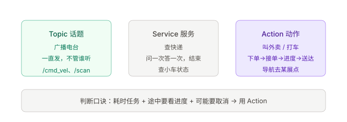
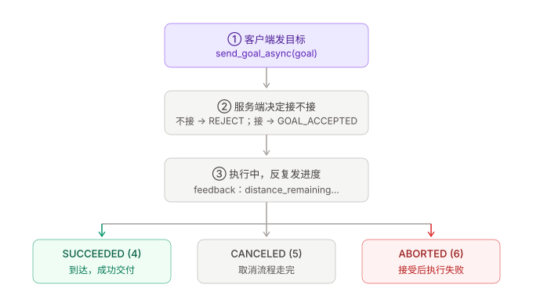
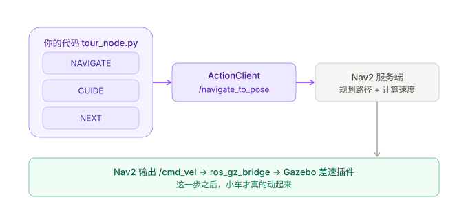

# 02A 深入：Action 到底是什么，以及它在你项目里怎么落地

更新日期：2026-10-13。本文对应你虚拟机上**已经跑过实测**的代码，不是纸上讲解。所有行号来自 `~/tour_guide_ws/src/tour_guide/tour_guide/tour_node.py` 与 `~/ros2_python_lesson2_ws/mock_nav_server.py`。

> ❗ **本文标注约定**：凡带 `❗` 的是你踩过或差点踩的误区，紧跟准确答案。
> ✅ **背诵约定**：每节末尾用 `**✅ 一句话版本**` 收尾。
> 复习时只扫 `❗` 和 `✅` 两种标记，总表在文末第 10 节。

> **分工**：第二课（`02_Action导航客户端_给Nav2一个目的地.md`）教你**跑起来**；本文教你**为什么这么写、以及你自己项目里已经这么写了**。

---

## 1. 先用一句话说清 Action 是什么

你对司机说"带我去 XX 展点"。司机回答你的顺序是：

1. **接不接这一单**（接单 / 拒单）
2. **路上还要多久、还剩多远**（一路可能报好几次）
3. **到了 / 取消了 / 中途失败了**（最后给一个结论）

这就是 Action：**一个耗时任务的全流程对话**。它和 Topic、Service 是 ROS2 的三种通信方式，选哪种看任务性质。



> 看图要点：先看三列各自的"生活类比"，再看底部那句话——**判断标准不是"数据量大小"，而是"这个任务要不要花时间、中途要不要看进度、要不要能取消"**。

具体判据：

| 需求 | 用什么 | 你项目里的实例 |
|---|---|---|
| 数据持续流动，不管有没有人听 | **Topic** | `/cmd_vel` 速度、`/scan` 雷达、`/tour_guide/speech` 播报 |
| 问一次、答一次、当场结束 | **Service** | 查小车当前状态、Nav2 生命周期查询 |
| 耗时任务，要进度、要结果、可能要取消 | **Action** | **导航去某个展点** `/navigate_to_pose` |

❗ **误区：Action 是"更高级的 Topic"。**
准确说法：Action 是**给"耗时任务"设计的一套对话协议**，底层由服务加话题拼成（第 4 节给实测证据）。它不替代 Topic，小车速度这类高频数据永远走 Topic——试想"每 50 毫秒发一次速度"要是走 Action，就是每 50 毫秒派一次单，荒唐。

**✅ 一句话版本**

> Topic 是广播电台，一直发不管谁听；Service 是查快递，问一次答一次就结束；Action 是叫外卖，下单、接单、报进度、最后送达，中途还能取消。导航去某地属于典型的 Action：耗时长、要看进度、要能取消。

---

## 2. Action 的三层结构：goal / result / feedback

你在教程里看到 `NavigateToPose`，它不是一个 `.msg`，而是一个 `.action` 文件。虚拟机里实测 `ros2 interface show nav2_msgs/action/NavigateToPose`，输出由两道 `---` 分成三段：

```
#goal definition                       ← 任务单：客户要什么
geometry_msgs/PoseStamped pose          目标位置 + 朝向
string behavior_tree                    用哪套行为树执行（可留空）

---

#result definition                     ← 最终交付物：干完了附带什么
uint16 error_code
string error_msg

---

#feedback definition                   ← 途中播报：现在到哪了
geometry_msgs/PoseStamped current_pose
builtin_interfaces/Duration navigation_time
builtin_interfaces/Duration estimated_time_remaining
int16 number_of_recoveries
float32 distance_remaining             ← 第二课日志里那个"还剩几米"
```

三段各管一件事，**永远不要混用**：

| 段 | 谁产生 | 什么时候产生 | 客户端的处理入口 |
|---|---|---|---|
| **goal** | 客户端填 | 发送前 | `send_goal_async(goal, ...)` |
| **feedback** | 服务端发 | 执行过程中，可能很多次 | `feedback_callback` |
| **result** | 服务端给 | 任务结束时，只有一次 | `get_result_async()` |

❗ **误区：把 feedback 当成 result。**
准确说法：`FEEDBACK: remaining=2.00 m` 只说明"车还在跑"，不能当作到达。**只有 result 里的 status 才算数**。第二课的日志特意把两者写成不同的行，就是为了让你分开。

❗ **误区：以为 Action 的"目标"只能是一个坐标。**
准确说法：goal / result / feedback 里装什么完全由 `.action` 文件定义。你项目里的 `NavigateToPose` 装的是位姿；同一套 Nav2 里 `FollowWaypoints` 装的是**一串**位姿，`Spin` 装的是**转多少度**。

**✅ 一句话版本**

> 一个 Action 由三段组成：goal 是客户下的任务单，result 是干完后交的活，feedback 是途中报的进度。三者结构不同、出现时机不同，feedback 只表示"还在进行中"，只有 result 才是最终结论。

---

## 3. Action 的一生：状态机

服务端每次会给出一个状态码。虚拟机里实测 `ros2 interface show action_msgs/msg/GoalStatus`，8 个常量：

| 值 | 常量名 | 含义 |
|---|---|---|
| 0 | STATUS_UNKNOWN | 状态还没设置好 |
| 1 | STATUS_ACCEPTED | **已接受，排队等执行** |
| 2 | STATUS_EXECUTING | 正在执行 |
| 3 | STATUS_CANCELING | 取消申请已受理，正在收尾 |
| 4 | **STATUS_SUCCEEDED** | 成功完成 |
| 5 | **STATUS_CANCELED** | 被取消后结束 |
| 6 | **STATUS_ABORTED** | 服务端自己中止（失败） |



> 看图要点：从上往下走三步；到第 ③ 步时 feedback 可能反复出现很多次；最后必定落到最下面三个之一，**不存在"没有结果的 Action"**。

**这一节最重要的一句话：任务被"接受"和任务"完成"，是两次完全不同的答复。**
`GOAL_ACCEPTED` 只代表"司机说这单我接了"，车一步都没动。

拒绝（REJECT）和执行失败（ABORTED）也不一样：

- **拒绝** = 还没开始就说"这单我不接"（客户端收到 `accepted=False`）
- **失败** = 接了单，干到一半不行了（result 里带错误码）

**✅ 一句话版本**

> Action 从发出到结束会经过"已接受 → 执行中 → 成功/取消/中止"几个状态，接受不等于完成；拒单是没开始，失败是开始了没干成，两者要分开讲。

---

## 4. Action 底层是什么？看看它藏起来的接口

这是最容易被忽略、但最能说明白"Action 是什么"的一节。虚拟机实测（服务端跑着的时候）：

```bash
# 只列 Action 本身，看不到内部结构
ros2 action list -t
# /navigate_to_pose [nav2_msgs/action/NavigateToPose]

# 把隐藏服务翻出来
ros2 service list --include-hidden-services | grep navigate
# /navigate_to_pose/_action/send_goal      ← 客户端"下单"
# /navigate_to_pose/_action/cancel_goal    ← 客户端"申请取消"
# /navigate_to_pose/_action/get_result     ← 客户端"取最终结果"

# 把隐藏话题翻出来
ros2 topic list --include-hidden-topics | grep navigate
# /navigate_to_pose/_action/feedback       ← 服务端"播报进度"
# /navigate_to_pose/_action/status         ← 状态变化的广播
```

所以：

```
Action  =  3 个 Service（下单 / 取消 / 取结果）
         +  2 个 Topic （反馈 / 状态）
         +  一套状态机把上面这些串起来
```

你用 `ActionClient` 时，这五个接口、消息序列化、goal_id 追踪、结果缓存，ROS2 全替你办了。**这也是为什么"自己拿两个 Service 拼一个 Action"是件吃力不讨好的事。**

顺便：`ros2 action info` 在服务端跑着时的实测输出——

```
Action: /navigate_to_pose
Action clients: 0
Action servers: 1
    /lesson_action_test_server [nav2_msgs/action/NavigateToPose]
```

❗ **误区：以为 `/navigate_to_pose` 是个话题名，能用 `ros2 topic echo` 看。**
准确说法：它是 **Action 名**。`ros2 topic list` 里根本没有它，因为内部用的是 `/_action/*` 这些隐藏接口。想从命令行手动玩，用 `ros2 action send_goal`（第 8 节有实测）。

**✅ 一句话版本**

> Action 不是一种新通信，而是"三个服务加两个话题"的官方封装。名字叫 `/navigate_to_pose`，但它在 topic 列表里查不到，内部是 `/_action/send_goal`、`/_action/feedback` 这些隐藏接口。

---

## 5. 你的项目里，Action 在哪儿？

**就在导览主控里**——`tour_guide_ws/src/tour_guide/tour_guide/tour_node.py`（330 行）。这个节点就是**Action 客户端**，它指挥 Nav2 把车开到每个展点。

先给一张代码阅读路线图，你照着行号看，不用通读：

| 行号 | 干什么 |
|---|---|
| 16、18、20 | 导入三件套 |
| 76 | 创建 Action 客户端 |
| 79 | 5Hz 主循环（关键） |
| 121–132 | 把 yaml 里的坐标填成任务单 |
| 209–222 | 发目标 |
| 178–186 | 处理"接不接" |
| 174–176 | 处理"进度" |
| 188–207 | 处理"最终结果" |
| 224–229 | 申请取消 |
| 234–242 | INIT 状态等 Nav2 上线 |
| 253–256 | NAVIGATE 状态发目标 |



> 看图要点：你的代码只到中间那个 `ActionClient` 为止。**右边 Nav2 和底部 Gazebo 都不是你写的**，你只负责"提需求 + 收结果"，这就是解耦。

下面按顺序拆。每段代码不超过 10 行，紧跟大白话。

### 5.1 导入三件套（第 16、18、20 行）

```python
from rclpy.action import ActionClient
from action_msgs.msg import GoalStatus
from nav2_msgs.action import NavigateToPose
```

- `ActionClient`：客户端"派单员"的类。
- `GoalStatus`：就是第 3 节那张状态码表，用来判断"到底是成功了还是被取消了"。
- `NavigateToPose`：任务单的格式（第 2 节那个三段式 `.action`）。

### 5.2 创建客户端（第 76 行）

```python
# Action Client for Nav2
self._nav_client = ActionClient(self, NavigateToPose, "/navigate_to_pose")
```

三个参数依次是：**属于哪个节点**（`self`）、**用什么格式的任务单**（`NavigateToPose`）、**连哪个 Action 接口**（`/navigate_to_pose`）。

❗ **误区：以为这一行会连上 Nav2 或启动导航。**
准确说法：它只是**建了个电话机**，还没拨号。真正的连接确认在 INIT 状态里做（第 234 行 `wait_for_server`）。所以你会看到启动日志写着"等待 Nav2 Action Server..."。

### 5.3 填任务单：从 yaml 坐标到 PoseStamped（第 121–132 行）

```python
def _point_pose(self, idx: int) -> PoseStamped:
    pt = self._points[idx]
    yaw = float(pt.get("yaw", 0.0))
    pose = PoseStamped()
    pose.header.frame_id = "map"
    pose.header.stamp = self.get_clock().now().to_msg()
    pose.pose.position.x = float(pt["x"])
    pose.pose.position.y = float(pt["y"])
    pose.pose.position.z = 0.0
    pose.pose.orientation.z = math.sin(yaw / 2.0)
    pose.pose.orientation.w = math.cos(yaw / 2.0)
    return pose
```

大白话：**从配置文件里取出第 idx 个展点，包成 Nav2 认的格式。**

- `frame_id = "map"`：这个坐标是**地图坐标系**里的，不是"车往前 2 米"。
- `position.x / y`：米。
- 朝向**不能直接填 yaw**，得转成四元数。这是本段唯一需要"记公式"的地方：`z = sin(yaw/2)`、`w = cos(yaw/2)`。（`x`、`y` 默认 0，所以省略了。）
- 这几个坐标来自 `src/tour_guide/config/tour_points.yaml`，虚拟机里实际内容是：

| 展点 | x | y | yaw |
|---|---:|---:|---:|
| 接待台 | 0.0 | -3.5 | 0.0 |
| 党史长廊 | -4.5 | 3.0 | 0.0 |
| 科技互动 | 4.5 | 3.0 | 3.14159 |
| 成果展示 | 4.5 | -3.0 | 3.14159 |
| 便民服务 | -4.5 | -3.0 | 0.0 |

❗ **误区：以为改目的地要改代码、重新编译。**
准确说法：目的地全在 `tour_points.yaml` 里。改 yaml、重启节点即可（配置是运行时读的，第 43 行 `load_yaml`）。这就是"业务配置和代码分离"——面试也爱问这个。

### 5.4 发目标（第 209–222 行）

```python
def _send_nav_goal(self):
    if not self._nav_client.wait_for_server(timeout_sec=1.0):
        self.get_logger().warn("Nav2 Action Server 尚未就绪，重试...")
        return
    goal = NavigateToPose.Goal()
    goal.pose = self._point_pose(self._idx)
    self._goal_active = True
    self._publish_current_point()
    ...
    send_future = self._nav_client.send_goal_async(goal, feedback_callback=self._feedback_cb)
    send_future.add_done_callback(self._goal_response_cb)
```

大白话：**先确认电话能打通 → 填单 → 寄出去 → 顺便登记两个回调。**

两个必须记住的点：

1. **`self._goal_active = True`**：发出去就置位，防止主循环 5Hz 每 200 毫秒重复发单。
2. **`add_done_callback`**：这里**不等待**。寄出去就走人，等快递员上门再打电话通知你（`_goal_response_cb`）。

### 5.5 处理"接不接"（第 178–186 行）

```python
def _goal_response_cb(self, future):
    self._goal_handle = future.result()
    if not self._goal_handle or not self._goal_handle.accepted:
        self.get_logger().warn("导航目标被拒绝")
        self._goal_active = False
        return
    self.get_logger().info("导航目标已接受")
    result_future = self._goal_handle.get_result_async()
    result_future.add_done_callback(self._goal_result_cb)
```

大白话：**接到"接单/拒单"的回话。**

- 拒单 → 清掉 `_goal_active`，等主循环下次重新发（失败重试的位置就在这里）。
- 接单 → **立刻去挂一个"等最终结果"的回调**，同时把 `goal_handle` 存下来（取消的时候要用它）。

注意顺序：**"接受"这里只是拿到了 handle，还要再挂一次回调才拿得到 result。** 两次 Future，对应两次答复。

### 5.6 处理"进度"（第 174–176 行）——项目里它是空的

```python
def _feedback_cb(self, feedback_msg):
    # Nav2 会周期性发来当前进度，调试时可取消注释
    pass
```

大白话：**进度回调在真实项目里被特意留空了。**

不是写错了，是故意的：

- 反馈默认会一直往 `/rosout` 打日志，真机上刷屏、还占带宽；
- 导览业务不关心"还剩几米"，只关心"到没到"。

❗ **误区：以为 `pass` 就等于"没有反馈"。**
准确说法：**feedback 一直在发**，只是客户端收到后选择不打印。想看的话，把 `feedback_msg.feedback.distance_remaining` 打出来即可（第二课的教学版就是靠这个看到"还剩 2.00 m"）。

这也解释了为什么第二课要专门做个 `MockNavigation` 服务端来发反馈——真实 Nav2 在没启动仿真时是收不到反馈的。

### 5.7 处理"最终结果"（第 188–207 行）——这里决定了状态机往哪走

```python
def _goal_result_cb(self, future):
    self._goal_active = False
    self._goal_handle = None
    status = future.result().status

    if status == GoalStatus.STATUS_SUCCEEDED:
        if self._state == State.NAVIGATE:
            self._change_state(State.GUIDE)      # 到了 → 开始讲解
    elif status == GoalStatus.STATUS_CANCELED:
        self.get_logger().info("导航被取消")     # 被取消 → 什么都不做
    else:
        if self._state == State.NAVIGATE:
            self._speak("导航出现异常，我将跳过该展点。")
            self._change_state(State.NEXT)       # 失败 → 跳过这个点
```

大白话：**三种收尾对应三种业务动作。**

| 结果 | 业务动作 |
|---|---|
| SUCCEEDED | 到站 → 进入 GUIDE（讲解） |
| CANCELED | 通常是人按了暂停/停止，由人来决定下一步，这里不动 |
| 其他（ABORTED 等） | 播报一句"跳过该展点" → 进 NEXT |

- 回调第一件事就是把 `_goal_active` 归零、`_goal_handle` 置空——**任务结束了，要把状态清干净**，否则主循环会以为还在导航中，卡死在 NAVIGATE。
- 判断 `self._state == State.NAVIGATE` 是防御性写法：防止"结果回来时状态已经被人工改掉了"。

### 5.8 申请取消（第 224–229 行）

```python
def _cancel_nav(self):
    if self._goal_active and self._goal_handle:
        self.get_logger().info("取消当前导航目标")
        self._goal_handle.cancel_goal_async()
    self._goal_active = False
    self._goal_handle = None
```

大白话：**给司机打电话说"这一单我不去了"。** 注意三点：

1. 取消要**用之前存下的 `goal_handle`** 才能找到是哪一单——这是第 5.5 节为什么要存它的原因。
2. **取消是"申请"**，不是命令。服务端要同意（第二课实测会看到 `CANCEL_REQUESTED` → `CANCEL_ACCEPTED` → `CANCELED` 三步）。
3. 这段代码是**异步**的：发完申请不等待，马上就把本地状态清了。所以严格来说，真机上"按了停止"到"车真停"之间有一小段延迟。

❗ **误区：以为自己写的"停止"按钮按下去，车就立刻停了。**
准确说法：`/tour_guide/cmd` 收到 `stop` → 调 `_cancel_nav()` 发取消申请 → Nav2 收尾 → 车才停。这是**三段延迟**。教程第 8.2 节特意提醒过：`已发布 ≠ 导航已取消 ≠ 车已停`。

### 5.9 教学版 vs 项目版：最关键的工程差别

同一个 Action，两套写法。这个对比很值钱：

| | 第二课 `nav_client.py` | 项目 `tour_node.py` |
|---|---|---|
| 等"接受" | `spin_until_future_complete(self, send_future)` **阻塞等** | `send_future.add_done_callback(...)` **回调** |
| 等"结果" | `spin_until_future_complete(self, result_future)` **阻塞等** | `result_future.add_done_callback(...)` **回调** |
| 好处 | 一行一句，顺序清晰，好懂 | **不卡住主循环** |

为什么项目里必须用回调？因为 `tour_node.py` 第 79 行有个 **5Hz 定时器 `create_timer(0.2, self._loop)`**。

❗ **误区：以为阻塞等只是"代码写得不优雅"。**
准确说法：在真实项目里是**功能会坏**。如果用 `spin_until_future_complete` 傻等导航结果（一趟可能几十秒），那几十秒里主循环停了——收不到 `/tour_guide/cmd` 的暂停指令、没法播报、没法响应迎宾，整个导览就"死"在那儿了。**这就是教程里"教学版"和"工程版"的分水岭：能不能一边等结果一边继续干活。**

**✅ 一句话版本**

> 我项目里的 `tour_node.py` 就是 Nav2 的 Action 客户端：创建 `ActionClient` 连 `/navigate_to_pose`，从 `tour_points.yaml` 读展点坐标填进 `NavigateToPose.Goal`，发出后分别处理"接不接"、"进度"、"最终结果"三个回调，取消时用存下来的 goal_handle 发申请。和教学版最大的区别是用回调代替阻塞等待，因为节点上还有 5Hz 状态机必须在导航期间继续跑。

---

## 6. 一次完整导览里，Action 出现在哪几拍

导览状态机（第 26–35 行 `State` 枚举）和 Action 的配合节奏：

```
INIT      等 Nav2 上线 ──wait_for_server──▶ 通了才走
  ↓
WAIT_VISITOR   等迎宾检测（Topic 触发）
  ↓
NAVIGATE  发一次 Action 目标 ──▶ 等 result
  ↓ (SUCCEEDED)
GUIDE     播报讲解词 → 逗留 guide_pause 秒
  ↓
QA        播报提问 → 等 qa_timeout 秒（或收到提问）
  ↓
NEXT      展点 +1 ──▶ 回到 NAVIGATE 发下一个目标
  ↓ (一圈走完)
FINISH    结束语 → 回 IDLE 或等下一轮
```

**每一站导航 = 一个完整的 Action 生命周期**（发单 → 接单 → 进度 → 结果）。五个展点就是五轮。

- 导航期间被打断（pause / stop / next）：调 `_cancel_nav()` → 一个 Action 以 CANCELED 收尾。
- 某个点导航失败：以 ABORTED 收尾 → 跳过该展点。

**✅ 一句话版本**

> 导览状态机每走一个展点，就完整跑一次 Action 生命周期。导航成功进讲解、被取消等人处理、失败则跳点。Action 是状态机里唯一一个"要花几十秒才回来"的环节，其他环节都是瞬时的。

---

## 7. 服务端那一半：你自己写的 Action Server 长什么样

客户端你会用了，服务端呢？第二课给你准备了一个最小的：`~/ros2_python_lesson2_ws/mock_nav_server.py`（62 行）。四件事：

```python
self.server = ActionServer(
    self, NavigateToPose, '/navigate_to_pose', self.execute,
    callback_group=ReentrantCallbackGroup(),
    goal_callback=self.accept,
    cancel_callback=lambda handle: CancelResponse.ACCEPT)
```

- `self.execute`：干活的函数（执行主体）
- `goal_callback=self.accept`：**接不接**由这个函数说了算
- `cancel_callback=...ACCEPT`：取消了同意不同意

```python
def accept(self, request):
    if request.pose.pose.position.x == 99.0:
        return GoalResponse.REJECT          # 不接单
    return GoalResponse.ACCEPT
```

```python
def execute(self, handle):
    if handle.request.pose.pose.position.x == -99.0:
        result.error_code = 999
        handle.abort()                      # 接了单但干不成
        return result
    for index in range(20):
        if handle.is_cancel_requested:
            handle.canceled()               # 客户要取消，收尾
            return result
        feedback.distance_remaining = (20 - index) / 10.0
        handle.publish_feedback(feedback)   # 播报进度
        time.sleep(0.1)
    handle.succeed()                        # 干完了
```

服务端的三个终局函数，正好对应第 3 节状态表的三行：**`succeed()` / `canceled()` / `abort()`**。

❗ **误区：以为服务端的 `execute` 里可以随便 `time.sleep`。**
准确说法：`execute` **必须放在多线程执行器或独立回调组里**，否则它会堵死整个服务端，连取消请求都收不到——你看代码里用了 `MultiThreadedExecutor(num_threads=3)` 加 `ReentrantCallbackGroup()`，就是这个原因。

**✅ 一句话版本**

> 写 Action 服务端就三件事：`ActionServer` 注册 + `goal_callback` 决定接不接 + `execute` 里循环发 feedback、最后调 succeed / canceled / abort 三选一收尾。execute 是阻塞的，所以必须配多线程执行器，不然连取消都收不进来。

---

## 8. 本篇的实测记录（2026-10-13，在你的虚拟机上实跑）

环境：`ROS_DOMAIN_ID=89`、`FASTDDS_BUILTIN_TRANSPORTS=UDPv4`、`bash ~/ros2_learning_ws/run_course.sh 2 server` 起服务端。

**① 正常送达**

```
WAIT_SERVER: waiting for Nav2
SEND_GOAL: x=0.0, y=-3.0, yaw=0.0
GOAL_ACCEPTED: accepted, but NOT arrived yet
FEEDBACK: remaining=2.00 m
FEEDBACK: remaining=1.00 m
SUCCEEDED: robot arrived at the goal
```

**② 中途取消**

```
SEND_GOAL: x=0.0, y=-3.0, yaw=0.0
FEEDBACK: remaining=2.00 m
GOAL_ACCEPTED: accepted, but NOT arrived yet
CANCEL_REQUESTED: asking Nav2 to cancel this goal
CANCEL_ACCEPTED: wait for final CANCELED result
CANCELED: navigation task has ended by cancellation
```

**③ 拒单**（`x=99.0`，测试约定）

```
SEND_GOAL: x=99.0, y=-3.0, yaw=0.0
GOAL_REJECTED: task was not accepted
[ros2run]: Process exited with failure 1
```

**④ 接了但失败**（`x=-99.0`，测试约定）

```
SEND_GOAL: x=-99.0, y=-3.0, yaw=0.0
GOAL_ACCEPTED: accepted, but NOT arrived yet
FAILED: status=6, error_code=999, error_msg=Intentional test failure
```

注意 `status=6` —— 这就是第 3 节表里的 **ABORTED**。

❗ **误区：以为 `x=99.0` 和 `x=-99.0` 是 Nav2 的规则或合法坐标。**
准确说法：这是**本课测试服务端自己代码里写死的约定**（`mock_nav_server.py` 第 21、27 行）。真实 Nav2 不认识这两个数，你往真机上发会直接把车派到 99 米外去。

**⑤ 命令行也能发 Action**（不用写 Python）

```bash
ros2 action send_goal /navigate_to_pose nav2_msgs/action/NavigateToPose \
  '{pose: {header: {frame_id: map}, pose: {position: {x: 0.0, y: -3.0, z: 0.0}}}}' --feedback
```

实测结尾输出：

```
distance_remaining: 0.1
Result:
    error_code: 0
error_msg: ''
Goal finished with status: SUCCEEDED
```

这个命令很实用：调别人写的 Action（比如 Nav2 的 `/follow_waypoints`）时，先用它试通，再去写代码。

**✅ 一句话版本**

> 我用 `ros2 action list / info / send_goal` 和四种场景实测过：正常到达、中途取消、被拒单、接了单失败。拒单是客户端拿到 `accepted=False`，失败是 result 里的 `status=6`（ABORTED）加错误码——两种"没成功"在代码里走的是不同分支。

---

## 9. 面试怎么说 / 哪些不能夸大

**口述版（照这个讲，别展开太细）**

> 项目里的导览主控就是 Nav2 的 Action 客户端。选 Action 而不是 Topic 或 Service，是因为导航是耗时任务，需要"接单确认、途中反馈、最终结果、可取消"这四样，Topic 只有单向数据流，Service 一问一答就结束了。
>
> 实现上：`ActionClient` 连 `/navigate_to_pose`，从 yaml 配置读展点坐标填 `NavigateToPose.Goal`；发出后分别处理三个回调——接受答复、进度反馈、最终结果，用 `GoalStatus` 区分成功、取消、中止，再驱动导览状态机跳转到讲解、跳过或等待人工接管。取消时用保存的 `goal_handle` 发取消申请。
>
> 和入门写法最大的区别是全部用回调、不用阻塞等待，因为节点上还有 5Hz 的状态机定时器必须在导航的几十秒里继续响应指令。

**会被追问什么，怎么答**

| 追问 | 答 |
|---|---|
| Action 底层是什么？ | 三个隐藏服务（send_goal / cancel_goal / get_result）加两个隐藏话题（feedback / status），`ros2 service list --include-hidden-services` 能翻出来 |
| 为什么要用回调而不是阻塞等？ | 节点上有 5Hz 主循环要一直跑；阻塞等会让暂停、播报、迎宾全部失效 |
| 反馈里有什么？ | `distance_remaining`、`estimated_time_remaining`、`number_of_recoveries` 等；我项目里没用到，留给调试 |
| 失败怎么处理？ | result 的 status 是 ABORTED 就播报跳过该展点，进 NEXT；重试逻辑挂在"目标被拒"的分支上 |
| 取消是立刻生效吗？ | 不是，是三步：发申请 → 服务端受理 → 车收尾停下。所以不能拿"我发了停止"当"车停了"的证据 |

**不能夸大的地方**

- 说"**参与**"，不要说"我从零设计了这套导览机器人"。
- 路径规划、速度计算是 **Nav2 的**，不是你的。你写的是**业务层客户端**与状态机编排。
- `_feedback_cb` 是空的，**别说"我做了实时进度展示"**。
- mock 测试服务端是**学习用的**，不要当项目成果讲。
- 别把 `x=99.0 / -99.0` 的约定说成 Nav2 规则。

**✅ 一句话版本**

> 面试讲这条，核心是三句话：为什么用 Action（耗时 + 要反馈 + 可取消）、三个回调各干了什么（接受/进度/结果驱动状态机）、为什么用回调不用阻塞（5Hz 主循环要继续响应）。路径规划和速度都是 Nav2 的，我只做业务层客户端和状态编排。

---

## 10. ❗ 误区纠正总表

| # | 我原来的理解 ❌ | 准确答案 ✅ | 位置 |
|---|---|---|---|
| 1 | Action 是"更高级的 Topic" | Action 是为耗时任务设计的对话协议，底层是"3 服务 + 2 话题"的封装；高频数据仍然走 Topic | 第 1、4 节 |
| 2 | feedback 就是结果 | feedback 只表示"还在进行中"，可能发很多次；只有 result 的 status 才是最终结论 | 第 2 节 |
| 3 | `GOAL_ACCEPTED` 就是到达了 | 只代表服务端接单了，车一步没动；到达是 `STATUS_SUCCEEDED` | 第 3 节 |
| 4 | 拒绝和失败是一回事 | 拒绝是没开始（`accepted=False`）；失败是接了单没干成（status=ABORTED） | 第 3、8 节 |
| 5 | `/navigate_to_pose` 是个话题 | 是 Action 名，`ros2 topic list` 里找不到；内部是 `/_action/*` 隐藏接口 | 第 4 节 |
| 6 | `ActionClient(...)` 一行就连上了 Nav2 | 它只是建了客户端对象，真正连接在 `wait_for_server` 才确认 | 第 5.2 节 |
| 7 | 改目的地要改代码重编译 | 目的地全在 `tour_points.yaml`，改配置重启节点即可 | 第 5.3 节 |
| 8 | `_feedback_cb` 里写 `pass` 就是没反馈 | feedback 一直在发，只是客户端选择不打印 | 第 5.6 节 |
| 9 | 阻塞等只是写法不优雅 | 在项目里是功能会坏：5Hz 主循环会被卡死几十秒，暂停/播报/迎宾全部失效 | 第 5.9 节 |
| 10 | 按了停止车就立刻停 | 是"发取消申请 → 服务端受理 → 车收尾"三段，有延迟 | 第 5.8 节 |
| 11 | 服务端 `execute` 里可以随便 sleep | 必须配多线程执行器 + 回调组，否则会堵死服务端连取消都收不到 | 第 7 节 |
| 12 | `x=99 / -99` 是 Nav2 规则 | 是教学 mock 服务端里写死的测试约定，真机上别这么发 | 第 8 节 |

---

## 11. ✅ 一页背诵版

背这 6 句，Action 就算通了：

1. **Topic 广播、Service 问答、Action 派单。** 耗时 + 要进度 + 可取消 → 用 Action。
2. **Action 三段：goal（任务单）/ result（交付物）/ feedback（过程播报）。** 只有 result 算数。
3. **接受 ≠ 完成。** 状态从 ACCEPTED → EXECUTING → SUCCEEDED / CANCELED / ABORTED。
4. **底层 = 3 个隐藏服务（send_goal、cancel_goal、get_result）+ 2 个隐藏话题（feedback、status）。**
5. **我项目里 `tour_node.py` 就是 Nav2 的 Action 客户端**：连 `/navigate_to_pose`，读 yaml 坐标填 Goal，三个回调驱动导览状态机，取消用 `goal_handle`。
6. **工程写法用回调不用阻塞**，因为 5Hz 状态机在导航期间不能停。

---

## 12. 下一步怎么练（建议顺序）

1. 先把第二课第 1～4 步在终端跑一遍（`bash ~/ros2_learning_ws/run_course.sh 2 server` / `2 client`），对着第 8 节的实测日志看。
2. 打开 `tour_node.py`，只看第 5 节路线图里那几个行号，其余略过。
3. **动手改一个参数**：把 `tour_points.yaml` 里"接待台"的 `yaw` 从 `0.0` 改成 `3.14159`，重启节点，看车到站后的朝向有没有反。这是你第一次用"配置"而不是"代码"控制机器人行为。
4. 打开 `_feedback_cb` 里的注释，打印 `distance_remaining`，观察真实 Nav2 是怎么报进度的（需要起仿真，`bash run_all.sh --view`）。
5. 想在项目里试一次自己的导航：先 `python3 tools/study_tools.py send cmd stop` 停掉自动导览，再用第二课第 8.3 节的命令发目标。
