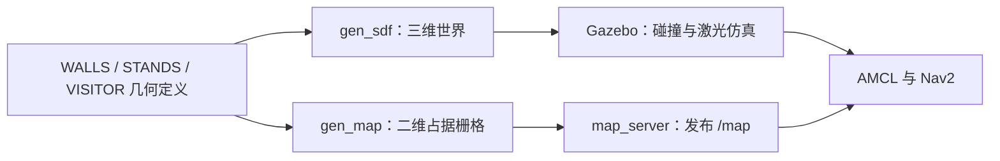
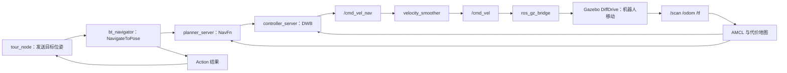

# ROS 2 导览机器人仿真：从设计到演示、学习与简历

核对日期：2026-10-11。依据当前虚拟机代码、启动脚本和实测日志整理。
工作区：/home/sbx/tour_guide_ws。当前环境：VMware Ubuntu 24.04、ROS 2 Jazzy、Gazebo Harmonic、4 vCPU、4 GB 内存。

这份资料按“先认识项目，再理解链路，最后自己改动和讲解”的顺序阅读。
下面的步骤是根据当前代码重建的设计过程；早期未保留的个人操作过程无法逐项追溯。

## 1. 你做的是一个什么项目

项目名称建议：**基于 ROS 2 与 Nav2 的室内导览机器人仿真系统**。

应用场景是一个简化的党群服务中心展厅。一个双轮差速机器人在接待台开始，依次前往四个展区，到站播放讲解，接受模拟问题并按关键词回答，完成一轮后等待。

完整功能流程：

接待台迎宾 → 导航到展点 → 到站讲解 → 问答 → 下一展点 → 结束。

这个项目的主要价值是把场景、机器人、传感器、定位、导航和业务调度接成可演示的系统。底盘模型来自开源项目，定位和导航算法调用成熟的 Nav2 插件；业务调度、场景配置、桥接适配、启动与性能调试是这个工作区的主要集成内容。

开源底盘来源：[akhiljithvg/Autonomous-Navigation-Robot](https://github.com/akhiljithvg/Autonomous-Navigation-Robot)。这是源码复用与改造的来源；原项目图片里的 RK3588、硬件通信等能力并不自动成为当前仿真项目的成果。

当前已经验证：开启 RViz 后连续完成一轮 5/5 个点，导航失败 0 次，讲解、模拟提问和规则回答正常。这里 5 个点包括接待台；四个展区不是五个展区。

目前功能边界：

| 能力 | 当前实际情况 |
|---|---|
| 差速机器人运动、激光扫描 | Gazebo 仿真 |
| 已知地图定位 | AMCL 已启用 |
| 自主导航、静态场景绕障 | Nav2 已运行并验证 |
| 地图来源 | 根据场景几何生成的静态占据栅格地图 |
| SLAM 在线建图 | 有相关配置和 launch，当前演示未运行、未验证 |
| IMU | 有仿真传感器和桥接；当前未接入 EKF 融合定位 |
| 迎宾 | 根据机器人靠近一个预设位置触发的模拟事件 |
| 摄像头视觉 | 有红色检测代码分支；摄像头传感器当前禁用，未验证视觉迎宾 |
| 语音播报 | pyttsx3 本地 TTS；你已确认能听到声音 |
| 语音输入 | 脚本自动生成文字问题，没有真实麦克风识别 |
| 问答 | YAML 关键词规则匹配，没有大模型或 RAG |
| 多点导览 | Python 状态机逐个调用 NavigateToPose |
| 一轮结束自动返航循环 | 尚未实现；重播脚本可以发指令返回接待台后重走 |
| 真机、RK3588、串口、CAN、人形机器人 | 当前仿真版本未接入 |

## 2. 从零设计时，为什么这样拆

**第一步：把目标收敛成最小流程。**
先要求一个机器人能从一个已知起点出发，导航到若干固定点并讲话。为了在普通虚拟机中跑通，采用固定地图、模拟迎宾和模拟提问，避免先处理真机驱动、视觉推理、麦克风和云端接口。

**第二步：复用开源差速底盘。**
已有模型能提供车体、左右轮、支撑轮、激光安装位置等结构，再适配 Gazebo Harmonic 的插件与 ROS 2 话题。无需一开始从机械建模和电机控制做起。

**第三步：建立一个尺寸明确、轻量的展厅。**
用矩形墙、展台和门口空隙组成四个展区与中央通道，不加载复杂外部模型。尺寸和目标坐标可控，便于排查导航是否能绕墙过门。

**第四步：同一套几何数据生成世界和地图。**
Gazebo 需要三维场景进行碰撞和传感器计算；Nav2 需要二维地图进行定位和规划。让这两种文件使用相同的墙和障碍物坐标，减少地图不对齐造成的定位问题。

**第五步：打通仿真与 ROS 的数据。**
用 ros_gz_bridge 把激光、里程计、TF 和仿真时钟送进 ROS，并把 ROS 速度命令送回 Gazebo。先验证机器人“感知得到、定位得到、命令送得到”。

**第六步：单目标导航跑通后，再加业务状态机。**
Nav2 负责“怎么去一个点”；tour_guide 负责“下一站去哪、到了说什么、什么时候继续”。这两部分通过 Action 的目标和结果衔接。

**第七步：补演示工具并解决资源限制。**
用 RViz 显示地图与路线，用脚本按顺序启动各模块，降低不必要的渲染和规划开销，再用实际到站日志验证，而不是只看节点是否启动。

## 3. 仿真的空间到底怎么搭出来

主要生成脚本：

`/home/sbx/tour_guide_ws/tools/gen_world_and_map.py`

它包含以下场景定义：

- `ROOM`：房间边界，x 从 -7 到 7 米，y 从 -5 到 5 米，约 14 × 10 米。
- `WALLS`：每面墙的名称、中心 x/y、长和宽。
- `STANDS`：四个展台的位置、尺寸和颜色。
- `VISITOR`：一个红色立柱，用作场景中的访客示意物。
- `TOUR_MARKERS`：四个展区的地面色块，仅用于显示。

墙厚 0.2 米、墙高 2.5 米。展台约 0.6 × 0.6 × 0.9 米。
门不是复杂的门模型，而是墙的空隙：一面墙分成两段，中间不放碰撞体，机器人就能通过。

例如南侧外墙：

```xml
<model name="wall_south">
  <static>true</static>
  <pose>0 -5 1.25 0 0 0</pose>
  <!-- collision 与 visual 中使用同样的长方体尺寸 -->
  <!-- box size = 14.2 0.2 2.5 -->
</model>
```

`pose` 中前面三个数是中心位置 x、y、z，后面三个是 roll、pitch、yaw。
墙高 2.5 米，中心 z=1.25 米，所以墙从地面向上延伸。
`static=true` 表示墙固定不动。
`visual` 决定看到什么，`collision` 决定哪些位置不能穿过去。四个地面展点标记只有 visual，没有 collision，因此不会把机器人挡住。

脚本的 `gen_sdf()` 把上述对象写入：

`src/diff_drive_robot/worlds/tour_hall.sdf`

SDF 是 Gazebo 的场景描述格式；世界文件还配置重力、灯光、物理与传感器系统插件。场景搭建方式可对照 [Gazebo Harmonic 官方 SDF 教程](https://gazebosim.org/docs/harmonic/sdf_worlds/)。

### 三维世界与二维地图是什么关系

`gen_map()` 把墙、展台和红色立柱的平面投影转换成栅格：

- 一个像素代表 0.05 米，即 5 厘米。
- 障碍物像素为黑色 0。
- 房间内的自由区域为接近白色的 254。
- 房间外的未知区域为灰色 205。
- 图像行坐标向下增加，而世界 y 向上增加，因此生成代码做了上下转换。

输出地图文件：

`src/diff_drive_robot/maps/tour_hall.png`
`src/diff_drive_robot/maps/tour_hall.yaml`

当前地图大小 288 × 208 像素，覆盖约 14.4 × 10.4 米。外侧留了一点边距。
YAML 记录分辨率 0.05、原点 [-7.2, -5.2, 0]、图像文件名与占据阈值。
map_server 根据这些数据发布 ROS 的 `/map`。

因此，**当前地图是程序按已知几何生成的，不是机器人一边走一边扫描建出来的**。
三维世界与地图共用几何定义，但栅格化仍有分辨率误差，不能把“共用几何”说成真实世界完全无误差。

场景生成的数据流：



设计中的世界坐标示意：+x 向右、+y 向上。RViz 的相机可以旋转，所以看编号比记截图上下左右可靠。

```text
                         +y
          2 党史长廊              3 科技互动
            (-4.5,3)               (4.5,3)

                     中央通道

          5 便民服务              4 成果展示
           (-4.5,-3)               (4.5,-3)
                     1 接待台
                      (0,-3.5)
                                           +x →
```

这是位置示意，不是机器人实际行驶路线；实际路线需要经过各展区门口。

特别注意：场景中的红色立柱在 (1.5,-3.5)，当前 fake 迎宾的逻辑触发位置由 launch 设置为 (0,-3.5)。fake 模式没有真的识别那根立柱，而是根据机器人位置触发一个假定的访客事件。

## 4. 机器人怎么定义，怎么动起来

`src/diff_drive_robot/urdf/robot.urdf` 定义机器人结构；虽然文件扩展名是 urdf，里面有 Xacro 宏，启动时先通过 xacro 展开。

- link 表示车体、左右轮、激光等部件。
- joint 表示这些部件的连接关系。
- visual 表示外观，collision 表示碰撞，inertial 表示质量与惯量。
- chassis 是紫色车体。
- 左右轮半径 0.05 米，轮间距 0.35 米。
- robot_state_publisher 根据结构及 joint_states 发布部件之间的 TF。

`urdf/robot.gazebo` 补充 Gazebo 的运动和传感器插件：

| 插件／传感器 | 作用 |
|---|---|
| DiffDrive | 接收 cmd_vel，驱动左右轮 |
| OdometryPublisher | 发布 /odom 与 odom→base_link TF，配置 20 Hz |
| JointStatePublisher | 发布轮关节状态 |
| 2D 激光 | 约 360°、720 条射线、配置 10 Hz，发送 /scan |
| IMU | 配置 50 Hz，发送 /imu |
| Camera | 当前传感器配置已注释禁用 |

“gpu_lidar”是所用传感器类型名称。当前通过 Ogre 与软件渲染运行，不代表虚拟机配有独立 GPU。

差速底盘的基础关系：

```text
v = r × (ω右 + ω左) / 2
ω = r × (ω右 - ω左) / L
```

这里 r 是轮半径，L 是轮间距，两个轮速按让车向前的方向取正。
同速向前则直行；一边更快则转弯；两边反向可原地转动。
当前不需要自己写电机驱动，Gazebo DiffDrive 插件把线速度 v 与角速度 ω 转成轮运动。

要认得 `geometry_msgs/msg/Twist`：

- `linear.x`：前进速度，单位米/秒。
- `angular.z`：绕竖直轴的转动速度，单位弧度/秒。
- 差速机器人不能像全向底盘一样直接横移，当前 `max_vel_y=0`。

当前 /odom 使用 Gazebo 的 OdometryPublisher，是仿真位姿提供的理想化里程计来源。没有验证真实编码器的漂移、打滑，也没有执行 IMU 与轮速 EKF 融合。这是当前仿真与真机的重要差别。

## 5. ROS 2、桥接与 TF 怎么把模块连起来

把 ROS 2 理解为各模块交换消息的基础框架：

| 概念 | 本项目实例 |
|---|---|
| Node：一个执行模块 | amcl、tour_guide_node、tts_node |
| Topic：持续发布消息 | /scan、/odom、/cmd_vel、/tour_guide/speech |
| Service：请求与回复 | 生命周期节点的 get_state、change_state |
| Action：有目标、过程、结果的长任务 | /navigate_to_pose |
| Parameter：节点的运行配置 | 控制频率、粒子数、use_sim_time |
| Launch：启动多个模块并传入配置 | robot.launch.py、navigation.launch.py |
| YAML：参数和业务数据 | nav2_params.yaml、tour_points.yaml |

Gazebo 与 ROS 的消息系统不同，由 `config/gz_bridge.yaml` 定义转换类型和方向。

| ROS 话题 | 方向 | 内容 |
|---|---|---|
| /clock | Gazebo → ROS | 仿真时钟 |
| /scan | Gazebo → ROS | LaserScan，激光距离数组 |
| /odom | Gazebo → ROS | Odometry，位置和速度 |
| /tf | Gazebo → ROS | odom→base_link 等变换 |
| /joint_states | Gazebo → ROS | 关节状态 |
| /imu | Gazebo → ROS | IMU 数据，当前未用于融合 |
| /cmd_vel | ROS → Gazebo | Twist 速度命令 |

桥接 YAML 仍保留摄像头条目，但摄像头关闭时不会因此产生真实图像数据。配置文件里存在某项，不等于运行中有对应数据。

### 你必须能解释的 TF 链

```text
map ──AMCL──> odom ──Gazebo OdometryPublisher──> base_link
                                                  ├── laser_frame
                                                  ├── imu_link
                                                  ├── chassis / wheels
                                                  └── base_footprint
                         机器人结构变换由 robot_state_publisher 提供
```

map：地图坐标系，展点目标写在这里。
odom：局部里程计参考系。
base_link：机器人的机体参考系。
laser_frame：激光安装坐标系。

AMCL 用定位结果提供 map 到 odom 的修正；Gazebo 提供 odom 到机体的关系；机器人结构提供激光到机体的安装关系。Nav2 因而能把“激光看到的东西”转换到地图里，也能知道机器人相对于目标的位置。

TF 是变换树，每个子坐标系应有唯一父系。早期让 base_link 同时由两个父帧或两个模块控制，会造成冲突；当前移除了 EKF 并调整 base_footprint 的连接，保留一套明确的发布来源。

`use_sim_time=true` 表示使用 /clock，而不是电脑墙上时间。仿真暂停时仿真时间也暂停；节点、传感器和 TF 的时间不一致会造成变换失败。

QoS 是 ROS 消息传递策略。需要先懂两个例子：激光允许 Best Effort 以减少实时数据积压；地图与机器人描述使用 Transient Local，让稍后打开的 RViz 仍能取得已有内容。

## 6. 导航怎么做：在哪里、走哪条路、怎样开车

### 6.1 定位：AMCL

map_server 提供已知地图。AMCL 结合激光扫描与里程计更新机器人在地图中的位置。

直观上，它维护多个“机器人可能在这里”的粒子；用运动估计更新这些猜测，再用“这个位置预计看到的墙是否符合实际激光”调整权重并重采样。

当前使用差速运动模型，粒子范围 100～400，初始位置 (0,-3.5)，yaw=0。
预设初始位置和 Gazebo 出生位置一致，所以启动时通常不需要手动点 2D Pose Estimate。
AMCL 是已知地图定位模块，这一点可核对 [Nav2 官方 AMCL 说明](https://docs.nav2.org/rolling/configuration_and_development/configuration_guide/others/configuring_amcl/)。链接页面为 rolling，项目实际参数以本机 Jazzy 配置为准。

### 6.2 全局规划：NavFn，当前选用 Dijkstra

插件是 `nav2_navfn_planner::NavfnPlanner`，参数 `use_astar=false`。
它在全局代价地图上搜索从当前位置到目标的路径。当前分支使用 Dijkstra，不能把当前配置说成 A*。[Jazzy NavFn 源码](https://api.nav2.org/nav2-jazzy/html/navfn__planner_8cpp_source.html)明确区分这两条算法分支。

目标点的顺序固定在 tour_points.yaml 里，但连接各点的具体行驶路径由 Nav2 根据地图规划。因此“路线顺序预设”与“自主规划经过哪些位置”可以同时成立；这也不是求最优参观顺序的 TSP 系统。

### 6.3 局部控制：DWB

插件是 `dwb_core::DWBLocalPlanner`。
它采样不同速度组合，预测短时间轨迹，再根据碰撞风险、离全局路径的距离、离目标的距离等评价项打分，输出合适的速度。算法原理可核对 [Nav2 Jazzy DWB 说明](https://github.com/ros-navigation/navigation2/blob/jazzy/nav2_dwb_controller/README.md)。

当前控制频率 10 Hz，最大前进速度 0.26 米/秒，最大角速度 1 弧度/秒。
vx_samples=10、vy_samples=1、vtheta_samples=10，候选采样规模约 100；实际可行轨迹和评分次数受约束与提前退出影响。
车无法横移，因此减少 y 方向的采样，不需要用多个横移样本增加计算负担。

### 6.4 代价地图：让车离墙留出空间

静态地图只告诉你哪里有墙；代价地图还把激光障碍与周围的风险加入规划。

- 全局代价地图：给全局规划使用。
- 局部代价地图：跟随机器人移动的 3 × 3 米窗口，给局部控制使用。
- obstacle_layer：把激光检测到的障碍加入或清除。
- inflation_layer：在障碍旁形成较高代价区域，让路线离墙远一点。

当前 robot_radius=0.22 米，inflation_radius=0.55 米。
这两个配置分别近似描述机器人尺寸和墙边代价区域，并不等于已经测得了实际碰撞距离或导航精度。
当前有绕障能力，但没有系统验证动态人群、所有狭窄通道或真机安全。

### 6.5 一个目标的完整链路



这是正常路径跟随时的速度链路。恢复行为中的 behavior_server 也可能直接发布 /cmd_vel。

velocity_smoother 平滑的是速度命令；它和已经移除的 smoother_server 不是同一个模块，后者是路径平滑服务。

### 6.6 两种调度：业务状态机和导航行为树

业务状态机决定“现在该迎宾、移动、讲解还是问答”。
Nav2 行为树负责一个导航目标内部的规划、跟随和失败恢复。

当前导航 BT 是：

`nav_to_pose_with_consistent_replanning_and_if_path_becomes_invalid.xml`

本机 XML 以 2 Hz 检查相关规划条件，路径失效、目标变化或路径过期时再计算；路径过期阈值实际写的是 10 秒。它不是“完全不重规划”，也不是每秒无条件完整规划。

BT 还配置清空代价地图、旋转、等待和后退等恢复动作。配置了恢复能力，不等于本轮验证中每种恢复都实际触发过。

## 7. 导览状态机与交互怎么实现

主控文件：

`src/tour_guide/tour_guide/tour_node.py`

主要逻辑用 Python 与 rclpy 编写，主循环定时器配置 5 Hz：

```text
INIT → WAIT_VISITOR → NAVIGATE → GUIDE → QA → NEXT
                           ↑                  │
                           └──还有展点────────┘
                                  最后一点 → FINISH → WAIT_VISITOR
```

| 状态 | 实际工作 | 切换条件 |
|---|---|---|
| INIT | 等待 Nav2 Action 服务 | 服务可用 |
| WAIT_VISITOR | 等待模拟迎宾事件 | visitor_detector 发布事件 |
| NAVIGATE | 发送当前目标并等待结果 | Action 返回成功则进入 GUIDE |
| GUIDE | 发布当前展点讲解词 | 配置的停留时间结束 |
| QA | 发布提问提示、等待问题 | 收到问题或等待超时 |
| NEXT | 展点索引加一 | 有下一站则导航，否则结束 |
| FINISH | 播放结束语 | 等待后进入 WAIT_VISITOR 或 IDLE |
| IDLE / PAUSED | 人工控制相关状态 | start / resume 等命令 |

每个导航目标包含 map 坐标系下的位置和方向。
yaw 是平面转角，单位弧度；0 朝 +x，π 朝 -x。代码把 yaw 转成四元数：
z=sin(yaw/2)，w=cos(yaw/2)，x=y=0。

使用 Action 是因为导航要持续一段时间，并且有“是否接受、进行中、成功、取消、失败”等状态。发送目标成功仅表示目标被接受；一定要等最终结果，才能进入讲解。

当前单点导航如果最终失败或中止，业务代码会播报异常并跳过该点；所以验收必须查每站结果，不能把“状态机走到了 FINISH”当成全部导航成功。

展点配置 `config/tour_points.yaml`：

| RViz 编号 | 展点 | map 坐标（米） | 目标 yaw |
|---|---|---|---|
| 1 START | 接待台 | (0,-3.5) | 0 |
| 2 History | 党史长廊 | (-4.5,3) | 0 |
| 3 Tech | 科技互动 | (4.5,3) | π |
| 4 Results | 成果展示 | (4.5,-3) | π |
| 5 Services | 便民服务 | (-4.5,-3) | 0 |

日志中的索引从 0 到 4，RViz 的编号从 1 到 5，两者相差 1。

交互部分：

1. visitor_detector 订阅 /odom，只在等待迎宾时比较机器人到逻辑标记的距离；小于 1.5 米就发布 visitor_1。不是人体识别。
2. tour_node 把讲解文字发布到 /tour_guide/speech。
3. tts_node 订阅该话题，用 pyttsx3 发声；初始化或播放失败时降级成文字。
4. voice_input_sim 收到 QA 状态后，约等待 3 秒仿真时间，从问题列表中随机选一个发布到 /tour_guide/question。
5. qa_node 遍历 qa_rules.yaml，按关键词包含关系匹配；第一条命中的规则返回答案，没有命中则用默认回答。
6. 问题也被 tour_node 收到，用于进入下一站。

当前用固定等待时间推进讲解与问答，没有“语音已完全播放完毕”的确认协议。后续若需要严格等待播报结束，要补完成事件；不能把当前逻辑说成完整的语音会话管理系统。

当前 loop=true 会让结束状态回到等待迎宾，但没有自动返航逻辑。机器人仍留在最后一站，离接待台触发位置较远，不能直接开始下一轮。replay_tour.sh 发 home 指令，索引归零，返回接待台后再走全部展点。

## 8. 你实际用了什么技术，应该先补哪些基础

| 学习顺序 | 基础 | 学到什么程度就能开始改项目 |
|---|---|---|
| 1 | Linux 与终端 | cd、ls、查看文件、重定向日志、进程与权限；知道 source 的作用 |
| 2 | Python | 类、函数、回调、列表／字典、异常、定时器；读懂 tour_node |
| 3 | ROS 2 基础 | Node、Topic、Message、Service、Action、Parameter、Launch、QoS |
| 4 | 坐标与机器人模型 | x/y/yaw、弧度、TF、link/joint、差速运动；知道目标写在哪个坐标系 |
| 5 | Gazebo 与地图 | SDF、碰撞／外观、传感器；分清三维世界和二维地图 |
| 6 | 导航 | AMCL、Dijkstra、DWB、全局／局部代价地图、导航成功判断 |
| 7 | 工程调试 | 按消息链检查故障、生命周期、资源负载与日志 |
| 8 | 进阶选学 | SLAM、EKF、真机驱动、ASR、视觉或大模型问答 |

优先把前七项结合项目学懂。当前自编业务主要是 Python，暂时不需要先掌握大量 C++ 才能理解它。
想投 C++ 机器人开发岗位，再补 C++ 基础与 rclcpp/rclcpp_action；当前不能把 Python 状态机写成自己实现了 C++ 状态机。

建议按下面七个练习推进，时间按你的基础调整：

1. **自己启动并复述演示。** 能指出五个点、机器人、规划线、激光点，并说明每个停顿在做什么。
2. **改一句讲解词。** 在 tour_points.yaml 修改 speech，重启导览后确认声音和日志改变。弄懂“配置数据”和“代码逻辑”的区别。
3. **读主控。** 画出状态图，标出发送 Action 与处理 Action 结果的函数，解释为什么不能接收目标后立刻讲解。
4. **改一条问答规则。** 在 qa_rules.yaml 新增一个明确关键词和答案，手动提问检验命中和未命中两种情况。
5. **读场景与地图。** 找出一面墙对应的中心位置、尺寸和地图像素；在备份中理解如何移动它，先不要随意破坏门口。
6. **理解导航参数。** 找出 use_astar、max_vel_x、robot_radius、inflation_radius，说明各自影响；每次只改一类参数并实测。
7. **自己讲解一个故障。** 例如“目标已接受但车不动”，按 controller→平滑器→桥接→Gazebo 检查链路。

读代码的顺序建议：tour_points.yaml → tour_node.py → tour_guide.launch.py → gz_bridge.yaml → robot.gazebo → nav2_params.yaml → gen_world_and_map.py → 三个启动脚本。

完成这些练习后，你才有可用自己的话说明的项目经验；跑通本身只是第一步。

## 9. 当前怎么启动、怎么看、怎么停

以下命令都在 **Ubuntu 虚拟机终端**执行，不是在 Windows PowerShell 执行。
现有虚拟机已经装好依赖和构建好项目，不需要每次安装或编译。

### 9.1 完整启动（推荐）

先登录 Ubuntu 图形桌面，再执行：

```bash
cd ~/tour_guide_ws
bash run_all.sh --view
```

脚本实际执行顺序：

source ROS 与工作区 → 清理本项目旧进程 → 准备 Xvfb → 启动无 GUI 的 Gazebo 与桥接 → 等待 45 秒 → 启动 Nav2 → 等待并重试激活 → 启动导览 → 打开轻量 RViz。

顺利时大约一分钟；服务激活重试会更久。日志中出现 ALL ACTIVE 后，说明这七个必要生命周期节点已激活：
map_server、amcl、controller_server、planner_server、behavior_server、velocity_smoother、bt_navigator。
ACTIVE 是必要条件，还要观察实际到站结果。

### 9.2 已经运行时，只打开地图窗口

```bash
cd ~/tour_guide_ws
bash view_demo.sh
```

脚本检测现有窗口，避免重复打开；会启动编号标注与 RViz 专用的时钟节流辅助节点。
Ubuntu 必须已登录可用的 Xwayland 图形桌面，SSH 连接本身不替代桌面登录。

### 9.3 一轮结束后重播

```bash
cd ~/tour_guide_ws
bash replay_tour.sh
```

它不重启仿真；发送 home 指令，让机器人先返回编号 1，再按 1→2→3→4→5 导览。
运行中执行会取消当前行程并回 1；建议等上一轮结束后使用。

### 9.4 如何看演示

- 紫色车体：机器人实际显示的位置。
- 绿色线：/plan 全局规划路径；重新规划时会变化，不能当成已走过的轨迹。
- 红色点：激光扫描到的墙面和障碍物。
- 蓝色编号点：配置的停靠位置；黄色是正在前往、讲解或问答的当前点。
- NAVIGATE：导航；GUIDE：讲解；QA：问答；WAIT_VISITOR：等待。
- 黑色墙／方块：地图障碍；房间内的浅色区域：可通行区域。

在自动导览运行时，先用 Move Camera 观察。2D Goal Pose 会另外发送导航目标，2D Pose Estimate 会改变定位初始化；不要把它们当作随意点击的看图按钮。

### 9.5 看日志，比只看画面可靠

```bash
tail -n 40 /tmp/run_all.log
tail -n 40 /tmp/tour_launch.log
tail -n 40 /tmp/nav_launch.log
```

实时看导览：

```bash
tail -f /tmp/tour_launch.log
```

Ctrl+C 只退出 tail 的日志查看，不会停止由后台脚本启动的仿真。

| 文件 | 查什么 |
|---|---|
| /tmp/run_all.log | 启动阶段和 ALL ACTIVE |
| /tmp/robot_launch.log | Gazebo、生成机器人和桥接 |
| /tmp/nav_launch.log | 规划、控制、导航成功／失败、心跳 |
| /tmp/tour_launch.log | 目标顺序、到站、状态切换、讲解与 QA |
| /tmp/rviz_light.log | 窗口和显示异常 |
| /tmp/tour_view_labels.log | 展点标注 |
| /tmp/rviz_clock.log | RViz 专用时钟节流 |

再次完整启动会覆盖对应 /tmp 日志；需要保留演示证据时，先把日志复制到工作区 log 目录。

### 9.6 修改代码后构建

现有环境通常只需启动。改包结构、入口、依赖或希望完整重新部署时再构建：

```bash
cd ~/tour_guide_ws
source /opt/ros/jazzy/setup.bash
colcon build --symlink-install --packages-select diff_drive_robot tour_guide
source install/setup.bash
```

source 顺序先 /opt/ros/jazzy，再工作区 install。
--symlink-install 让许多源码与资源通过链接安装；当前关键 YAML 和 launch 的链接已核对，但这不等于运行中的节点会自动重新读配置。修改 YAML 后要重启对应节点；仅再次 source 不会改变已运行节点的数据。

改完展厅几何后：

```bash
cd ~/tour_guide_ws
python3 tools/gen_world_and_map.py
bash run_all.sh --view
```

先备份生成脚本和世界／地图文件。需要同步检查目标点是否仍在自由区域、门宽是否足够、初始位姿是否一致。生成脚本的渲染配置已同步为当前验证可用的 ogre。
改变 TOUR_MARKERS 不会自动修改 tour_points.yaml；业务目标与场景可视标记仍需要一起维护。

### 9.7 停止仿真与导览

```bash
cd ~/tour_guide_ws
python3 tools/stop_stack.py
```

该脚本按本项目的启动树与可识别进程清理，不会用宽泛命令杀掉所有 Python 或 ROS 程序。
RViz 是独立打开的观察窗口，可以手动关闭；标注与时钟辅助进程也独立于导航栈。关闭窗口不等于停止仿真。

## 10. 为什么之前跑不动，现在怎样减负载

| 遇到的问题 | 采取的处理 | 原理与限制 |
|---|---|---|
| 无 GPU 的虚拟机渲染不稳定 | 禁用摄像头、使用 Ogre／Xvfb、不打开 Gazebo GUI | 节省渲染负担；激光传感器仍需要场景计算 |
| Gazebo 有数据但 ROS 没有 | 检查桥接话题、类型、方向，并设置 lazy=false | 两套消息系统需要明确转换 |
| 目标被接受但车不动 | 排查速度链路，恢复仿真 launch 和 bridge | 有 Action 服务不代表底盘命令能到达 |
| odom TF 缺失或冲突 | 桥接 /tf，移除重复 EKF 发布，调整模型 TF | 定位和控制需要完整且来源唯一的变换树 |
| Jazzy 插件配置不兼容 | 调整 AMCL 类名与 BT 插件加载配置，移除出问题的 collision_monitor | 这是本项目配置适配经历，不能泛称所有 Jazzy 都不能用 collision_monitor |
| 高负载下服务没有激活 | bringup_nav.py 重试生命周期转换，失败返回非零 | 启动失败不再直接进入导览 |
| 心跳超时导致导航停栈 | 减少负载，生命周期 bond_timeout 放宽到 15 秒 | 容忍延迟也会延后真正故障的发现 |
| 规划过于频繁 | 使用条件重规划 BT、BT tick 调整到 50 ms | 保留路径失效等重规划条件 |
| 不必要的计算 | AMCL 最大粒子 400；轻量 2D obstacle_layer；DWB 横移采样 1 | 减少计算，仍要关注定位与控制质量 |
| 未使用服务占资源 | 不启动 route_server、smoother_server、waypoint_follower | 当前业务直接逐个发 NavigateToPose |
| RViz 占 CPU | 10 FPS、软件渲染线程 1、仅显示必要数据 | 地图窗口用于观察，资源优先给仿真导航 |
| 高频时钟给窗口增加开销 | 单独给 RViz 节流 /clock 至最高 20 Hz | 导航与仿真的原始 /clock 保持不变 |
| 通信与资源竞争 | 启动环境使用 Fast DDS UDPv4 | 本机选用的运行设置，不保证适合所有网络环境 |
| Python 方法名被布尔值覆盖 | 将配置变量改为 _loop_enable | 实例属性与方法同名会造成不可调用错误 |

当前使用 1 个虚拟处理器插槽、4 个核心，即合计 4 vCPU；“1 个处理器”不等于只有一核。
内存 4 GB 当前可以演示。增加内存只有在内存紧张、换页时才有明显针对性；CPU 和软件渲染瓶颈不能单靠加内存解决，也不应无限占用 Windows 主机资源。

本次可视化优化后的采样结果：

- 一轮 5 个目标全部成功，无导航失败，未发现该轮导航日志中的心跳超时。
- 一次运动中 20 秒采样实时因子约 0.80：仿真 1 秒约对应现实 1.25 秒。
- 一次 4 秒采样 RViz CPU 约单核 30%。
- 当时可用内存约 1.7 GiB，swap 使用为 0。

这是固定场景下的功能验证与短时资源采样，不是长期压力测试、100%可靠性、导航精度或真实人群安全性报告。

常见故障的检查顺序：

1. **地图没出来**：查 map_server 激活、/map、RViz Fixed Frame=map。
2. **地图有了，机器人不显示**：查 robot_description、robot_state_publisher、TF 与显示项。
3. **目标接受后不移动**：查 /cmd_vel_nav → velocity_smoother → /cmd_vel → bridge → Gazebo；同时看导航是否已失败。
4. **移动一段后停止**：查 Action 结果、心跳、进度检查、代价地图与 CPU。
5. **讲解没有声音**：查 /tour_guide/speech、tts_node 日志与 Ubuntu 音量；文字输出只能证明消息到了。
6. **最后一站不动**：先查是否 FINISH→WAIT_VISITOR；这通常是本轮结束，使用 replay_tour.sh 重播。
7. **ROS CLI 报 context invalid**：先确认 source 顺序和运行环境；本机曾遇到此类问题，可以用同环境的 rclpy 订阅／服务脚本复核，不要凭 CLI 一次失败断定整个项目坏了。

## 11. 简历怎么写，面试怎么讲

建议标题：
**基于 ROS 2 与 Nav2 的室内导览机器人仿真系统**
技术栈：Ubuntu 24.04、ROS 2 Jazzy、Gazebo Harmonic、Nav2、Python、URDF/Xacro、SDF、YAML。

下面是适合当前功能的简历素材。你亲自完成上面的学习与改动练习后，再根据实际承担的工作使用“搭建、实现、调试”等动词：

- 基于开源差速底盘搭建 Gazebo 展厅仿真，通过统一几何定义生成 SDF 世界与分辨率 0.05 m 的静态栅格地图，完成模型、激光及 ROS–Gazebo 通信集成。
- 集成 AMCL 定位、NavFn 全局规划与 DWB 局部控制，通过 NavigateToPose Action 与 Python 状态机串联模拟迎宾、多点导航、到站讲解及规则问答。
- 针对 4 vCPU／4 GB 的虚拟机进行渲染与导航参数调整，加入启动重试、RViz 展点标注与重播脚本；在可视化演示中完成一轮 5/5 目标导航与语音交互流程验证。

“在一轮测试中完成 5/5 目标”比“导航成功率 100%”更符合现有证据。
当前没有测得定位误差，不写厘米级精度；没有实现真实视觉、真实语音识别或硬件驱动，就不把这些写入成果。
当前代码由 AI 辅助生成和调试。个人贡献应对应你实际理解、修改、验证的部分；不能把开源导航算法写成独立研发，也不能声称自己以前完成过原图片的 RK3588 真机项目。

### 60 秒介绍稿

“我做的是一个面向室内展厅的导览机器人仿真系统，运行在 Ubuntu 24.04、ROS 2 Jazzy 和 Gazebo Harmonic 上。底盘复用开源差速机器人模型，展厅由简单几何体组成，并用同一套几何定义生成三维世界和二维静态地图。导航部分集成 AMCL 定位、NavFn 全局规划和 DWB 局部控制，上层用 Python 状态机通过 NavigateToPose Action 调度五个目标点，到站后进行本地语音讲解和关键词规则问答。为了适配普通虚拟机，我关闭了重型可视化和摄像头，调整规划、控制与 RViz 负载，验证了开启 RViz 时一轮五个点全部到达。当前迎宾和提问采用模拟输入，后续可以接真实传感器与麦克风。”

这是一份系统介绍稿。面试询问“你亲自做了哪些部分”时，需要另说实际参与与学习的工作，不能把介绍稿自动当成独立完成声明。

### 面试前至少能回答的十个问题

| 问题 | 应该讲出的关键点 |
|---|---|
| 场景怎么搭的？ | Python 定义墙和展台，生成带 visual/collision 的 SDF；门是墙间空隙 |
| 地图怎么来的？ | 同一几何栅格化，0.05 m 分辨率；当前不是 SLAM 建图 |
| Gazebo 与 RViz 的区别？ | Gazebo 计算物理、运动和传感器；RViz 展示 ROS 数据 |
| 为什么用 AMCL？ | 已有地图，结合激光和里程计进行定位 |
| 全局与局部规划区别？ | NavFn 找通往目标的路径；DWB 输出当前如何行驶的速度 |
| 用的是 A* 还是 Dijkstra？ | 当前 use_astar=false，NavFn 选 Dijkstra |
| 为什么用 Action？ | 导航耗时，要处理接受、结果、取消等状态 |
| map、odom、base_link 是什么？ | 地图参考、里程计参考、机体参考；知道各变换由谁发布 |
| 车不动怎样查？ | 从目标与状态查起，沿速度链路到桥接和仿真，检查 TF 与日志 |
| 真机还要做什么？ | 底盘驱动、真实里程计／传感器、标定与时间同步、性能和安全验证，再替换模拟交互 |

提交简历前，最好自己录制一次完整演示、保存各点成功日志、能自己从零启动，并至少完成讲解词和问答规则两个改动练习。

## 12. 文件索引：每个问题去哪里找答案

下表中的相对路径均以 /home/sbx/tour_guide_ws 为根目录。

| 文件 | 查什么 |
|---|---|
| tools/gen_world_and_map.py | 房间、墙、展台、世界与地图生成 |
| src/diff_drive_robot/worlds/tour_hall.sdf | Gazebo 实际加载的三维场景 |
| src/diff_drive_robot/maps/tour_hall.yaml / png | 静态地图分辨率、原点与障碍 |
| src/diff_drive_robot/urdf/robot.urdf | 车体、轮子、传感器与结构 TF |
| src/diff_drive_robot/urdf/robot.gazebo | 差速、里程计、激光、IMU 插件 |
| src/diff_drive_robot/config/gz_bridge.yaml | ROS 与 Gazebo 消息桥接 |
| src/diff_drive_robot/config/nav2_params.yaml | AMCL、NavFn、DWB、代价地图参数 |
| src/diff_drive_robot/launch/robot.launch.py | 仿真、生成机器人、桥接 |
| src/diff_drive_robot/launch/navigation.launch.py | 定位、导航及生命周期管理 |
| src/tour_guide/config/tour_points.yaml | 目标坐标、讲解词、等待时间 |
| src/tour_guide/config/qa_rules.yaml | 问答关键词与答案 |
| src/tour_guide/tour_guide/tour_node.py | 业务状态机与 Action 调用 |
| src/tour_guide/tour_guide/visitor_detector.py | 模拟迎宾与预留红色检测 |
| src/tour_guide/tour_guide/voice_input_sim.py | 自动发布模拟问题 |
| src/tour_guide/tour_guide/qa_node.py | 关键词匹配 |
| src/tour_guide/tour_guide/tts_node.py | 本地播报和文字降级 |
| run_all.sh / bringup_nav.py | 启动顺序与激活重试 |
| view_demo.sh / tools/open_visualization.py | 轻量窗口、标注与时钟辅助进程 |
| tools/tour_view_labels.py | RViz 编号与状态提示 |
| replay_tour.sh | 发 home 指令重播 |
| VISUALIZATION.md | 当前可视化操作速查 |

旧 README 已保存备份，早期配置记录可以参考，但启动与项目能力描述以本资料和当前代码为准。

