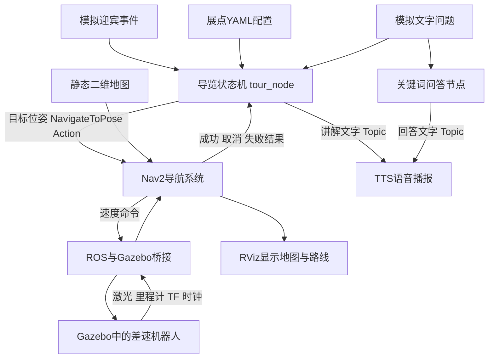

# ROS 2 导览项目快速入门与面试训练

适用对象：已经在AI帮助下跑通仿真，但还不熟悉ROS 2、代码回调和导航流程，准备投C++、机器人或自动驾驶软件实习的你。

核对日期：2026年10月11日。项目依据：虚拟机 /home/sbx/tour_guide_ws 的当前源码与配置。此前已经验证过导航和语音演示；本次核对源码不代表重新完成了一轮导航测试。

这份材料的目标是：你能独立解释一次导览如何发生，找到负责该功能的代码，修改一个小功能并验证结果。完成这些后，再组织面试回答。七节是学习顺序，每节约60—90分钟，可以拆成两个晚上；用时是安排建议，不是掌握程度的保证。

**今天只做第一节。不要先读完整个仓库，也不用把这份文档从头背到尾。**

## 一 先调整准备方法

你原来的“先了解，再让AI生成问题，最后背答案”可以保留第一步，但需要在整理答案前补上验证。

每个知识点按这个顺序学：

1. 用一句话说功能，例如“到科技展区后，机器人开始讲解”。
2. 找到输入和输出，例如“输入是导航成功结果，输出是讲解文字”。
3. 找到一两个关键函数，例如 _goal_result_cb 和 _speak。
4. 自己预测一次小改动会发生什么，再运行验证。
5. 不看笔记讲出来，让AI追问你的依据和实现细节。

背熟一句“使用Action进行异步导航”还不够。你至少需要知道：谁发送目标、目标包含什么、被接受与到达有什么区别、成功后哪个函数改变状态。

先给每项知识标记自己的程度：

| 程度 | 判断方法 |
|---|---|
| 认识 | 看到AMCL等名字，知道它大致负责什么 |
| 能解释 | 不看材料，能说清输入、输出和它在系统里的作用 |
| 能操作 | 能找到代码、修改一个参数或逻辑，并验证结果 |

面试前优先把少量核心内容做到“能操作”。遇到陌生的库实现，先把它作为一个输入输出明确的模块使用，再按追问需要深入。

## 二 这份指南与现有材料怎么配合

本指南负责学习顺序和练习。目录中的《导览机器人项目_设计学习与简历说明.md》用于查项目细节；《ROS2_Gazebo_小车高效入门_Jazzy.docx》提供更一般的ROS 2与C++入门练习。遇到不懂的名词，再查对应部分，不要求同时读完三份。

所有 /home/sbx/tour_guide_ws 路径和下面的bash命令，都在Ubuntu虚拟机使用。不要把这些命令直接粘进Windows PowerShell。

学习工具的Windows副本：D:/3study/ROS/learning/study_tools.py。
虚拟机使用位置：/home/sbx/tour_guide_ws/tools/study_tools.py。

每个新Ubuntu终端先准备环境：

```bash
cd /home/sbx/tour_guide_ws
source /opt/ros/jazzy/setup.bash
source install/setup.bash
export FASTDDS_BUILTIN_TRANSPORTS=UDPv4
```

已经在运行时，只打开可视化：

```bash
bash view_demo.sh
```

需要完整启动时使用：

```bash
bash run_all.sh --view
```

run_all.sh 会清理当前项目的仿真和导航，再按顺序启动，内含约65秒的固定等待，另有生命周期检查时间。因此已经运行时不要反复执行它。

查看最近日志：

```bash
tail -n 60 /tmp/tour_launch.log
```

一轮结束后，需要重新演示：

```bash
bash replay_tour.sh
```

这条命令通过home业务指令返回接待台，再按展点顺序执行。当前一轮结束不会自行返航。

## 三 先记住一次运行的完整故事

这台机器人有两层职责。

导览业务层决定下一站去哪、什么时候讲解、什么时候继续；导航层决定从现在的位置怎样走到目标。Gazebo计算机器人运动和模拟传感器数据，RViz显示ROS中的地图、机器人和路线。



举例：状态机从配置中取出科技互动的坐标，发送导航目标。Nav2结合地图、定位与障碍物信息计算路线和速度。Gazebo接收速度，让左右轮运动，同时继续生成雷达和位置数据。导航成功后，状态机进入GUIDE，把讲解文字发给TTS。进入QA后，脚本模拟一个问题，问答节点按关键词返回答案。状态机继续下一站。

这里的业务状态机不是路径规划算法，它只决定当前处于哪个业务阶段。

## 第一节 看懂演示和目标配置

**今天要回答的问题：机器人到底按什么顺序做事？**

先看10分钟运行画面与日志，再读下面这个文件，暂时不用读Python源码：

/home/sbx/tour_guide_ws/src/tour_guide/config/tour_points.yaml

当前五个目标如下。代码索引从0开始，RViz标号从1开始。

| RViz标号 | 代码索引 | 名称 | 地图坐标 米 |
|---|---|---|---|
| 1 START | 0 | 接待台 | 0.0，-3.5 |
| 2 History | 1 | 党史长廊 | -4.5，3.0 |
| 3 Tech | 2 | 科技互动 | 4.5，3.0 |
| 4 Results | 3 | 成果展示 | 4.5，-3.0 |
| 5 Services | 4 | 便民服务 | -4.5，-3.0 |

这些坐标是地图里的位置，不是截图中的像素。机器人需要经过门口，实际行驶路线通常不会是目标之间的直线。接待台也算一个目标，所以“5个点”包含接待台和4个展区。

配置中的一项可以这样理解：

```yaml
- name: "科技互动"
  x: 4.5
  y: 3.0
  yaw: 3.14159
  speech: "这里是科技互动展区，您可以体验最新的科技成果。"
```

name是名字，x和y是目标位置，yaw是到站朝向，单位为弧度，speech是到站讲解。接近3.14159的yaw表示转向约180度。目标坐标属于map坐标系。

文件上面的tour项配置了自动启动、等待迎宾、问答超时、讲解停留时间等。注意：guide_pause现在是固定等待时间，不是“语音确实播完”的反馈。

只读观察工具：

```bash
python3 tools/study_tools.py observe --seconds 12
```

它订阅话题并汇总数据，不发送导航或速度命令。状态和讲解只在事件发生时发布；如果机器人已经在等待，本次12秒没收到状态变化并不意味着节点坏了。

**本节产出：**写下或录音讲出“接待台 → 党史 → 科技 → 成果 → 服务”的流程，找出一个展点的坐标、朝向和讲解词。能解释“五个点为什么只有四个展区”。

暂时跳过：算法源码、DDS内部实现、全部launch文件。

## 第二节 搞懂节点 话题和回调

**要回答的问题：一段文字为什么能从导览节点到语音节点？**

只读这两处：

1. src/tour_guide/tour_guide/tour_node.py 中的 _speak，当前约第87行。
2. src/tour_guide/tour_guide/tts_node.py 中的 create_subscription 和 _speak_cb。

_speak的核心动作是：

```python
msg = String()
msg.data = text
self._speech_pub.publish(msg)
```

它创建一个标准字符串消息，填入文字，再发布到 /tour_guide/speech。TTS节点订阅同一个话题，收到消息时，ROS执行注册的_speak_cb函数。

```python
self.create_subscription(String, "/tour_guide/speech", self._speak_cb, 10)
```

这句话的意思是：收到这个话题上的String消息时，调用我的_speak_cb处理。最后的10是队列深度配置，不是运行频率。

**回调可以理解为“先登记处理函数，等事件发生再调用”。**你没有看到tour_node直接调用tts_node的函数，是因为它们通常在不同进程里，通过ROS消息通信。

main里的rclpy.spin负责持续处理这些事件。它不等于“每次循环都往前走”，也不保证每个节点一定只有一个线程。

动手只测试语音：

```bash
python3 tools/study_tools.py send speech '这是我自己发送的语音测试。'
```

预期：TTS收到文字并播放；音频不可用时可能只打印文字。先选择机器人停止时测试，避免多条讲解排队。发送工具显示“已发布”只证明消息发出，需要声音或节点日志确认处理结果。

本项目常见通信方式：

| 方式 | 本项目例子 | 为什么使用 |
|---|---|---|
| Topic | /scan、/odom、/cmd_vel、/tour_guide/speech | 发布传感器或业务消息，订阅者收到后处理 |
| Service | 生命周期get_state、change_state | 请求节点状态或进行一次状态转换 |
| Action | /navigate_to_pose | 导航持续一段时间，需要目标、反馈、结果和取消 |

语音当前使用Topic，但没有完成确认协议；需要严格到站讲完再走时，可以补完成事件或改成带结果的接口。

**本节产出：**画出“发布者 → 话题 → 订阅者 → 回调”，并指出这条语音链路的两个函数。能解释回调和普通直接函数调用的区别。

## 第三节 搞懂世界 机器人和地图

**要回答的问题：这个展厅是怎样搭出来的？**

只看这些位置：

- tools/gen_world_and_map.py 的 ROOM、WALLS、STANDS、gen_sdf、gen_map。
- src/diff_drive_robot/maps/tour_hall.yaml。
- src/diff_drive_robot/urdf/robot.gazebo 的DiffDrive和laser配置。

展厅使用矩形墙、展台等简单几何体。ROOM定义约14×10米的房间；WALLS记录各墙中心和长宽；门口就是墙的空隙。

同一套几何生成两种文件：

| 文件 | 用途 |
|---|---|
| worlds/tour_hall.sdf | Gazebo计算三维场景、碰撞和传感器 |
| maps/tour_hall.png与yaml | Nav2使用二维占据栅格进行定位和规划 |
| urdf/robot.urdf | 定义车体、轮子、连接关系等机器人结构，启动时由Xacro展开 |
| urdf/robot.gazebo | 增加仿真运动、里程计、激光等插件 |

地图分辨率0.05米，表示一个像素覆盖5厘米。原点当前为[-7.2,-5.2,0]。世界里的墙在二维地图中对应障碍区域。

**本项目当前用的是根据已知几何生成的静态地图。没有运行在线SLAM建图。**AMCL在已有地图中定位，也不负责创建地图。

差速机器人靠左右轮的速度差转弯。当前轮半径0.05米、轮间距0.35米。Gazebo DiffDrive插件把Twist速度命令转成轮运动，你不需要先写电机驱动。

Twist最常用的两个字段：linear.x为前进速度，单位米/秒；angular.z为绕竖直轴转动的角速度，单位弧度/秒。

模拟激光根据场景几何产生距离数组，经桥接发布成LaserScan。当前720条射线、配置10Hz。它提供障碍物距离，不能直接把它理解成“已经算好的全局位置”。

动手：打开地图yaml，找到分辨率和原点；打开robot.gazebo，找到轮半径、轮间距和scan话题。观察工具输出的地图尺寸、激光射线数量，核对配置与实际消息。

**本节产出：**用两句话讲清三维世界与二维地图的区别，指出一个墙体的定义，解释机器人如何转弯。

暂时不要修改墙体或重生成地图。改变几何需要同时更新地图、世界和相关目标坐标，会扩大本次练习范围。

## 第四节 搞懂定位 TF与桥接

**要回答的问题：机器人怎么知道自己在哪，激光又怎么放到地图里？**

先记住这条关系：

```text
map → odom → base_link → laser_frame
```

map是地图坐标系，odom是局部里程计参考系，base_link是机体坐标系，laser_frame是雷达安装坐标系。TF记录坐标系之间的位置和朝向关系，方便把“雷达前方两米的点”换算到地图里。

当前发布来源：

- AMCL提供map到odom的定位修正。
- Gazebo OdometryPublisher提供odom到base_link。
- robot_state_publisher依据机器人结构与关节信息提供机体到部件的变换。

里程计主要描述局部连续运动；真实设备中的里程计可能积累误差。AMCL结合激光、已知地图和里程计，用粒子表示位置假设，再根据扫描与地图的匹配情况更新定位。入门时先理解这些输入输出，之后再学习概率分布和粒子滤波细节。

当前odom来自仿真位姿发布，是理想化的数据来源。不能据此声称解决了真实编码器打滑、漂移或IMU融合。IMU有配置和桥接，当前没有启用EKF融合。

Gazebo和ROS使用不同消息系统，由gz_bridge.yaml配置转换：

```text
Gazebo激光 → ros_gz_bridge → ROS /scan
Gazebo里程计与TF → ros_gz_bridge → ROS /odom 与 /tf
ROS /cmd_vel → ros_gz_bridge → Gazebo DiffDrive
Gazebo时钟 → ros_gz_bridge → ROS /clock
```

只读gz_bridge.yaml中的scan、cmd_vel、tf三项，分别找到消息类型和direction。传感器通常是GZ_TO_ROS，速度命令是ROS_TO_GZ。

use_sim_time=true表示节点用/clock作为ROS时间。仿真运行慢时，4秒仿真时间可能对应更长的现实时间。观察工具统计的Hz以墙上时间为分母，不能直接与配置的仿真时间频率比较。

QoS先理解两个实际例子：实时激光常允许Best Effort；地图常用Transient Local，让后启动的订阅者拿到缓存地图。订阅者和发布者的QoS需要兼容，配置里有话题不代表一定收到数据。

动手：用观察工具确认/scan、/odom、/tf和/clock有消息，检查TF中是否见到map→odom及odom→base_link。观察的是/tf动态变换，不包含/tf_static中的所有固定安装变换。

**本节产出：**能画TF主链，说明各段发布来源，并指出scan和cmd_vel的桥接方向。

## 第五节 搞懂导航和异步Action

**要回答的问题：状态机下发一个坐标后，机器人为什么会动？**

导航的基本分工：

| 模块 | 当前使用 | 负责什么 |
|---|---|---|
| 定位 | AMCL | 估计机器人在已有地图中的位姿 |
| 全局规划 | NavFn，use_astar=false | 在代价地图上用Dijkstra模式计算到目标的路径 |
| 局部控制 | DWB | 采样候选速度、预测短期轨迹、结合障碍和路径评分，选出速度 |
| 速度平滑 | velocity_smoother | 限制速度变化，使指令满足平滑要求 |
| 导航调度 | bt_navigator与行为树 | 串联规划、控制及相关恢复流程 |

Nav2使用生命周期节点。进程启动后，还需要配置和激活才能正常工作；本项目的bringup_nav.py负责启动后的状态检查与激活重试。观察工具能发现Action服务，不等于已经检查了所有节点的active状态。

代价地图在普通占据地图上叠加障碍物和膨胀代价，使规划和控制考虑机器人尺寸及离墙距离。局部控制会随着当前位置和障碍信息反复计算速度，目标位置不是直接“写进机器人当前位置”。

正常跟随路径的速度链路：

```text
controller_server → /cmd_vel_nav
                  → velocity_smoother → /cmd_vel
                  → ros_gz_bridge → Gazebo DiffDrive
```

恢复行为也可能发送速度，不能把所有/cmd_vel来源都归为DWB。

现在读tour_node.py，按调用关系读，别按第一行到最后一行硬啃：

| 顺序 | 当前函数和大致行号 | 只看这个问题 |
|---|---|---|
| 1 | __init__ 第39行起 | 配置读进哪些成员？创建了哪些通信接口？ |
| 2 | _point_pose 第121行起 | x、y、yaw怎样变成目标位姿？ |
| 3 | _send_nav_goal 第209行起 | 怎样发送NavigateToPose目标？ |
| 4 | _goal_response_cb 第178行起 | 目标是否被接受？ |
| 5 | _goal_result_cb 第188行起 | 成功、取消、失败分别怎样处理？ |
| 6 | _loop 第232行起 | 当前状态下一步做什么？ |

行号是本次核对版本的定位提示，代码变动后用函数名搜索。

关键链路可以压缩成这样。这是阅读用的简化示意，不替代项目中的完整函数：

```python
goal = NavigateToPose.Goal()
goal.pose = self._point_pose(self._idx)
send_future = self._nav_client.send_goal_async(goal)
send_future.add_done_callback(self._goal_response_cb)
```

send_goal_async发出请求，返回一个Future；它稍后完成时，执行_goal_response_cb。这个结果说明目标是否被接受。

接受后，再请求导航最终结果：

```python
result_future = self._goal_handle.get_result_async()
result_future.add_done_callback(self._goal_result_cb)
```

第二个Future的结果才用于判断是否成功到达。成功时从NAVIGATE进入GUIDE；当前业务节点对失败/中止的处理是跳过展点，没有实现业务层有限次数重试。Nav2内部的恢复行为是另一层机制。

_goal_active防止0.2秒定时器每次触发都重复发目标。这个定时器名义频率5Hz，用于检查业务状态；控制器当前配置10Hz，是另一件事。

_feedback_cb目前是pass，所以当前主控没有使用反馈显示距离或进度。接口支持反馈，不等于代码已经实现了进度展示。

**本节产出：**自己画出“发送目标 → 接受回调 → 最终结果回调 → GUIDE”。能回答“为什么接受目标不等于到达”“为什么需要_goal_active”。

## 第六节 搞懂状态机和问答

**要回答的问题：到了站以后怎样继续，为什么会说话？**

默认业务流程如下：

```text
INIT → WAIT_VISITOR → NAVIGATE → GUIDE → QA → NEXT
                            ↑                 │
                            └── 还有下一点 ───┘
最后一点结束 → FINISH → WAIT_VISITOR
```

代码还包含IDLE、PAUSED，用于手动启动和暂停。循环回等待状态不代表已经回到接待台；最后一站离模拟迎宾位置较远，所以需要home或重播脚本返回。

主要成员：

| 成员 | 作用 |
|---|---|
| _state | 当前业务阶段 |
| _idx | 当前展点索引 |
| _goal_active | 是否已经发出并在等待导航任务 |
| _goal_handle | 已接受目标的句柄，用于结果查询或取消 |
| _entered_state_time | 进入当前状态的时间，用于超时判断 |
| _pending_question | 收到但尚未被主控消耗的问题 |

读_loop时，每个分支只记“进入条件、做的动作、退出条件”。比如GUIDE：进入后发一次讲解文字，固定停留时间到后进入QA。NEXT：索引加一，有点就继续导航，没有点就结束。

迎宾当前采用fake模式。visitor_detector订阅odom，在WAIT_VISITOR时检查是否靠近预设位置。launch把该位置设为(0,-3.5)、阈值1.5米；它不是摄像头识别真实访客，也不是场景红柱的位置。它直接用odom位置比较，当前演示假定该预设点与odom参考一致，移到其他地图时还需要核对坐标系。

问答链路：

```text
进入QA → voice_input_sim等待后发布文字问题
       → /tour_guide/question
       ├→ qa_node按qa_rules.yaml匹配 → /tour_guide/speech → TTS
       └→ tour_node记录问题 → NEXT
```

只读qa_node.py里的_question_cb和_match。_match会按规则顺序检查关键词，命中就返回对应答案；全部没命中则返回默认答案。它没有接大模型、RAG或麦克风语音识别。

先独立测试QA链路，选择机器人停止时：

```bash
python3 tools/study_tools.py send question '机器人用了什么技术？'
```

预期QA返回一条规则答案，并交给TTS。如果正处于QA，这条问题也可能使主控进入下一点；如果处于其他状态，主控仍可能记录问题，在后续QA消耗。当前代码没有给问题绑定展点或任务编号，所以这不是一条完全隔离的测试消息。

人工指令入口是_cmd_cb，当前支持start、pause、resume、stop、next、home。stop停止业务并归零索引；home会导航回第一个目标，然后继续导览，不是关闭进程或只做单独返航。

暂停实验请等第五节学完，再在导航过程中做：

```bash
python3 tools/study_tools.py send cmd pause
python3 tools/study_tools.py send cmd resume
```

两条命令不要立即连续执行。先看PAUSED和取消相关日志，确认机器人停止，再手动执行resume。resume会重新进入NAVIGATE，不保存GUIDE或QA的精确暂停位置。取消是异步请求，当前代码没有等取消确认才清空本地状态，连续快速操作存在旧回调干扰的可能。正式扩展应加任务编号或目标ID校验、取消确认和明确的恢复策略。

**本节产出：**能画业务状态机，说明模拟提问与关键词问答，指出一项当前限制，例如“没有等待TTS完成再走”。

## 第七节 做一个自己的改动并准备面试

**要回答的问题：我能否对这份项目做一个可解释的改动？**

先只修改一条讲解词。不要同时改坐标、控制参数和世界。

1. 备份配置并停掉当前项目栈。
2. 修改接待台的speech，保留其他字段和YAML缩进。
3. 重新构建tour_guide包并启动。
4. 核对日志和声音是否变成新文字。
5. 恢复配置，再构建、启动确认。

示例操作如下。备份文件已存在时先检查，不要覆盖之前需要保留的备份。

```bash
cd /home/sbx/tour_guide_ws
mkdir -p log
cp -p -n src/tour_guide/config/tour_points.yaml log/tour_points.study.bak
python3 tools/stop_stack.py
nano src/tour_guide/config/tour_points.yaml
colcon build --packages-select tour_guide --symlink-install
source install/setup.bash
bash run_all.sh --view
```

恢复时：

```bash
python3 tools/stop_stack.py
cp -p log/tour_points.study.bak src/tour_guide/config/tour_points.yaml
colcon build --packages-select tour_guide --symlink-install
source install/setup.bash
bash run_all.sh --view
```

为什么要构建、重启？utils.py通过get_package_share_directory读取已安装包的配置，setup.py负责把config文件安装到包目录；节点在启动时加载配置，运行中不会自动重读。是否使用符号链接与构建方式有关，所以不要假定编辑src后运行中的节点立即改变。

备份命令中的-n表示不覆盖已有文件。如果已有备份，请先核对其内容，再决定是否使用它恢复。

这次实验要留下一小段记录：修改前是什么、改了哪个字段、为什么预期会改变播报、实际观察到什么、怎样恢复。这就是你能自己解释的项目证据。

如果源码已有某个处理，先区分“代码存在”“观察到执行”“自己能够修改”三件事。别把配置中的功能名直接当作完成验证的成果。

## 四 用具体问题组织面试回答

下面是理解后的回答要点，不是要求逐句背诵的标准答案。回答中只使用自己已经核对和能解释的内容。

### 1 这个项目解决什么问题

在简化展厅中实现多点自主导航，到站讲解、模拟提问和规则问答。主要是把仿真、定位导航和导览业务接成完整演示。

追问：哪些输入是模拟的？哪些功能已验证？你自己修改了哪部分？

### 2 ROS 2在里面负责什么

提供节点通信、标准消息、参数和运行框架。传感器、导航与业务模块通过Topic、Service、Action协作。

证据：_speak发布String，TTS订阅；主控用NavigateToPose Action发目标。

### 3 展厅和地图怎么做

简单几何体定义墙、展台和门口空隙；同一套几何输出Gazebo SDF世界和二维占据地图。当前是静态地图，没有在线SLAM。

追问：地图分辨率什么意思？改变一面墙后为什么地图也需要更新？

### 4 激光是不是直接给出机器人位置

激光主要给距离扫描；AMCL结合扫描、已有地图和里程计估计地图中的位姿。TF用于在不同参考坐标系之间换算。

### 5 为什么需要map和odom

map用于全局地图和目标；odom用于局部连续运动参考。AMCL通过map到odom修正把两者接起来。当前仿真odom较理想，不代表真实里程计没有误差。

### 6 全局规划和局部控制有什么区别

NavFn在代价地图上计算到目标的路径，当前选择Dijkstra模式；DWB根据当前位置、路径与障碍物评分候选运动，反复输出速度。

追问：机器人为什么不会沿两个展点之间的直线穿墙？为什么要膨胀层？

### 7 为什么导航用Action

导航是持续任务，需要目标、反馈、最终结果与取消。项目异步发送目标，接受后再等待最终结果。当前反馈回调没有使用反馈内容。

### 8 状态机怎样避免重复发送目标

NAVIGATE分支只有在_goal_active为false时才调用发送函数。发送时置true，最终结果等处理再更新它。

追问：拒绝目标后会怎样？异步取消时旧结果会不会影响新任务？后者是当前可改进点，需要目标ID或任务序号校验。

### 9 到站以后怎么讲话

成功结果使主控进入GUIDE，读取当前点的speech，发布到语音话题。TTS通过pyttsx3本地合成和播放，失败时可降级为文字输出。

### 10 问答是怎样实现的

脚本在QA阶段发布模拟文字问题，qa_node按YAML关键词顺序匹配并返回答案。它不是大模型问答，也没有真实语音识别。

### 11 虚拟机资源有限时怎么处理

关闭不需要的重型显示和摄像头，使用低帧率RViz，降低粒子数、采样与更新负载，按需要启动导航节点。生命周期心跳超时放宽有助于应对负载，但会延迟故障发现，不能单靠延长超时解决性能问题。

证据：当前AMCL粒子范围100—400、控制10Hz、全局代价地图更新0.5Hz，具体以nav2_params.yaml和launch中实际启动的节点为准。讲这些修改时说明AI辅助及自己实际核验的内容。

### 12 目标接受了但机器人不动 怎么查

先看任务状态与节点是否active，再沿/cmd_vel_nav → velocity_smoother → /cmd_vel → bridge → Gazebo检查。还要确认TF与时钟正常。等待或已经到站时速度为0属于正常情况。

### 13 有什么当前限制

任选自己理解的两项：静态地图；fake迎宾；模拟文字提问；规则问答；没有真实硬件；没有TTS完成反馈；未实现结束自动返航；异步取消和旧回调隔离不完善。

### 14 你的C++体现在哪里

当前这个ROS项目的业务代码是Python，底层使用成熟的导航和仿真组件。使用C++实现的组件不等于自己编写了它们。C++能力需要通过已有的真实代码经验，或后续亲自实现的C++模块展示。

下一步可以只迁移导览状态机和导航Action客户端，保留地图、仿真、Nav2与TTS。迁移后需要自己能构建、调试、修改，并验证目标成功、失败、取消和旧回调隔离，再写入对应能力。

### 15 让你从头再做一遍 先做什么

先定义一个目标点和可行场景，确认仿真与桥接数据正常；再验证单目标导航；随后接多点状态机和语音；最后验证异常处理和资源占用。每一步都要有可观察的结果。

## 五 C++岗位应该补到什么程度

先把ROS中的概念与熟悉的C++概念接起来：

| 当前Python代码 | C++学习对应点 |
|---|---|
| class TourGuideNode(Node) | 类、继承、rclcpp::Node |
| State枚举 | enum class与状态转换 |
| self._idx等成员 | 对象状态与成员变量 |
| 注册订阅或定时器回调 | lambda、成员函数绑定、对象生命周期 |
| send_goal_async与Future | 异步接口、结果回调、异常与状态同步 |
| _goal_handle | 目标句柄及所有权，不要直接照搬Python引用语义 |
| YAML展点列表 | 配置解析、vector与结构体 |
| 节点退出与资源清理 | RAII和资源生命周期 |

单线程回调调度也可能出现旧任务结果晚到的逻辑问题；多线程执行器还需要考虑共享状态同步。不要为了“用到锁”就给所有地方加锁，先确定实际执行方式和竞争点。

迁移是后续编程任务，本指南没有把现有项目改成C++。七节学完后，再用一个小模块练C++，不要同时重写整套导航或另开大项目。

## 六 不知道代码怎么读时照这个模板

每次只提交一个函数及它直接用到的成员和调用处，让AI按以下格式解释：

> 我只有C++与ROS 2基础。请只解释这个函数，先不要扩展到完整框架。
> 先说明它解决什么问题、谁调用它、输入是什么、改变哪些状态、输出什么。
> 再用一个具体的展点例子走一遍，指出异步操作在哪里。
> 每个关键结论引用我提供代码中的函数或语句。未知内容写“需要查看某文件”，不要猜。
> 最后给我一个不超过10行的练习，让我先预测再验证。

遇到陌生函数时问四件事：参数是什么、返回什么、是否会等待、完成以后在哪里处理。先记在纸上，暂时不进入它依赖的所有库源码。

生成面试问题时使用：

> 根据我已核对的项目事实，先问一个基础问题，等我回答后再追问。
> 请检查我的回答有没有把“复用组件”说成“自己开发”，有没有把配置写着的功能说成已验证。
> 评估我是否能说明调用关系和实验依据，不要只评价措辞是否专业。

不要一次生成100道问答。每次练一个核心问题及两次追问，更容易暴露真正没懂的部分。

## 七 与简历和另外两份项目怎样结合

你提供的简历已经包含AirOS、交通参数检测、C++ WebServer和科研项目，当前没有单独列导览项目。面试优先级应结合简历已有内容：已写的实习职责和C++基础会直接被追问，ROS项目是补充机器人方向的材料。

在职时间有限时，可以先按每天90分钟安排：算法35分钟，已写实习内容30分钟，ROS25分钟。这个分配用于控制范围，面试反馈明确后再调整；不要求每晚把七节中的一整节做完。

这次没有替你修改原简历。投递前至少核实以下两处：

1. 简历实习时间写2026.02—2026.09，但你口述2026年8月3日入职且目前仍在实习。请按真实经历核对日期。
2. 简历写了设备接口设计、工厂注册、多路视频接入、检测器框架、有界队列等参与成果。源码里存在这些功能，只能证明项目有该实现，不能证明你参与过。每项都需要区分实际工作、阅读学习、个人复现。

你给出的智路OS目录README将其介绍为开源平台；traffic_flow目录README描述了交通参与者数据输入、检测线配置和交通指标输出。它们可以帮助理解架构与C++实现。具体取得方式、使用范围和你的贡献，需要分别核实；本指南没有把它们改写成你的个人成果。

如果学习这些仓库，先缩小到一条链路：

```text
交通流模块：目标数据输入 → 队列或回调 → 检测器计算 → 周期输出
设备模块：配置 → 创建驱动 → 读取数据 → 消息发布 → 停止和资源释放
```

每次只选一条链路中的一个函数或类。没有必要先读完整个智路OS，再开始面试准备。涉及公司的代码和配置留在本地学习，面试材料用自己能说明的职责与通用设计，不需要展示公司内部文件。

WebServer也不用因为常见就丢弃。先核实它的实际结构与自己的修改：Reactor到底分几层、跨线程怎么通知、ET读取是否循环到EAGAIN、连接什么时候销毁、异步日志如何同步。简历中的“无锁”“零拷贝”等表述也需要与实现对应；mmap本身不等于完整网络发送路径都没有拷贝。

## 八 学完后的自查

- [ ] 我能用自己的话讲出一分钟项目介绍，并明确哪些功能是模拟输入。
- [ ] 我能在tour_points.yaml找到五个目标，说明坐标系和朝向。
- [ ] 我能指出语音消息的发布函数与接收回调。
- [ ] 我能解释地图来源、激光数据和AMCL的职责。
- [ ] 我能画TF主链，指出桥接的两个方向。
- [ ] 我能找到目标发送、接受和最终结果三个位置。
- [ ] 我能解释_goal_active、当前状态与展点索引。
- [ ] 我做过一次配置修改，验证过结果并恢复。
- [ ] 我能说明至少两项当前限制，不把未来计划说成现有能力。
- [ ] 简历中的实习日期和参与职责已按真实情况核对。

参考介绍结构：场景与目标 → 系统分工 → 一次导航与讲解链路 → 自己做过的一个改动和验证 → 当前限制。控制在一分钟左右。自己的贡献先填实际操作证据，再组织措辞。

## 九 官方资料

链接用于查概念与接口，不要求通读。项目使用Jazzy，注意其他发行版可能有参数或接口差异。

- [ROS 2 Jazzy Action入门官方文档源码](https://raw.githubusercontent.com/ros2/ros2_documentation/jazzy/source/Tutorials/Beginner-CLI-Tools/Understanding-ROS2-Actions/Understanding-ROS2-Actions.rst)：目标、反馈、结果和取消。
- [Gazebo Harmonic SDF世界教程](https://gazebosim.org/docs/harmonic/sdf_worlds/)：世界、几何、物理与插件。
- [Nav2 Jazzy NavFn配置](https://docs.nav2.org/jazzy/configuration_and_development/configuration_guide/planners_plugins/configuring_navfn/)：NavFn与use_astar。
- [Nav2 DWB官方文档源码](https://github.com/ros-navigation/docs.nav2.org/blob/rolling/docs/configuration_and_development/configuration_guide/controller_plugins/dwb_controller/index.md)：DWB概念；rolling配置示例不要直接覆盖本项目Jazzy配置。

## 十 本次核对与工具验证

当前代码确认：业务Python实现、静态地图、fake迎宾、模拟文字提问、关键词问答、没有TTS完成事件、没有结束自动返航。配置与启动链路按本次虚拟机源码整理。

study_tools.py的observe模式只订阅数据与发现Action服务，不发送控制消息；send模式只有手动运行时才发布消息。工具已在虚拟机通过语法检查和12秒只读观察，收到激光、里程计、TF、仿真时钟与地图，并发现NavigateToPose服务。详细结果见同目录的《ROS学习工具_验证记录.md》。本次没有改动导览业务源码、导航参数或你的原简历。
